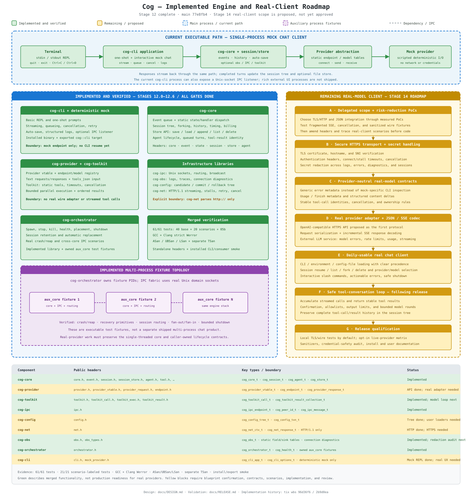
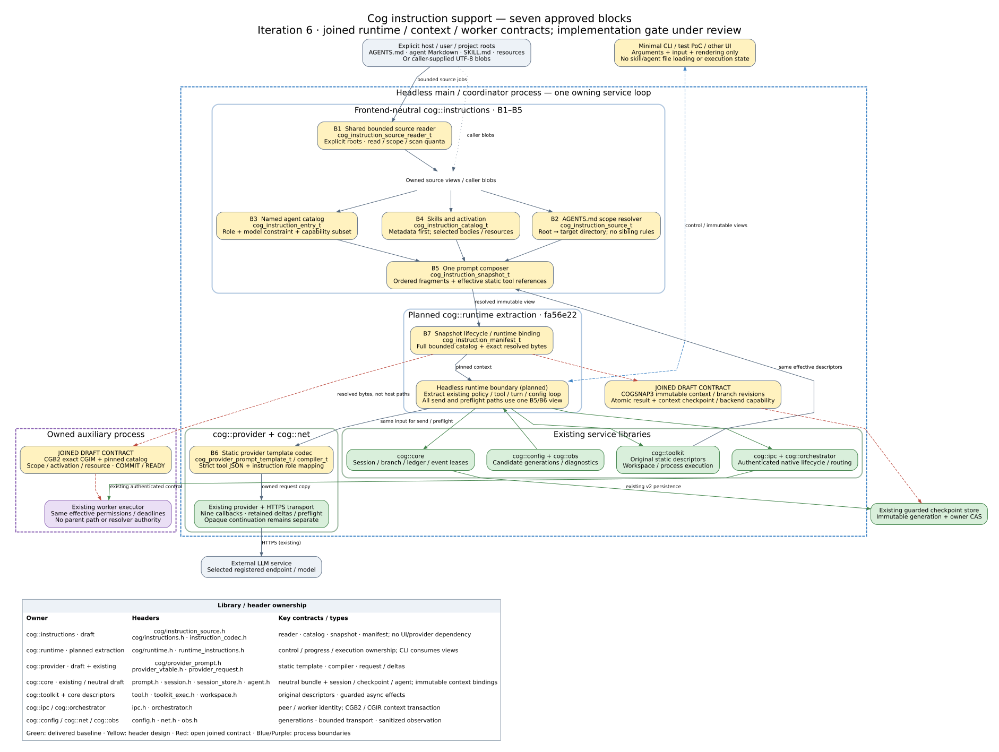

# Cog — System design

Cog is a pre-alpha C11 LLM harness and agent framework. A table-driven core
routes user input, provider progress, tool results and control events through
explicit handlers. The CLI composes the eight libraries into a streaming coding
agent with durable sessions, policy-controlled tools, headless clients and
bounded local/native children.

Public headers define the contract. This document explains the current system
and its boundaries; implementation contracts beside each library describe
module details. [README](README.md) has runnable commands and
[RELEASE](RELEASE.md) records the accepted code/profile and executable assertion
map. Completed plans, design passes and dated evidence live in git `tix`;
`tix show bcc629b` contains the full document migration index.

## Goals and supported scope

The delivered application streams text and structured tool calls through
OpenRouter, reads/searches/edits a workspace, executes permitted commands,
cancels work, and resumes or forks durable conversations. It supports a detached
UI and bounded delegation across local executors and owned native workers.
The public C libraries remain embeddable with explicit startup and teardown.

The supported transport profile is Linux/POSIX, HTTPS with a c-ares primary
resolver, fresh HTTP/1.1 connections and application-owned retry. Migration
transfers an exact quiescent checkpoint on the same host/shared store. GUI/web
clients, multimodal input, cross-host/live-handle migration, automatic context
summarization and a broad provider matrix remain outside this release scope.

## Blocks and ownership

| Block | Owns | Contract |
|---|---|---|
| `cog-core` | Event queue, static state dispatch, session tree, persistence and agent intent/update leases | [Public core](../libraries/cog-core/include/cog/core.h), [module contracts](../libraries/cog-core/contracts/README.md) |
| `cog-provider` | Immutable endpoint/model descriptors, typed provider operations, JSON/SSE and continuation encoding | [Provider contract](../libraries/cog-provider/contracts/CONTRACT.md) |
| `cog-toolkit` | Static tool lookup, schema validation, asynchronous execution, workspace/process ownership | [Toolkit contract](../libraries/cog-toolkit/contracts/CONTRACT.md) |
| `cog-ipc` | Framed Unix sockets, peer identity, bounded nonblocking delivery and replay primitives | [IPC contract](../libraries/cog-ipc/contracts/ipc/CONTRACT.md) |
| `cog-config` | Bounded dotted-path candidate/running tree, validation, commit and rollback | [Config contract](../libraries/cog-config/contracts/CONTRACT.md) |
| `cog-net` | Explicit HTTP lifecycle, bounded service, retained body delivery, cancellation and connection facts | [Net contract](../libraries/cog-net/contracts/CONTRACT.md) |
| `cog-obs` | Static structured fields/sinks, span stack and connection diagnostic snapshots | [Public obs API](../libraries/cog-obs/include/cog/obs.h) |
| `cog-orchestrator` | Managed worker identity, authenticated readiness, health, placement, stop/reap and advisory routes | [Orchestrator contract](../libraries/cog-orchestrator/contracts/CONTRACT.md) |
| `cog-cli` | Application state machine, configuration generations, policy, retries, durable tool turns, UI/worker/handoff composition | [App contract](../applications/cog-cli/CONTRACT.md), [public app API](../applications/cog-cli/include/cog_cli/cli.h) |

The link graph stays acyclic. Core links IPC and obs; those use the header-only
`cog::result` contract. Provider and toolkit link core; provider's OpenRouter
composition also uses net. Orchestrator links core/IPC. The application joins
these libraries. Core only borrows forward-declared provider types and does
not link provider, toolkit or net implementations.

## Invariants and resource lifecycle

- Public headers precede implementation. Dispatch/vtables are `static const`;
  there is no runtime implementation registry.
- There is no Cog global mutable state or implicit constructor. Contexts are
  caller-owned or explicitly constructed with a matching destructor. The host
  explicitly initializes networking dependencies before creating contexts and
  cleans them up after every context is gone.
- Constructors reserve bounded Cog queues, payload arenas, parser/writer pools,
  session/ledger storage and execution buffers. Service does not grow those
  reservations. Capacity exhaustion fails explicitly; output-buffer OVERFLOW
  reports required capacity without rerunning an effect.
- Two allocation boundaries require precision: accepting an IPC connection
  explicitly constructs an endpoint, bounded by `ipc_peer_capacity`, with a
  matching free; curl/c-ares/TLS handles can allocate during service until
  destruction. Hosts acknowledge DYNAMIC dependency memory. A total dependency
  byte ceiling is unsupported.
- One owner thread drives each context. `cog_core_stop` is the core API intended
  for cross-thread/signal use. Immutable descriptor tables may be shared.
  Callback reentry must follow each header's restrictions.
- Fail closed on invalid state, schema, identity or protocol. Cleanup preserves
  the first error while consuming remaining owned resources as specified by
  their individual contracts.

## Core scheduling and conversation flow

The state machine maps `(state, event)` to handlers through a static table.
Run and cooperative begin/step/end share the same driver. Configured service
quanta bound local/IPC dispatch, provider/tool progress and idle waits, so a
nonempty event queue cannot starve timers, cancellation or IPC. IPC ingress has
its own reserved descriptors; external event capacity remains configured.

A normal turn follows this sequence:

1. Resolve an immutable configuration/provider generation and append user input.
2. Copy the selected session history into a request. The provider validates and
   serializes it before accepting one asynchronous wire turn.
3. Fair service polls transport/provider and copies retained typed deltas into
   bounded application state. Display updates are distinct from durable history.
4. A completed model turn forms one assistant message with text, identified
   calls, continuation metadata and explicitly available usage.
5. For tools, validate complete arguments and policy, durably save STARTED,
   execute, then save the correlated result and terminal ledger state before
   another model request.
6. Finish or preserve an explicit incomplete/failed/cancelled branch. Earlier
   queued input does not authorize continuation of failed work; fresh input
   selects a safe ancestor without replaying effects.

Only the application owns retry admission: one finite budget, whole-turn
deadline and timer-driven backoff. Neither provider nor transport multiplies
retries. Retryability alone is insufficient: accepted output, tool effects and
replay safety must permit it. Midstream failure never silently repeats output
or tool execution. [Scenario traces](scenarios/01-user-prompt.md) and the
[assertion map](RELEASE.md#original-0120-and-05b) cover the end-to-end joins.

## Providers, messages and prompts

Endpoint/model implementation tables are static and immutable. Resolved
endpoint configuration is owned per generation and remains alive through all
borrowing provider instances. A provider embeds the public first-member base;
external adapters need no private header.

The current vtable has nine required callbacks: connect, disconnect, preflight,
send, receive, poll, cancel, next and get_error. Connect reserves local state
without network activity. Send copies nested request data and accepts one turn;
the prior FINISH must be consumed before another send. Typed clients use next
for TEXT, TOOL_BEGIN/ARGUMENTS/END, OPAQUE, USAGE and FINISH. Legacy receive is
text-only and refuses structured items without consuming them. The
[vtable header](../libraries/cog-provider/include/cog/provider_vtable.h) specifies
ownership, errors and callback lifetimes.

`next` is transactional: insufficient caller storage changes only the required
capacity, retains the item/sequence and allows copy retry across poll calls.
Configured workspace exhaustion is terminal LIMIT. Full retention pauses only
the owning request. Cancel preserves accepted retained items and a queued
successful completion; otherwise it produces an aborted terminal outcome.

OpenRouter uses Chat Completions with one choice, strict private yyjson pools,
depth preflight, UTF-8 validation and duplicate-key rejection. SSE tolerates
arbitrary fragmentation. Tool IDs/names/arguments assemble privately; only
validated completion permits tool readiness. There is no implicit model
selection, substitution, retry or fallback to mock.

Opaque continuation is owned/persisted separately from visible text under a
pinned namespace/format. The recognized field grammar and streaming closure
rules are in the [provider contract](../libraries/cog-provider/contracts/CONTRACT.md).
Unknown required formats fail before effects; usage/cost availability stays
explicit. Preflight checks selected history and provider compatibility without
network, allocation, state mutation or effect admission. PENDING_TOOLS permits
only the final unresolved assistant group; ordinary send requires COMPLETE.

System-role messages and request `tools_json` already exist. Child admission
records provenance as a system message. General system-prompt composition,
tool-use instruction generation from registered descriptors and provider/model
template selection are part of the proposed instruction-support blocks below:
`tix show e321ec3`.
Prompt text never grants execution policy or replaces schema validation.

## Proposed instruction, agent and skill blocks

**Software-blueprint Stage 2 boundaries approved; not an implemented contract.**
The user confirmed that agents means both named agent-definition files and
runtime subagents, and approved keeping the seven block boundaries on
2026-11-17. Parent `e321ec3` owns this design; `76aa2a9` records the block-planning
work. The goals cross-check and diagram iterations now lead into draft headers.
Loaders/catalogs are frontend-neutral; CLI is a minimal test/proof host in the
target architecture. Existing headers and shipped
behavior remain the contract until reviewed amendments land.

The requested capabilities are to assemble system instructions, read scoped
`AGENTS.md` files, select named agent profiles, discover/activate file-based
skills, and apply provider-specific request conventions. Their shared needs
are bounded source access, deterministic selection and exact lifetime/provenance.
Use seven responsibilities, with one shared reader and one composition path:

| Block | Inputs → outputs | Responsibility and proposed owner |
|---|---|---|
| B1. Bounded source reader | Explicit roots/relative references or caller-supplied blobs → owned UTF-8 source bytes, source identity and content digest | `cog-instructions`: read resources with file/count/depth/aggregate limits and no-follow containment. Own copied bytes and I/O progress; do not interpret instructions or execute files. Reuse workspace traversal techniques without depending on private toolkit internals. Embedders can supply bytes without filesystem discovery. |
| B2. Workspace instruction resolver | Workspace/working-directory/target scope plus B1 → ordered applicable `AGENTS.md` fragments with scope metadata | `cog-instructions`: resolve root-to-specific instruction applicability and deterministic ordering. Keep host-provided instructions separate from project text. Core and UI do not parse Markdown or discover files. |
| B3. Named agent catalog | Agent-definition sources plus explicit selection → validated role profile | `cog-instructions`: describe name, purpose, instruction fragment, model constraint, tool subset, skill references and limits. The headless runtime binds the profile to existing local/native admission. A definition is data; selection alone does not spawn, register code or expand permissions. |
| B4. Skill catalog and activation | `SKILL.md` metadata, explicit or validated model selection, referenced resources → skill listing and activated content | `cog-instructions`: discover bounded names/descriptions first; disclose selected bodies/resources on activation. Track activation identity and resource scope. Runtime admission owns effects; parsing/discovery does not run scripts. |
| B5. Prompt composer and tool guidance | Host/base instructions, B2, selected B3/B4, task context and effective static tool bindings → provider-neutral prompt bundle | `cog-instructions`: establish fragment order, source boundaries, deduplication and byte budgets. Derive names/descriptions/schemas/guidance from original effective static descriptors. Return neutral data without provider request or UI types. |
| B6. Provider request adaptation | B5 plus selected endpoint/model capabilities and a versioned static template → validated wire request | Map instruction roles and tool declarations into the selected protocol. Keep JSON/wire encoding and provider-required continuation in existing provider adapters. Model/template selection is explicit and validated; no guessed fallback or second competing prompt compiler. |
| B7. Snapshot lifecycle and runtime binding | Resolved sources/profiles/activations plus current branch, generation and admission state → retained instruction snapshots and child/restore inputs | Planned headless `cog-runtime`: own publication, borrowing, durable provenance and cleanup; reuse core/config/store/agent/orchestrator lifecycles. Children receive resolved context and intersected capabilities. CLI supplies input/control and renders views. |

These responsibilities share one frontend-neutral `cog-instructions` library
for B1–B5. Its draft target currently exports headers only; it has no UI,
provider/net or terminal dependency. Neutral `cog/prompt.h` data belongs to core.
B6 stays in `cog-provider`, consuming the neutral bundle independently of the
loader. B7 belongs in a reusable headless `cog-runtime` extraction, tracked by
`fa56e22`, which joins the existing engine/services. It adds no second session
store, process supervisor or subagent scheduler. Existing composition is still
physically in `applications/cog-cli`; extraction is planned, not claimed done.
New loading/composition logic must not be added to the CLI. The CLI becomes a
minimal test/proof frontend over runtime operations and immutable views.
File catalogs are data; implementations/callbacks remain static.

### Composition and authority

The proposed data path is sources → scoped instructions/catalog selection →
prompt bundle → provider adaptation. Runtime binding supplies the effective
profile and retains each published result. Agent files choose a role;
`AGENTS.md` supplies workspace instructions; skills supply selected procedures
and resources. None can grant ALLOW, expose credentials, mutate a live static
table or bypass durable STARTED admission.

Host/base instructions, workspace rules, role instructions, skill instructions,
task context and conversation history need an explicit composition order.
Exact conflict/override semantics remain a review decision: putting text later
in one system message is not enforcement of permissions. Structural controls
stay in the existing tool-policy, path, schema, guard and budget checks.
Provider templates adapt representation without reclassifying project text as
host authority. Full fragment accounting must include advertised skills and
tools; overflow must fail before send rather than silently omit instructions.

Discovery is bounded by configured roots. Project discovery does not
implicitly walk outside the configured workspace or import a home directory;
host/user sources are explicit separate roots. Optional absent files and
explicit missing selections need distinct outcomes. Malformed, unreadable,
oversize, escaping or ambiguous sources must produce an attributable failure,
with no partially published catalog or context. Source text and local paths
are not diagnostic payloads by default.

### Integration seams found in the current implementation

- [Tool assembly](../applications/cog-cli/src/app_tools.c) already selects from
  static workspace/delegation tables. Its JSON generation includes name/schema
  but omits the existing descriptor description. B5 needs one effective binding
  view for advertisement, guidance and dispatch, including ASK/DENY behavior.
- [Ordinary request assembly](../applications/cog-cli/src/app_turn.c),
  [restored tool preflight](../applications/cog-cli/src/app_sessions.c),
  [reload preflight](../applications/cog-cli/src/app_reload.c) and
  [staged execution preflight](../applications/cog-cli/src/execution.c)
  currently assemble their own request views. All four must consume the same
  composed context and limits; changing only ordinary send would be incomplete.
- [Provider requests](../libraries/cog-provider/include/cog/provider_request.h)
  currently take provider-specific `tools_json`; the
  [message contract](../libraries/cog-core/include/cog/message.h) has SYSTEM,
  USER, ASSISTANT and TOOL roles. B5/B6 must decide the neutral tool/role
  representation before promising additional provider template support.
- [Agent configuration](../libraries/cog-core/include/cog/agent.h) carries a
  task, parent/placement/attempt identity and limits, but no named profile or
  instruction snapshot. Existing
  [child configuration](../applications/cog-cli/src/child_profile.h) intersects
  permissions and bounds. These are extension seams, not grounds to replace
  the existing spawn/cancel/status/result machinery.
- [Child SYSTEM provenance](../applications/cog-cli/src/child_context.c)
  records execution identity, not a general role or skill instruction set.
  [Store checkpoints](../libraries/cog-core/include/cog/session_store.h)
  preserve structured sessions but do not establish a full prompt-source
  manifest. B7 needs an explicit persistence/compatibility decision.

### Initial contract questions

1. **Scope changes:** how are nested `AGENTS.md` rules discovered before a
   workspace operation enters a new subtree? A proposed call must not execute
   under newly discovered rules it never saw. Commands can access more than
   their working directory; instruction scoping cannot claim OS confinement.
2. **Formats and selection:** which configured user/project roots, agent-file
   metadata grammar, `SKILL.md` metadata subset, duplicate/override rules and
   explicit activation syntax are supported initially? Compatibility with any
   other harness requires a named, researched target; no general YAML/Markdown
   execution or implicit recursive includes are assumed.
3. **Activation versus pinning:** distinguish a catalog generation, active
   skills and the exact snapshot for each provider request. Resolve progressive
   skill loading during tool continuation without changing the context of an
   already admitted effect. Specify atomic refresh/activation and stale-source
   behavior before adding live reload or watchers.
4. **Restoration and transport:** hashes alone cannot reproduce changed/deleted
   source content. Decide which exact resolved bytes are persisted and sent to
   children, how branch history references them, how store/bootstrap versions
   change, and how inspection/recovery avoids source scans or model/tool work.
5. **Provider boundary:** choose typed tool declarations or a validated neutral
   representation, supported instruction roles and versioned template selection.
   Preserve opaque continuation and preflight invariants across every path.

Future header traces must cover cold startup, nested scope entry, malformed or
missing sources, duplicate names, agent selection, local/native child parity,
skill discovery/activation/resources, tool advertisement and denial, provider
variation, context exhaustion, retry, restart/fork with changed files, reload,
handoff and cancellation/cleanup. These are coverage requirements for the next
stages; this block proposal claims no completed header passes or runtime proof.
Research and later execution plans stay under `tix show e321ec3`.

### Goals cross-check and diagram iterations

The approved seven boundaries serve these testable goals. They add no new
library dependency from core to the application or provider implementation.

| Goal | Blocks | Smallest proving observation |
|---|---|---|
| Load only explicitly configured sources | B1 | Unknown root/escape fails before content is published; caller blobs need no reader. |
| Apply the correct workspace rules before effects | B1,B2,B7 | Root-to-target rules are present before admission; a newly discovered scope denies stale proposals and requires replanning. |
| Select named agents without granting capabilities | B3,B7 | A role narrows existing bindings/limits and uses the existing child lifecycle. |
| Discover skills cheaply in model context | B4,B5 | Metadata is advertised first; unselected bodies are cached off-prompt. |
| Activate procedures/resources deliberately | B1,B4,B7 | Exact selected bytes become a new immutable snapshot; scripts are ordinary tools, never parse-time execution. |
| Keep advertisement and dispatch consistent | B5,B6 | Names, descriptions and schemas derive from the same original static descriptors. |
| Encode for the selected provider | B6 | Exact static template/table agreement; mismatch fails without a provider call. |
| Reproduce context across retry/restart/children | B7 | Exact bytes survive; no source reread or hash-only reconstruction. Store/worker integration is still a joined contract gap. |

[Editable Graphviz source](instruction-blocks.dot). Diagram pass 1 mapped the
seven blocks onto existing processes/libraries. Pass 2 made caller-supplied
sources bypass the shared reader for every catalog/scope path. Pass 3 separated
the implemented lifecycle from the still-open durable/worker capsule contracts.
Pass 4 places B1–B5 in `cog-instructions`, B7 in the planned headless runtime,
and a minimal CLI/test frontend outside loading and execution ownership.
Pass 5 removes redundant service-edge labels so ownership and data paths remain
readable at ordinary zoom.
Green is existing behavior, yellow is new header design, red is an unresolved
join; the diagram is not a runtime acceptance receipt.

### Initial source, catalog and provider profile

The following choices enable independent header authoring. They do not close
the full B7 app/store/worker gate. New contracts are
[instruction_source.h](../libraries/cog-instructions/include/cog/instruction_source.h),
[instructions.h](../libraries/cog-instructions/include/cog/instructions.h) and
[provider_prompt.h](../libraries/cog-provider/include/cog/provider_prompt.h).
Shared [prompt.h](../libraries/cog-core/include/cog/prompt.h) contains only
neutral borrowed data and an opaque static-tool reference. The loader target
uses core's header-only `cog::result` include contract; it does not link UI,
provider or networking code. Providers consume the neutral bundle without
depending on the loader. Planned `cog-runtime` composes both with existing
services; CLI/test hosts depend on that runtime. Current source extraction is
still pending, and the new loader target supplies headers only until delivery.
Existing request/vtable structs and library implementation bodies are unchanged.

| Target boundary | Dependencies / output |
|---|---|
| `cog::instructions` draft | Neutral core headers through `cog::result`; reader/catalog/snapshot APIs, no UI/provider request types. |
| `cog::provider` | Existing core/net dependencies; consumes `cog_prompt_bundle_t` without linking the loader. |
| Planned `cog::runtime` | Joins instructions, provider and existing execution services; owns effects, state and lifecycle. |
| Minimal CLI/test PoC | Calls runtime operations and renders progress/views; does not discover or parse agent/skill files. |

The compile-only `instruction-loader-no-ui` consumer exposes only instruction
and neutral core include roots, with no UI/provider/net/IPC targets or headers.
It guards the dependency boundary independently of the main CLI build.

**Discovery and scope.** A host passes explicit logical root IDs and absolute
opened directories. There is no implicit home scan or walk above the workspace.
Agent scans list direct `.md` files; skill scans list direct child directories
with `SKILL.md`. A SCOPE job reads the `AGENTS.md` ancestor chain from workspace
root through the target directory. Existing workspace code supplies the proven
descriptor-relative/no-follow technique; the new reader requires its own
bounded public owner, not access to private toolkit structs. Poll bounds bytes
and work units; OS filesystem latency remains outside that guarantee.
The initial Linux reader follows existing workspace search's caller-buffer
[`getdents64`](https://man7.org/linux/man-pages/man2/getdents.2.html) path, with
reserved/in-place resumable sorting. It does not create allocating directory
streams during poll; unsupported filesystem backends fail construction.
Reader failures retain logical root/path diagnostics; catalog/snapshot
constructors can return an optional caller-owned diagnostic with source identity
and original byte offset. They expose neither source contents nor absolute host
paths, and no failed-constructor storage escapes through a diagnostic pointer.

The [AGENTS.md convention](https://agents.md/) supports nested files and
closer-file precedence. Cog retains the root-to-specific text with scope
labels, keeps direct user instructions as user messages, and enforces
permissions structurally. Before a workspace call enters a new scope, the app
must compare applicable sources with the snapshot used for its proposal. A
changed scope closes unstarted proposals with identified no-effect denials,
then publishes the replacement context only after the group is closed. Any
next model turn is ordinary bounded continuation, not a rerun of the old call.
Commands use their declared cwd scope; this is not a claim to know every path
an arbitrary command may access. The joined publication is a B7 gap below.

**Metadata and progressive disclosure.** The
[Agent Skills specification](https://agentskills.io/specification) defines
`SKILL.md` with name/description frontmatter and optional resources. Its
[client guide](https://agentskills.io/client-implementation/adding-skills-support)
separates catalog metadata, activated instructions and referenced resources;
it also permits caching bodies during discovery. Cog's initial parser is an
explicit bounded subset, not a claim of complete YAML or client compatibility.
Names use ASCII lowercase letters/digits/hyphens, match directory/basename and
fit 64 bytes. Descriptions support 1–1024 UTF-8 characters, compatibility up to
500. Invalid syntax fails closed instead of being guessed or silently repaired.

Frontmatter starts/ends with a line exactly `---`, with LF or CRLF. Required
skill keys are name/description; optional keys are license, compatibility,
metadata and allowed-tools. Agent files additionally require `cog-agent: 1`;
their keys are name,description,model,tools,skills,max-context-bytes,
max-output-tokens,max-tool-rounds. Agent numeric limits are positive decimal
reductions when present. Sources are retained byte-for-byte; parsing normalizes
line endings only in decoded metadata. Supported string scalars are plain,
single-quoted (doubled quote escapes), double-quoted (JSON escape set), and
literal/folded `|`/`>` blocks with two-space indentation. Block chomping/indent
modifiers, anchors, aliases, tags, collections and nested metadata maps return
UNSUPPORTED. Plain `: ` requires quoting; a whitespace-preceded unquoted `#`
starts a comment. A single metadata string map is allowed. Duplicate keys or
malformed scalars are PROTOCOL; unknown keys are UNSUPPORTED.

Catalog sources are HOST/AGENT/SKILL; per-snapshot additions are AGENTS and
explicitly loaded RESOURCE text. The host assigns precedence: higher wins a
same-kind catalog name; equal-precedence duplicates fail. Project roots should
be assigned above user roots explicitly. Effective entries and advertised
skills sort by name, independent of directory iteration order. Markdown bodies
remain text, with no include/shell/template evaluation. Agent tool/skill lists
are space-separated exact names. A model field constrains a selected profile;
the host still validates/selects that exact model through existing configuration.
No implicit model routing, recursive child delegation or new process scheduler
is introduced.

Skill `allowed-tools` is treated as required capability metadata, never an
approval grant. The initial profile accepts exact tool names; pattern dialects
are unsupported on explicit activation. Ineligible skills are omitted from
advertisement, while an explicit missing/unsupported choice produces a specific
error. Child policy intersection still applies, including noninteractive ASK
denial. Complete bounded source bodies are cached at catalog construction;
only selected bodies enter fragments. Resources are loaded through B1 and
explicitly supplied to a replacement snapshot. Parsing does not execute scripts.

**One compiler and static templates.** Snapshot fragment order is host,
root-to-specific workspace, selected role, skill metadata, active skill names
in lexical order, explicit resources, then tool guidance. Request history and
opaque continuation remain separate. The host supplies the same effective
original static descriptors used by dispatch; denied tools are omitted, ASK is
advertised as requiring a decision, and descriptions are encoded with schemas.
The [OpenRouter client-tools contract](https://openrouter.ai/docs/guides/features/tool-calling)
uses names/descriptions/parameters and correlated tool results; its wire
representation belongs in the provider codec.

A static template descriptor binds ID/revision to an exact provider vtable and
one pure render callback. It receives explicit scratch/output capacities and
has no provider calls, I/O or allocator. A compiler reserves two output lanes;
only successful complete validation replaces the old copied request view.
The snapshot view returns a `cog_prompt_bundle_t` with no provider request type.
The headless runtime pairs it with selected history/settings. The bundle carries
template ID/revision into compiler input; compile validates both before calling
the renderer. The runtime uses the same
compiled context for ordinary send, restored-tool preflight,
reload preflight and staged-execution preflight. No developer-role expansion
or additional provider is promised by the initial template interface.

### Remaining joined contracts and header gate

The in-memory manifest retains the complete bounded catalog plus applicable
scope/resources and exact resolved fragments. This allows restoration without
reading changed source files, but it is not a native memory wire/disk format.
Instruction data must not be placed in provider opaque continuation, and hashes
alone cannot reconstruct it. The following remain explicit open contract work
under `1ddb6d2` before the full header gate `04800f5` can pass:

- Define a versioned generic session context attachment, immutable per-branch
  bindings and bounded public snapshot/restore capacities. Core stores opaque
  namespace/format/data, without parsing Markdown or importing application types.
- Define a new store format and explicit custom-backend capability refusal, so
  exact result/ledger/context publication is one checkpoint transaction. Older
  backends must fail instead of dropping new context fields. Inspection remains
  offline and does not scan sources; legacy adoption must be explicit.
- Define an authenticated, capacity-bounded worker instruction/catalog capsule
  and resource request/receipt lifetime, including ordering with bootstrap,
  staged handoff, partial delivery, cancellation and slot reuse. Local/native
  children must use the same resolved bytes and permission intersection.
- Define publication hooks for scope changes and skill activation after closing
  proposed call groups, without changing an already admitted effect's context.
  Ordinary input/retry deadlines and request/tool budgets remain unchanged.

The continuation adds [instruction_codec.h](../libraries/cog-instructions/include/cog/instruction_codec.h)
with the canonical CGIM v1 format shared by persistence and native bootstrap.
It encodes explicit little-endian fields, complete cached sources, source hashes,
selection, effective tool metadata and exact fragments. Decode performs the same
semantic validation as restoration; neither source hashes alone nor supplied
fragments are sufficient proof of a consistent snapshot. Constructors may copy
bounded bytes; ordinary queries and encoding do not allocate. Instruction data
is private session content, excluded from UI replay and diagnostic logs.

The next runtime boundary promotes the existing cooperative executor rather
than adding another event loop. Terminal parsing/output currently embedded in
turn, policy, session and reload handlers moves to the CLI adapter. Public runtime
configuration contains resolved values, no argv/environment precedence or FILE
objects. Existing `cog::cli` interfaces remain compatibility adapters during the
migration. A runtime-only installed consumer must work with CLI building disabled.

The implementation dependency plan is tracked by `tix show 7eb6cf9`; the
[instruction contract inventory](../libraries/cog-instructions/contracts/CONTRACT.md)
defines module obligations without duplicating progress in this docs folder.

The independent B1–B6 draft surface can be compiled and traced while these joins
are designed. It does not authorize implementation, claim all scenarios covered,
or bypass the three full header/scenario passes plus additional final review.
The consolidated [instruction traces](scenarios/P01-instruction-support.md)
record exact drafted calls and the remaining gaps rather than inventing app APIs.

## Tools and effect admission

The toolkit resolves static descriptors. Complete strict JSON and its bounded
schema subset are validated before execution; unknown validation keywords fail
UNSUPPORTED. Partial streamed arguments cannot execute. Async tools use
new/start/poll/cancel/result/destroy; poll/cancel do bounded work without sleeping.
The execution borrows its durable guard through cleanup.

UNDECIDED cannot start work. DENY is terminal without effects. ALLOW still
requires valid ownership, policy, budgets and a successfully persisted STARTED
record. Tool results correlate by `(assistant node ID, call ID)` within a branch.
Tools run sequentially in the application. Explicit toolkit parallelism requires
REENTRANT and INDEPENDENT descriptors; batch storage is reserved before effects,
and startup barriers prevent partial worker creation from launching work.

Workspace operations use an opened root, descriptor-relative I/O and no-follow
component traversal. Commands are separately enabled, receive a copied explicit
environment and run in an owned process group supervised by a helper. TERM/KILL
cleanup drains/reaps inherited-group descendants. Process execution permission
does not provide an OS sandbox; group escape is outside this cancellation scope.

Synchronous compatibility calls retain one 64 KiB capture and invoke their
handler at most once. Output copy retry never reinvokes it. These blocking paths
refuse fenced owner stores and do not run in the real-client service loop.

## Sessions, persistence and recovery

The session is a bounded tree of structured messages and immutable shared
ancestors. Selected-path history carries roles, identified calls/results,
continuation, timing and known billing. Fork preserves old effects and identity;
selecting a nonleaf fork point leaves the active leaf intact until fresh input
creates the divergent child. Incomplete or unresolved work cannot be forked.

The store uses static backend dispatch, explicit backend-context ownership,
versioned records, immutable checkpoints, exact owner/epoch compare-and-swap
and normal/recovery guards. Custom backend contexts outlive all guards and
`cog_store_free`; generic free does not destroy them. The
[store header](../libraries/cog-core/include/cog/session_store.h) and
[store contract](../libraries/cog-core/contracts/session_store/CONTRACT.md)
specify load, migration, atomicity and committed-prefix recovery.

A tool begins PROPOSED; denial becomes DENIED. STARTED is durably committed
before effect admission, then becomes SUCCEEDED, FAILED, CANCELLED or
INDETERMINATE. Crash-restored uncertain work refuses ordinary resume. This is
at-most-once admission; it does not make filesystem/process effects an
exactly-once transaction. Failed saves freeze further admission and retain
results instead of executing again.

A new app saves an empty durable checkpoint before publication. Explicit resume
can repair an owner-only checkpoint-zero reservation only after checked absence
of recognized legacy remnants, exact owner CAS, guard acquisition and successful
save. Inspection errors are not absence. NEW collisions remain refusals.

LIST/RECOVER need no provider, net, workspace, model or key. Recovery requires an
explicit operator fencing assertion; that assertion does not stop prior writers.
Reconciliation records one identified outcome and evidence durably without
executing tools. Ordinary resume is explicit after the ledger is safe.

For a valid live guard, INVALID_STATE alone refuses release without consumption.
OK and all other cleanup results, including IO and AGAIN, consume both backend
handle and public wrapper. Callers clear consumed aliases, never retry them and
retain cleanup errors. Wrapper storage is reserved before custom acquire
callbacks. A checked app destructor's output pointer distinguishes complete
consumption from cleanup-only retained ownership. Custom retain-on-error
backends require explicit migration; see the
[public fenced example](../tests/external-consumer/project/fenced_store.c).

## Configuration and reload

The config tree reserves aggregate node/string/transaction/validator pools at
construction. Candidate mutation, validation, commit and rollback do not grow
them. CLI precedence is explicit options, environment, bounded config file,
defaults. Credentials resolve from references into owned startup memory; they
are excluded from durable history, logs, fixtures and UI replay. See
[CLI configuration](../applications/cog-cli/CONFIGURATION.md) for exact grammar.

Reload admits model/base-URL/credential-reference changes with fixed
store/workspace/policy/capacity reservations. Preparation constructs and checks
an idle generation before transactional publication. The whole active
model/tool turn pins the old generation. Safe idle activation changes app and
core borrowed provider references before disconnecting the old provider and
clearing its secret. Failed preparation retains the running generation;
consuming cleanup errors remain errors. Resolved child copies transfer neither
source-file reread authority nor credential resolver callbacks.

## Headless control, children and handoff

The coordinator owns the canonical projection and UI listener; the orchestrator
owns a separate worker-control fabric. Each endpoint has one receive/service
owner. All peer references are fabric-scoped. Kernel PID/UID, immutable owned
spawn identity and matching bootstrap must agree before a worker becomes READY.
Same-UID UI clients are inside the local trust boundary.

One bounded logical controller lease authorizes mutations; watchers are
read-only. Exact command identities and retained original bytes distinguish
transport acceptance, semantic completion and receipt consumption. Duplicate
commands repeat retained results without repeating effects. Reconnect HELLO has
its own receipt lifetime; it cannot acknowledge an unrelated pending command.
Retired/expired identities cannot gain new authority by retransmission.

The projection is bounded and separate from execution. CGD1 snapshots contain
visible active/incomplete state; CGR1 retention carries DATA/GAP/CURSOR; CGV1
replacement anchors the canonical view. GAP requests atomic replacement, never
model/tool replay. Prompt delivery must succeed before ASK can authorize work.

Core reserves agent records, copied config and leased SPAWN/CANCEL intent
events. Application dispatch executes locally or forwards to an authenticated
owned worker. CGA1 updates retain exact attempt/epoch/sequence identity until
copy/ack/release; terminal results remain readable until release. Remote terminal
UPDATE receipt consumption precedes physical slot reuse. Transport-copy
ownership, semantic request ownership and reply-delivery retention remain
separate, with bounded resend eligibility and unchanged operation deadlines.

Child permissions/limits intersect the parent profile; inherited ASK on
noninteractive children denies before effects. Children cannot recursively
delegate. Worker failure freezes uncertainty and drains/reaps owned processes;
it grants no automatic replay or replacement of an admitted attempt. Logical
child capacity is separate from primary/staged physical executor slots.

Handoff orders QUIESCE, guarded CHECKPOINTED, target PREPARED, source guard
release, exact owner CAS, target guarded READY, route publication and ACTIVATE.
Disposal receipts precede slot reuse. Failed release/CAS never thaws the old
source or rewinds the epoch; cleanup errors cannot become success evidence.
Only the exact quiescent same-host checkpoint transfers. Detailed private wire,
receipt and phase design is archived under `tix show 035219b`, `300e835`,
`4536a17`, `5b90444` and `2fee64f`; declarations remain beside the implementation
in [control.h](../applications/cog-cli/src/control.h) and
[handoff.h](../applications/cog-cli/src/handoff.h). The private host runtime is
not an installed public embedding API.

## Observability

Static field/sink tables, a bounded explicit span stack and fixed connection
snapshot slots share a caller-owned obs context. No ambient global/TLS span or
per-call key registration exists. The transport owns actual connection facts.

An optional constructor-borrowed numeric net callback copies values, checked
callback-time timestamps and prepared scope into a host-owned bounded bridge.
The host drains outside net/provider callbacks into sanitized obs rows.
Request metadata pins its real configuration generation through reload. Only
an admitted app retry emits RETRY; readiness reflects actual DNS/TCP/TLS state.
Provider/tool duration, status and usage availability are typed and explicit.

Credentials, URLs, bodies, tool arguments/results and opaque continuation are
absent from diagnostics. Callback/bridge/sink failure stops later admission
through normal cleanup while preserving the primary request/effect outcome.
It never makes a completed POST or tool replayable. Diagnostic borrows end
before obs destruction; bridge storage outlives net destruction.

## Development and verification

Every design decision, gap and implementation task belongs in `tix`. Amend
headers first, trace end-to-end scenarios, complete at least three full passes
and one additional final review before implementation. Keep current decisions
here, detailed module contracts beside their code, and ongoing ownership,
dependencies, review notes and dated evidence in tickets. Do not create another
Markdown WBS or per-ticket progress report in `docs/`.

All original 01–20 traces, R01–R18 and L01 remain in `scenarios/`, with sequence
diagrams, header coverage and gap analysis. The original 01–10 executable cases
live in `tests/scenarios`; 11–20 live in `applications/cog-cli/tests`. Release
coverage maps the actual assertions, including 05b, rather than inferring
conformance from names alone. Research and standalone `pocs/` are supporting
evidence, not linked production implementations.

Run strict builds, meaningful contract/negative and integration/scenario tests,
standalone public headers, separate sanitizer profiles and installed/relocated
consumer checks as appropriate. Commands are in [README](README.md); exact
accepted historical selections and limits are in [RELEASE](RELEASE.md).
Keep builds/logs inside checkout-local `build*` directories and git worktrees
beside the checkout under `../cog-worktrees/`.

The completed implementation trees are `tix wbs 96d36f6` (original engine/mock
baseline) and `tix wbs 2b9d0ea` (real client). The latter retains A–Q package
dependencies, O's source/review/integration/finalize tickets and later fixes.
`tix show bcc629b` maps all removed document paths to their verbatim ticket
records, with source revision and content hashes. Historical draft/gate wording
in those attachments does not supersede current headers or reopen completed work.
