# N pass2 — whole sequential scenario retrace

Starting assembled pass1 `ce188db`, after incremental findings. This pass walks
ALL20 original scenarios plus R13/R14 against the full header surface and shipped
primitives; it is not an executable test run. New amendments are A29–A40 below.
Sequence arrows name actual declared operations or explicitly typed protocol
messages/static handlers; no nonexistent library helper is assumed.

## 01 — prompt, accepted stream and display

```mermaid
sequenceDiagram
 Client->>Coordinator: UI_HELLO discovery; UI_COMMAND SUBMIT
 Coordinator->>Executor: execution_apply_command / typed EXECUTOR_COMMAND
 Executor->>Coordinator: execution_copy_view / EXECUTOR_VIEW
 Coordinator->>Replay: projection_commit → replay_append
 Coordinator-->>Executor: exact VIEW_COMMIT
 Executor->>Provider: send/poll under existing K loop
 Coordinator-->>Client: CGR1 DATA(CG V1 actual copied display)
 Client-->>Coordinator: CURSOR only after checked full render
```

Coverage: `host_client.h`, `control.h`, `execution.h`, `projection.h`, public
provider.h/ipc.h/cli.h. Raw app counters never become ring cursor. Save/stage
user→publication→send and accepted TEXT→publication→next ordinary action are
separate internal phases, not merely one core dispatch. Small decode/output
capacity changes required sizes only; no partial UI or successful skipped text.
No known declaration gap after A11/A12/A14/A29/A30.

## 02 — network stall and safe recovery

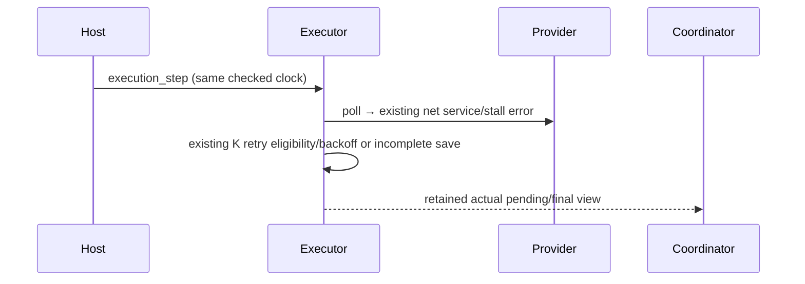

Coverage: execution/core/provider/net headers plus existing K retry contract.
Only application retry before accepted output/effect, inside original turn and
elapsed budget. Other contexts/signalfd continue; no blocking stall wait, no
transport retry. A partial-output failure preserves INCOMPLETE actual state and
requires fresh explicit continuation, not queued input replay. No gap.

## 03 — actual local child, status/result and parent

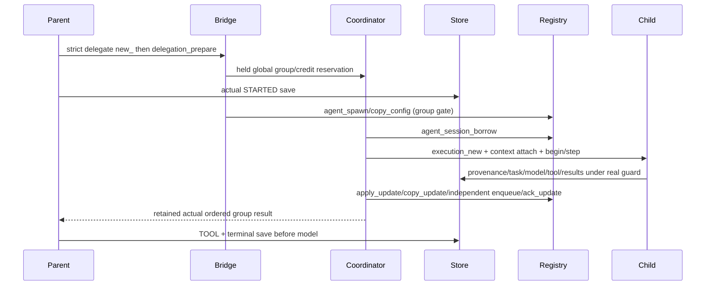

Coverage: delegation/child_profile/execution headers, public agent/session/store/
toolkit headers. Child uses exact registry-owned tree, never replacement same-ID
tree. Child cleanup destroys app/tool/context/provider/config/net/observer/guard
borrows before session_return; parent release waits terminal ACK and borrow0.
Partial group reservation failure keeps prefix nonexecuting until cancel/lease/
terminal cleanup, absent members explicit. No paid/mock replay used for child
acceptance: actual local child fixtures use offline REAL TLS. No known gap after
A18/A19/A21/A31/A32/A33.

## 04 — cold start and failed construction

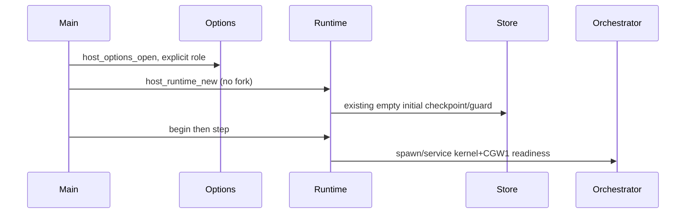

Coverage: host_options/host_runtime/execution, public orchestrator/ipc/store.
Named constructors allocate fixed resources; secret/config failure returns no
app/runtime. New failed startup preserves any committed empty checkpoint and
guard is released. Never-begun shutdown/close never starts a prompt/worker to
clean up. Native connect AGAIN is serviced; no synchronous HELLO shortcut. No gap.

## 05 — graceful shutdown with owned work

```mermaid
sequenceDiagram
 Main->>Runtime: signalfd → request_shutdown
 Runtime->>Executors: cancel + bounded execution_step/drain_step
 Runtime->>Orchestrator: request_shutdown/service native deadline/reap
 Runtime->>Runtime: return child borrows; close done contexts
```

Coverage: host_runtime/worker_host/execution + core drive/orchestrator/toolkit.
core done→drive_end exactly once→direct bounded drain units; never restart a
failed core or call legacy while-until-done drain inside another context. Primary
error wins, but ownership_lost stays separately visible. Native KILL/reap does
not prove escaped descendant effects stopped: recovery-only uncertainty. No gap
after A34; active-output sink/observer failure cannot skip actual teardown.

## 06 — parallel tools and timeout

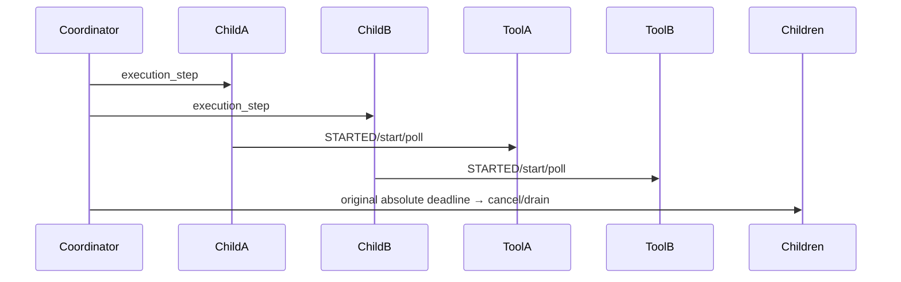

Coverage: runtime/execution/delegation + existing I async lifecycle. K remains
sequential within one app; independent app contexts actually overlap. Original06
toolkit independent parallel component checks remain, fresh handles for timing.
No hidden threads or multiplied unlimited budgets. All started handles drain,
unstarted proposals get identified no-effect closure. No declaration gap.

## 07 — owned aux crash and uncertain effects

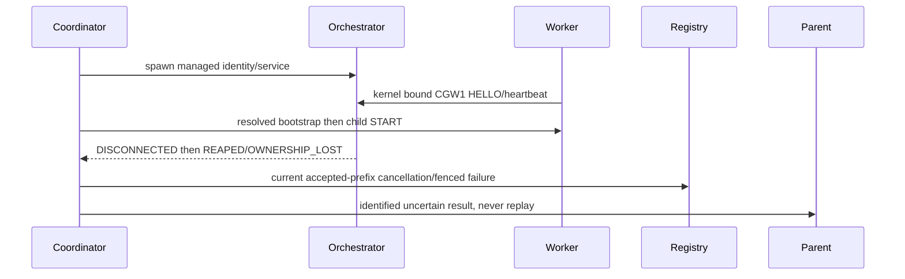

Coverage: public orchestrator/agent/ipc + worker_host/control/delegation. Immutable
native PID from spawn; every signal exact waitpid WNOHANG under supported exclusive
reap profile. ECHILD never signals old numeric PID again. Forced native death may
leave helper/descendants; no synthetic proof from EOF/reap. Whole-parent crash
does not restore volatile prefix/placement from worker claim. No known gap after
A04/A23/A31/A33/A35.

## 08 — hot reload while turn/children are pinned

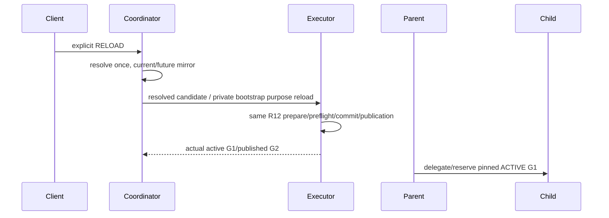

Coverage: existing public app_reload/config + execution_reload_resolved,
copy_configuration/child_profile/control. Only three fields change. Same bounded
attempt counter, postcommit infallible publication, consuming disconnect before
secret retirement, cleanup freezes separately. ACK publication never implies
activation. Handoff refuses any future/notice/publication mismatch. No gap A17.

## 09 — actual sibling messaging

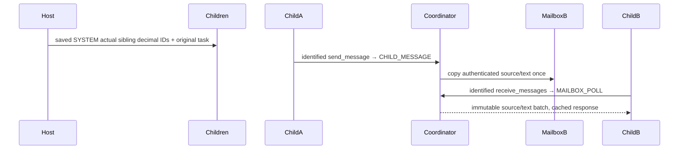

Coverage: delegation/control/child_profile/execution. Mailboxes authoritative at
coordinator, no unsolicited model input or status-string control. Per-attempt
MAILBOX lanes and round-robin permit B poll while A send is AGAIN. Full-ID decimal
strings avoid signed64 JSON-ID loss. Global DENY dominates, child ASK no-effect
denial; root approval never elevates child policy. No gap after A20/A21/A32.

## 10 — distributed fan-out/fan-in and cancellation

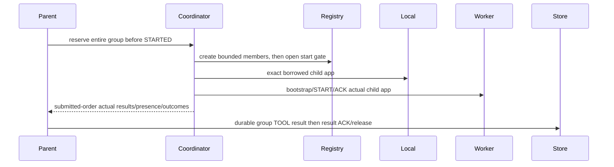

Coverage: delegation/runtime/control/agent/worker_host. Aggregate slot/process/
request/deadline credits cap the whole group, depth1. nth constructor failure
does not execute prefix; fatal coordinator core disposes queued leases only
after independently draining started executors/returning borrows. Actual child
failure after start can have partial effects, not an atomic transaction. Cancel
before START latches and refuses later start, after start drains. No gap A19/A35.

## 11 — real UI detach and replay

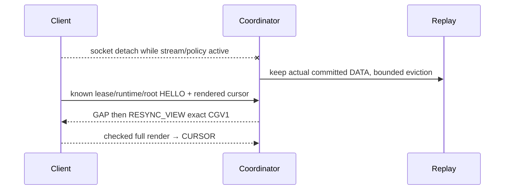

Coverage: projection/client/control/ipc. Fresh client discovers generated root
without store/config access. Same root/runtime/retained lease required for old
command lookup; retirement or restart never rewrites pending input to new lease.
Controller role expires separately; pending not-yet-forwarded POLICY/CONTINUE is
refused on role loss; an exact forward-committed grant may finish after expiry. No gap after
A13–A16/A29/A30/A36/A37.

## 12 — rate limit, backoff and input queue

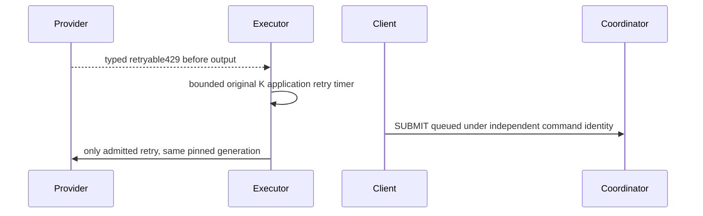

Coverage: provider/net/K/execution/control. Child global reservation charges
worst-case requests including bounded retry; no reset on parent reload/handoff.
Full queued input returns checked overflow/no admission. No retry after accepted
output/tool effect, no implicit incomplete continuation. No gap.

## 13 — persistence/restart/owner-only repair

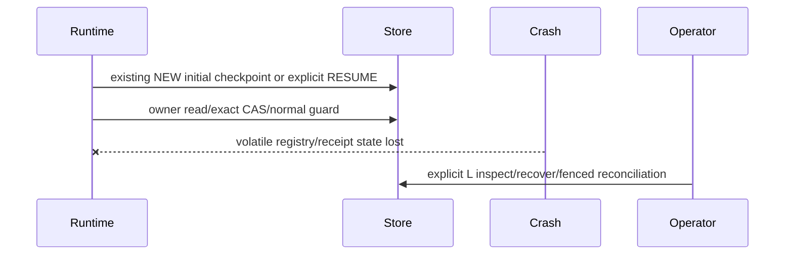

Coverage: existing G/L/session_admission + execution ROOT. No relaxed corruption/
legacy empty proof. Real checkpoint authority wins over owner-only repair path.
Saved child SYSTEM/parent link may aid investigation, never reconstructs complete
placement set/accepted prefix. Crash before provenance/result can leave unknown
members; parent STARTED remains uncertain, no automatic tasks. No gap A33.

## 14 — fork and incomplete branch choice

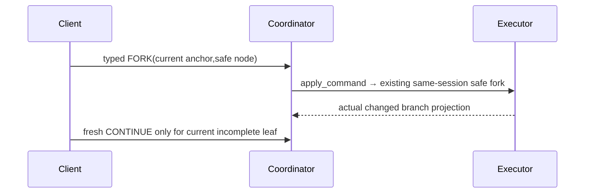

Coverage: control/execution + existing L/session fork/copy_history. No off-active
unresolved ledger switch, no hidden history truncation/opaque drop. Queued SUBMIT
remains unauthorized for failure continuation. Exact command dedup forks once.
Role loss before forwarding refuses stale CONTINUE, no transferred decision. No gap.

## 15 — real model/tool continuation

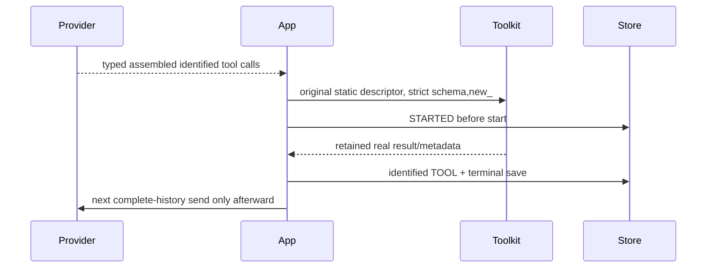

Coverage: K/I/provider/session + delegation static table references. No copying
private workspace vtable/schema into a flattened registry. Delegate PREPARE gets
global reservation before STARTED; save failure never starts group and retains
honest uncertain authority. Result append/save failure keeps only result handle,
never repeats mailbox/effect. No gap.

## 16 — provider/output/error propagation

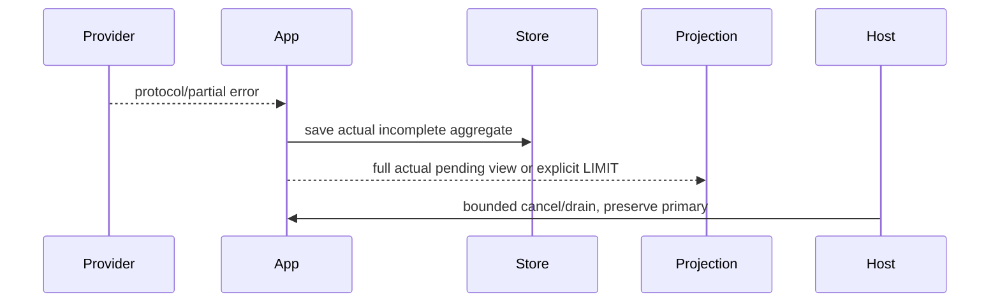

Coverage: execution/projection + existing K observation/result/output contracts.
NonOK observer AGAIN is driver failure, not stall retry. Frozen copy survives
newer drain text/result. If feed cannot commit, caller gets error, no successful
partial snapshot or fabricated cursor; actual incomplete durable state survives.
No gap A12/A34.

## 17 — exact quiescent handoff

```mermaid
sequenceDiagram
 Coordinator->>Source: QUIESCE(cp0)
 Source->>Store: frozen guarded checkpoint save
 Source-->>Coordinator: CHECKPOINTED exact token
 Coordinator->>Target: resolved profile + STAGED exact load/preflight
 Target-->>Coordinator: PREPARED
 Source->>Store: release guard, remain frozen
 Coordinator->>Store: exact expected→next epoch+1 CAS
 Target->>Store: COMMIT acquire guard, still staged
 Target-->>Coordinator: READY
 Coordinator->>Route: publish exact owner/token
 Coordinator->>Target: ACTIVATE; exact retained ACK
```

Coverage: handoff/execution/child_profile + G/CGH1/orchestrator routes. No active
child/input/policy/view/result/future generation. Target drops all old startup
prompt/queue; ACTIVATE sends no input. Lost ACK retry cannot repeat save/CAS or
infer activation from latest generation. Abort/failure requires shutdown+explicit
fresh L epoch/recovery, no old guard thaw. Guard release refusal retains pointer;
provider disconnect consumes even error then secret clears. No gap A24–A26.

## 18 — real structured observation

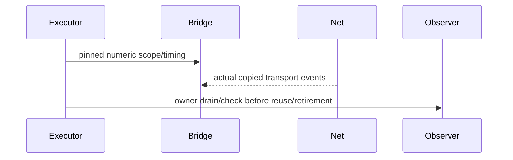

Coverage: existing observation/obs/net + per-executor runtime lifetime. Separate
net/bridge perapp, no target-sharing violation. Provider/tool actual durations and
known/unknown usage remain truthful. No credentials/URL/header/body/task/arguments/
opaque in lifecycle logs; secret bootstrap never generic receipt/event/replay.
No gap A22.

## 19 — real connection diagnostics

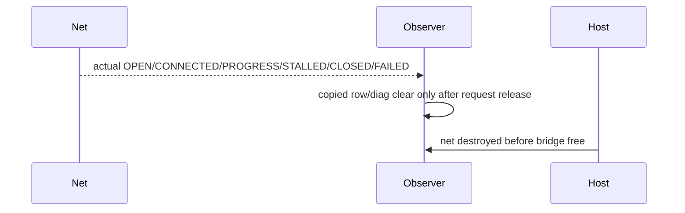

Coverage: existing observation/net/obs and host lifecycle. Actual HTTP outcome
separate transport failure, no fake RETRY/diagnostic from native heartbeat. Lost
feed frozen/drained, detach consuming app ends target borrow safely. No gap.

## 20 — signal, partial text and queued input

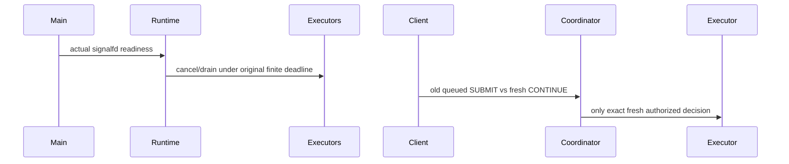

Coverage: existing host_output+execution/runtime/control. No parent shared stdout/
stderr flag changes, unsupported descriptors explicit. Native workers reset inherited
blocked INT/TERM before own signalfd setup, command helper signal profile preserved.
Queued input cannot authorize new branch after error. EOF final-line command waits
checked final result or returns unknown, never silent send-OK success. No gap A37.

## R13 / R14 compound walks

R13 combines01/11/14/16/20: detach during accepted text, ring eviction while ASK,
tiny corrupt CGV1/CGD1 suffix, output failure, stale cross-session reconnect,
controller expiry and late POLICY/CONTINUE. Nonwriting full scan precedes any
decode output; CGD1 rows cannot be partially installed before later bad policy.
Exact view or error, independent command/render acknowledgement, no effect replay.

R14 combines03/07/09/10/15: global credit exhausted before STARTED; parent G1 turn
while G2 published; prefix OOM; early cancel before profile/start; RUNNING n in
flight when parent cancel wins; pending local notification backpressure; lost
positive/negative receipt; accepted terminal wins; crash/old epoch/new transport.
Existing core contiguous/idempotent/ACK rules stay unchanged. Negative consume
retires exact wire only; NEW drained terminal fills unaccepted semantic slot.
Unknown parent-crash placement/effects stay uncertain; never fabricate prefix0.

## Pass2 amendments and result

| ID | Full walk finding | Amendment |
|---|---|---|
| A29 | Q has opaque payload, no message type field | magic CGW/CGL dispatch inside actual Q frame; full payload counted |
| A30 | CURSOR vs send/command ACK and GAP snapshot unspecified | explicit REPLAY CURSOR direction + RESYNC_VIEW + checked full install |
| A31 | early cancel/retired attempt could admit late START | retained cancel slot, ordered first admissions/high watermark, stale after cleanup |
| A32 | SYSTEM siblings/provenance and full64 IDs not traceable | actual CHILD_START fields, admission saved context, decimal-string targets |
| A33 | volatile registry falsely looks durably reconstructable | persisted facts only; missing members/prefix explicitly unknown, no rebind |
| A34 | core done cannot progress old blocking app drain | direct bounded drain_step after drive_end, no nested wait/restart |
| A35 | fatal rollback retains intent leases | drain separate executors/return borrows then existing core_free lease disposal |
| A36 | dead UI receipts consume all slots or eviction repeats input | nonreused server logical leases, finite record retirement/stale before admission |
| A37 | clean EOF/last command can silently disappear | all EOF finite role lease; final admission + ACK-of-ACK or checked unknown/error |
| A38 | child clone would replay parent's mock fixture cursor | headless MOCK UI-only; child paths actual offline REAL TLS, no fallback |
| A39 | handoff of active generation loses failed reload-attempt budget | explicit imported attempts-used0..64, authoritative attempt/candidate ID, no replenishment |
| A40 | group/mailbox result can exceed parent capture despite individual fit | pre-STARTED whole-result proof/negotiated caps; whole-message batch+more flag, no hidden truncation |

All20+R13/R14 completed as declaration/ownership/error traces, with no known call
gap after these amendments. This is NOT final gate approval or runtime evidence.
Pass3 must now re-read the entire assembled surface for consistency/edges and
verify every exact source/test/review/integration ticket dependency before a
different final critic approves N. O bodies remain gated.
