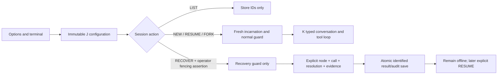

# Stage 14.L session UX header amendment

Ticket `65ccb86`, delivery `ff2dbc9`, baseline main `42c5e15` (K complete).
This record is header-only. Production implementation waits for three actual
passes and independent final header review. No library contract is weakened.

## Pass 1 — goals, boundaries and smallest API

The app must list durable sessions without credentials/network, explicitly
resume a selected session under a fresh owner incarnation, select a divergent
safe branch while preserving other branches/effect identity, and reconcile one
uncertain call only on an explicit operator decision. Terminal output must
remain clean, report known usage, and propagate EOF/signal/output failures.

Existing session/store APIs provide exact load/restore, same-session fork,
immutable IDs/audits, normal/recovery guard acquisition and atomic per-call
reconciliation. The missing public application contract is command selection,
source/node inputs and the app-owned recovery operation. Add only:

- session_action NEW/LIST/RESUME/FORK/RECOVER;
- source_session_id, fork_node_id, previous_processes_fenced and show_usage;
- cog_cli_app_fork and cog_cli_app_reconcile.

Selectors are direct CLI/host inputs, with no environment/file precedence.
J still resolves model, endpoint, credentials, workspace, policy, store and
limits for normal execution. Metadata LIST/RECOVER skip model/credential/net
construction while still rejecting malformed configuration values. Metadata
DEFAULT means DURABLE, including explicit MOCK fixtures; no-store is invalid.

FORK stays within the same session tree; it does not copy/rebind a persisted
session identity. A nonleaf fork point is remembered for the next fresh user
message's explicit parent. No new branch is durably created without that input.
Queued input cannot be silently redirected by a fork selection.

`--recover ID --fenced` records the operator assertion that prior command
processes have been stopped/reaped or externally fenced. The application cannot
verify this from an opaque owner incarnation and does not claim to do so. The
store's exclusive independent-description guard still prevents a concurrent
live owner. Never signal unknown PIDs or treat a missing output as proof of no
effects. /reconcile selects exactly one node/call and one evidence-backed outcome,
or ACKNOWLEDGED when effects remain unknown. It never authorizes another tool.

After reconciliation this app remains offline/recovery-only. A later explicit
RESUME performs a new checked epoch admission and acquires a normal guard.
That separates durable closure from new execution without a hidden fallback.
EOF or a failed save preserves unresolved intent; failed reconciliation cannot
claim success or continue mutating in-memory outcomes.

Public signatures/errors/lifetimes are in `applications/cog-cli/include/cog_cli/cli.h`.
Implementation ownership: options/config changes, new private app_sessions.c,
cli lifecycle/terminal integration, deterministic installed-binary tests and
CONTRACT/HARNESS/evidence updates. Public libraries remain unchanged.

## Pass 2 — exact call traces and amendments

| Flow | Public application selection | Exact existing library coverage | Result / failure rule |
|---|---|---|---|
| 1. Offline list, no model/key/net | LIST; app_new/run/free | store_new/list/free, caller frees returned IDs/array | Sorted validated metadata IDs; checked stdout/flush, no integrity/health claim or guard/credential/provider |
| 2. Restart complete session | RESUME source ID | owner_read → checkpoint_load(exact generation) → snapshot_view/restore(current reservations) → owner_compare_exchange(new incarnation/epoch, exact checkpoint) → owner_acquire | Stale checkpoint/owner refuses; live guard AGAIN; provider created only after safe activation |
| 3. v1 text migration | explicit RESUME + quiescence assertion | load_ex report → temporary require_owner=false store/save/free(v2) → fenced owner_read/CAS/acquire | Explicit migration publication before ownership; v1 unidentified tools UNSUPPORTED |
| 4. Resume completed tools | RESUME | exact restore + copy_history | Ancestor IDs/results/opaque/usage remain exact; no old tool constructor/start |
| 5. Resume partial text | RESUME then fresh prompt | display snapshot; session_fork(safe ancestor) + add_message(parent=forkpoint) | Prequeued input cannot authorize; failed aggregate retained on old branch |
| 6. Resume PROPOSED | RESUME | snapshot ledger → normal guard → current policy/denial → STARTED save before start | Already closed calls skipped from validated restored state; unrelated input waits; partial STARTED never mistaken for PROPOSED |
| 7. Resume STARTED | RESUME | checkpoint_load/restore normalizes STARTED → INDETERMINATE; owner_acquire refuses | Return INDETERMINATE, no provider/tool/input work, no recovery downgrade |
| 8. Divergent same-session branch | FORK or app_fork | session_fork + add_message(parent=selected node) + store_save | Complete safe prefix only, no identity rebinding; other branches/effects remain intact |
| 9. Fork unresolved/queued | FORK/app_fork | copy_history/fork safety and app pending admission checks | INVALID_STATE for unsafe path; AGAIN for active/queued input, no mutation |
| 10. Recovery-only restart | RECOVER + fenced assertion | exact load → new owner CAS → owner_acquire_recovery | No normal guard/net/credentials/core; live guard still AGAIN; assertion is not verification |
| 11. Per-call reconciliation | app_reconcile / terminal command | session_reconcile_tool(matching node+call, explicit outcome/evidence) → store_save | Only exact call closes; failed/uncertain save freezes this app; no automatic execute |
| 12. Restart after reconciliation | later explicit RESUME | owner_read/CAS(new epoch)/owner_acquire after all final | New normal activation only after durable closure; remaining uncertain call still refuses |
| 13. EOF/signal/output failure | normal/recovery run; app_stop | core_stop when present; app-owned lock-free flag; existing provider/tool cancel/drain; checked FILE output | Metadata cannot depend on a nonexistent core stop flag; no lost guard/child cleanup |
| 14. Known usage/history | show_usage or terminal /usage,/history | node_data/message usage; display snapshot | Show exact known counts/cost/availability, no billing guesses or opaque rendering |

Pass-2 amendment: metadata apps have no core, so app_stop must also record an
explicit constructor-verified lock-free flag observed by their owner-thread run
loop. This does not introduce a process-global signal target. A platform lacking
that profile returns UNSUPPORTED. Main's explicit SIGPIPE disposition handling
allows EPIPE to reach normal cleanup; it restores the host disposition at exit.

Pass-2 amendment: RESUME is explicit authorization for text-only v1 migration.
An unowned v2 save precedes owner admission; the application does not adopt v1
under a new owner tuple or invent missing tool identity. All restore operations
use public snapshots and matching IDs, never private structures or rebinding.

Pass-2 amendment: distinguish same-session fork from cross-session cloning.
There is no new-session destination ID for FORK. `session_id` remains NEW-only;
`source_session_id` selects RESUME/FORK/RECOVER. A successful fork selection is a
pending parent for fresh input, not an in-place active-leaf switch on a nonleaf.

All original scenarios retain their accepted headers; this amendment changes
only application entry/terminal coverage. 01/02/04/05/06/12/15/16/18/19 keep K's
loop/tool/diagnostic contracts; 03/07/09/10 and 11/17 retain N/O IPC/migration
boundaries; 08 retains immutable J generations; 13 now invokes guarded RESUME;
14 invokes safe app_fork; 20 retains K's fresh-input and queued-text rule. R10,
R11 and R16 receive corresponding application traces. No implementation claim.

## Pass 3 — consistency, failure cases and final self-review

The third pass cross-checked every selector and operation against existing
constructor ownership and the G/K contracts. Amendments from this pass:

- All non-NEW actions resolve DEFAULT to DURABLE, including MOCK; explicit
  DISABLED fails rather than quietly selecting an alternate location/backend.
- Metadata modes do not bind an endpoint; normal REAL retains required model,
  credential and borrowed net lifetime. Missing metadata model/credentials are
  allowed while malformed present values and unusable durable location fail.
- Constructor errors now distinguish malformed selectors (INVALID_ARG), absent
  session/node (NOT_FOUND), competing live guard (AGAIN), unsafe normal resume
  (INDETERMINATE), stale admission/no recovery uncertainty (INVALID_STATE),
  missing recovery/unowned-adoption fencing assertion (DENIED), and reservation/platform limits.
- Reconciliation remains one exact assistant/call, with resolution and nonempty
  bounded evidence; a failed save freezes later reconciliation. No blanket
  ALLOW, outcome inference, session-ID rebinding or automatic execution appears.

| Edge | Contract outcome |
|---|---|
| NEW with source ID; LIST with source/identity; RESUME/FORK/RECOVER without source | INVALID_ARG before publication |
| Multiple action flags, `--session` with non-NEW, `--from-node` outside FORK, `--fenced` outside RESUME/FORK/RECOVER | INVALID_ARG; parser exits2 |
| FORK with queued startup input; LIST/RECOVER with prompt/queue | INVALID_ARG, no reassignment/model effects |
| Invalid UTF-8/control/separator/empty/oversize source ID; overflowing unsigned node ID | INVALID_ARG/LIMIT as documented, no guessed/truncated identity |
| Missing store / explicit no-store on a non-NEW action | NOT_FOUND / INVALID_ARG, never null-store success |
| Existing owner lock, owner/CAS race, changed checkpoint | AGAIN / INVALID_STATE, no activation grant from a read |
| STARTED without final result, one of several uncertain calls, unsafe legacy tools | Normal INDETERMINATE / still frozen / UNSUPPORTED |
| Different call/node/outcome or empty/over-limit evidence | NOT_FOUND/INVALID_STATE/INVALID_ARG/LIMIT, no mutation |
| Reconciliation save failure or uncertain publication | Return original failure, retain recovery guard, freeze app; no model/tool admission |
| EOF/SIGINT/SIGTERM in metadata recovery | Leave unresolved evidence intact, release only on app_free; no missing-core stop dereference |
| Output/flush EPIPE/ENOSPC; unavailable usage | IO through cleanup / explicit availability, never guessed bill |

All new public function parameters have directions, finite bounds, ownership,
threading, failure and no-effect rules. Added types use existing session/core
headers and add no library dependency. Static dispatch/data ownership stays in
the app. Each source family's implementation/review/integration tickets exist;
no production `.c` change has been made.

Final self-review after pass 3 rechecked the 14 call traces plus original01–20
mapping and the alternate failure edges above. Strict standalone C11 and C++11
header compilation validates self-containment; it is not executable conformance.
The independent final header review must PASS before L implementation starts.

## Independent header-review amendments

The independent audit requested explicit per-call semantics for valid metadata
apps. submit/queue/cancel return INVALID_STATE (required NULLs still NULL_PTR),
shutdown records the app stop flag and returns OK, and stop works without a core.
The old queue forwarding prose is corrected to K's actual reserved app FIFO and
fresh postfailure authorization rule. No production behavior is changed here.

LIST uses the existing store_list temporary output constructor and frees every
ID/array. Enumeration allocates proportionally to returned metadata; no fixed
pre-enumeration allocation ceiling is claimed. Before any output the app checks
at most 1024 IDs, aggregate bytes+NULs <= max_context_bytes, UTF-8 and store-safe
1..127-byte IDs. Over-limit returns LIMIT; malformed metadata IDs return PROTOCOL;
neither partially prints nor silently filters. Listing does not validate session
generation checksums or establish replay health.

The G v1/adoption preconditions need an explicit temporary unowned store context:
require_owner=true cannot save before guard acquisition, while v1 cannot acquire
that guard. RESUME/FORK therefore require --fenced for unowned v1/v2 adoption,
recording the operator assertion that all old writers are quiescent (not app
verification). v1 text is saved through require_owner=false, that context is
released, then a new fenced owner is admitted against the exact v2 checkpoint.
Owned clean RESUME/FORK still use normal exclusive guard arbitration without a
required assertion; RECOVER always requires it. Unowned uncertain data remains
INDETERMINATE under G's CAS contract and cannot be bootstrapped into execution.
