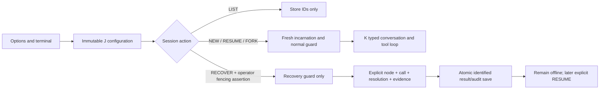

# Stage 14.L session UX header amendment

Ticket `65ccb86`, delivery `ff2dbc9`, baseline main `42c5e15` (K complete).
This record is header-only. Production implementation waits for three actual
passes and independent final header review. No library contract is weakened.

## Pass 1 — goals, boundaries and smallest API

The app must list durable sessions without credentials/network, explicitly
resume a selected session under a fresh owner incarnation, select a divergent
safe branch while preserving other branches/effect identity, and reconcile one
uncertain call only on an explicit operator decision. Terminal output must
remain clean, report known usage, and propagate EOF/signal/output failures.

Existing session/store APIs provide exact load/restore, same-session fork,
immutable IDs/audits, normal/recovery guard acquisition and atomic per-call
reconciliation. The missing public application contract is command selection,
source/node inputs and the app-owned recovery operation. Add only:

- session_action NEW/LIST/RESUME/FORK/RECOVER;
- source_session_id, fork_node_id, previous_processes_fenced and show_usage;
- cog_cli_app_fork and cog_cli_app_reconcile.

Selectors are direct CLI/host inputs, with no environment/file precedence.
J still resolves model, endpoint, credentials, workspace, policy, store and
limits for normal execution. Metadata LIST/RECOVER skip model/credential/net
construction while still rejecting malformed configuration values. Metadata
DEFAULT means DURABLE, including explicit MOCK fixtures; no-store is invalid.

FORK stays within the same session tree; it does not copy/rebind a persisted
session identity. A nonleaf fork point is remembered for the next fresh user
message's explicit parent. No new branch is durably created without that input.
Queued input cannot be silently redirected by a fork selection.

`--recover ID --fenced` records the operator assertion that prior command
processes have been stopped/reaped or externally fenced. The application cannot
verify this from an opaque owner incarnation and does not claim to do so. The
store's exclusive independent-description guard still prevents a concurrent
live owner. Never signal unknown PIDs or treat a missing output as proof of no
effects. /reconcile selects exactly one node/call and one evidence-backed outcome,
or ACKNOWLEDGED when effects remain unknown. It never authorizes another tool.

After reconciliation this app remains offline/recovery-only. A later explicit
RESUME performs a new checked epoch admission and acquires a normal guard.
That separates durable closure from new execution without a hidden fallback.
EOF or a failed save preserves unresolved intent; failed reconciliation cannot
claim success or continue mutating in-memory outcomes.

Public signatures/errors/lifetimes are in `applications/cog-cli/include/cog_cli/cli.h`.
Implementation ownership: options/config changes, new private app_sessions.c,
cli lifecycle/terminal integration, deterministic installed-binary tests and
CONTRACT/HARNESS/evidence updates. Public libraries remain unchanged.
