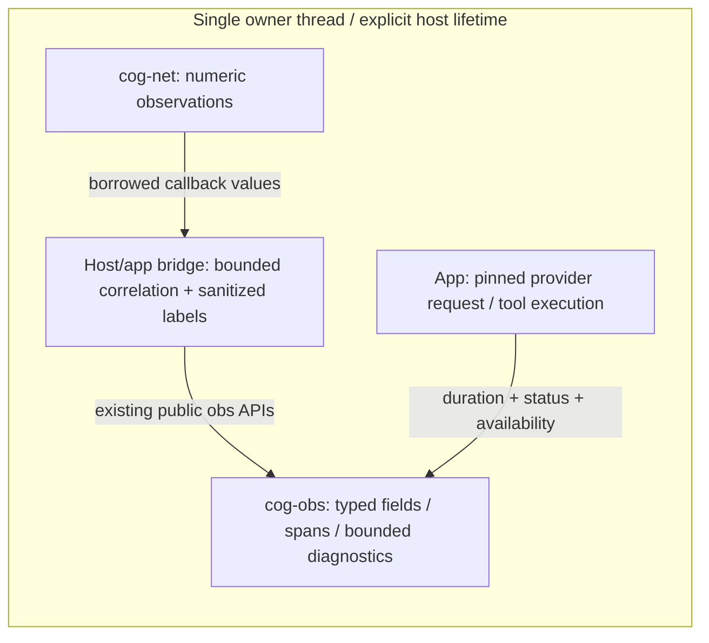

# Runtime observability composition

Design ticket `d32fafd`; delivery `b64ee7c`; baseline main `8c68b4a`.
This is a header-first amendment for original scenarios 18 and 19. It supplies
no implementation or executed runtime acceptance. Shared DESIGN.md is owned by
the concurrent R12 designer; the proposed decision append is recorded below for
coordinated integration.

## Goals, blocks and cross-check

- Observe real transport admission, connection readiness, body progress and one
  terminal result, preserving HTTP status versus transport failure.
- Record real provider/tool duration and status with typed fields and reported
  usage availability. Never print raw prompt/tool/response/opaque/credential data.
- Keep callback, diagnostic and sink ownership explicit and bounded. A failed
  observer cannot change a transfer's outcome or cause a POST/tool replay.

Three existing blocks suffice: net owns transport facts; the application/host
owns correlation, sanitized labels and timing; obs owns typed log/span/diagnostic
formatting and bounded delivery. Net gains no dependency on provider, app or obs.
No GUI, exporter protocol, dynamic registry or new telemetry service is added.

## Public net amendment, pass 1

`net.h` adds `cog_net_observer_fn`, `cog_net_observation_kind_t`,
`cog_net_observation_t`, two optional constructor fields (`observer`,
`observer_user`) and `cog_net_observer_status`. Zero-initialized old configs
leave observation off. The constructor borrows the function and user context;
there is no later registration or mutation. Existing request/retention APIs and
ordinary return semantics stay intact.

The event contains no pointer to payload, URL, headers, credentials, error text
or opaque continuation. `(net context identity, request ID)` keys a request;
sequence starts at one and never wraps. The callback is synchronous on the
calling owner thread and cannot re-enter net through itself or a downstream
sink. It copies any retained values into explicit host reservations. No signal
handler calls an observer; app/core stop still only records stop intent.

OPEN follows successful `out_id` publication during request construction.
CONNECTED comes from actual DNS/TCP/TLS readiness, before HTTP transmission;
there is no invented CONNECTED based on send, first response, or time elapsed.
PROGRESS counts entity-body bytes: inbound bytes accepted transactionally into
retention once (paused callback retry does not double count), and actual uploaded
request-body bytes. It excludes headers/TLS/framing. Non-PROGRESS deltas are
zero; progress may coalesce without losing totals. HTTP429 can end with CLOSED,
transport outcome OK and HTTP status429. A true response inactivity timeout
produces STALLED then FAILED. Backpressure pause is not a network stall.
The transport never emits RETRY or performs a replay.

Any callback error disables further observation on this context and latches the
first error. Counter/sequence exhaustion latches LIMIT. Transfer state/results,
retained bytes and constructor ownership remain independent. Hosts read
`cog_net_observer_status` after net operations before allowing subsequent work;
application code must also check after provider calls that service the net.
The affected host chooses to stop its own work, then cancels/drains normally;
observation failure itself never cancels unrelated shared-net requests. The
failed event is not retried and the feed cannot silently resume with a gap.

`net_free` destroys the observation domain without callbacks. Hosts needing
terminal evidence explicitly cancel/release their IDs, check observer status,
clear bridge rows and only then free net/bridge/obs. This preserves safe teardown
when app construction fails and no obs target was ever installed. After free,
the host removes every key using that context identity before reusing its memory.

## Application bridge and lifetime

The Linux CLI host supplies a static callback and constructor-owned bridge
storage before net construction. App construction has no wire effects, so the
bridge may bind the existing `cog_cli_app_obs` result after successful app_new
and before app_run. Constructor failure leaves no target and no network request.
A bridge target is never borrowed from a replaceable provider configuration.
It remains app/host-owned through both R12 provider generations and their final
cleanup. Only the host owns dependency global initialization/cleanup.

The reference CLI has one app on its host net context. At OPEN, the bridge
copies the active request's pinned session/model/configuration generation and
application attempt number into a fixed row. The owner prepares this scope
before calling provider_send; OPEN can occur synchronously inside that call.
A send failure clears the prepared scope without inventing a network row.
Later events use the copied row, never
whatever generation was most recently published. Candidate connect/preflight
has no wire request and produces no transport observation. R12 publication
cannot relabel old requests or clear labels while diagnostics borrow them.
Embedding hosts that share a net across providers/apps supply their own
constructor callback and route `(ctx,id)` without consuming another request's
peek/ack or assuming that one context means one provider. The default app does
not replace an externally configured observer.

The bridge assigns nonzero never-reused obs `conn_id` values across its context
set, rather than treating context-local request IDs as globally unique. It keeps
fixed-capacity rows sized for admitted live/retained requests. Active rows cannot
be evicted. Once a terminal event is delivered, the terminal row may be cleared
with `cog_obs_diag_clear` before reuse; there is no unbounded history. Host
consumers copying events must likewise reserve/cap their state. Capacity or ID
exhaustion is an explicit error; it never silently drops a row or wraps identity.

The host obtains event timestamps from the existing monotonic obs clock at
callback time. Net observations do not mix the caller-supplied service clock
with real timestamps or report a fabricated request timestamp before first
service. Clock failure follows the same latched observer-error path.

Label reservations use fixed per-row capacities: session ID128 bytes including
NUL, model label128 bytes including NUL, and static endpoint/provider/tool names.
Long/unsafe/unavailable labels are represented as absent with explicit typed
availability flags, never silently truncated and never a new failure of an
otherwise valid4096-byte configuration field. Model labels allow ASCII letters,
digits and `._:/-` only; session labels use the same safe alphabet. Before output,
compare candidate labels with the pinned credential bytes/reference and omit a
label containing either. Real endpoint/provider names are static `openrouter`;
mock uses static `mock`. Request/generation/node/ordinal numeric identities remain
available even when a human-readable label is omitted. These rules constrain
logging labels only; they do not rewrite stored sessions, model configuration,
call identity or network input. Typed records have a bounded subset of fields
and fit the existing obs formatting reservation; oversized optional labels cannot
force a valid request to fail simply because the obs scratch is1024bytes.

Endpoint/provider labels use bounded approved names, not arbitrary base URLs;
never log URL userinfo, query, path or raw peer error text. Session/model labels
are bounded validated copies, formatted with existing string escaping, and
never copied from credential references or opaque continuation. Diagnostic
snapshot strings remain valid until that row is republished/cleared, as required
by obs.h. The bridge therefore owns copies; it does not borrow config-generation
strings across retirement. Body/tool content is never an observation attribute.

App retry admission emits existing obs RETRY with the explicit application
attempt, then the newly admitted request has a fresh OPEN identity. RETRY is
recorded only when an attempt is actually admitted; a refused retry budget,
backoff cancellation or failed provider send does not claim a new wire attempt.
A provider 429 record includes HTTP429 while its net CLOSED remains transport
OK. DNS/TLS/connect/capacity/cancel are sanitized transport classes, not HTTP429.

## Provider/tool typed records

Use a static const obs field table. Emit only bounded allowlisted metadata:
`session`, `request`, `configuration_generation`, `provider`, `model`, `attempt`,
`duration_ns`, `status`, `http_status`, token/cost availability and values when
known. Tool records add assistant node ID, call ordinal, static tool name,
terminal status, side-effects-possible/truncated flags and duration. Do not log
call arguments, command text, paths, output, raw model text or opaque bytes.
Use the original immutable call ordinal rather than arbitrary provider call ID
as a display/log key; exact IDs still remain intact in the session ledger.

Provider timing begins around an admitted send and ends when its terminal is
consumed or cleanup fixes cancellation/error. A failed send has one explicit
failed-attempt record, no fake net OPEN. Tool timing brackets an admitted
execution, including cancellation/drain until owned work is reaped; denial and
schema failure produce explicit no-execution status with no claimed effect.
The app's existing sequential model/tool execution can use the explicit obs
span stack with static names and reverse close order. Multiple providers sharing
a net must not open overlapping non-nested spans in one stack; their owner uses
separate obs contexts or typed duration records. R12 candidate preparation must
not open a long-lived span that encloses an unrelated old request.

Known USAGE is a replacement cumulative snapshot; never sum repeated snapshots.
Emit availability booleans and omit unknown numeric token/cost fields. Do not
invent zero billing or print a mutable credential through a model/endpoint label.
Net terminal and provider semantic terminal stay distinct (e.g. valid HTTP200
with malformed provider frame). Both are observed once in their own domain.

Sink/format/clock/capacity errors are checked. The bridge returns errors from
existing obs calls; the net feed latches them. App timing log/span errors latch
an app-owned observation error and stop subsequent admission after the owner
cancels/drains/persists work. Preserve any earlier work error as primary and
retain the first observation error for explicit reporting. Cleanup never retries
an effect merely to regenerate a missing record. If a sink rejects trace_end,
its documented unchanged stack may be discarded during failed cleanup, rather
than retrying a partially delivered record blindly.

## Pass 2: scenario traces and amendments

Tracing the initial draft against release/cancel/quantum and actual obs capacity
found three gaps: active release lacked an explicit observer terminal boundary;
terminal totals could hide a final upload delta; and a valid4096-byte configured
model could overflow the existing1024-byte obs scratch. net.h now pins active
release/completion precedence and final progress flush; this document bounds
optional labels with explicit availability, not truncation/config rejection.
The callback budget and accounting-error policy are now explicit as well.

| Trace | Public calls / existing authority | Required observation/result |
|---|---|---|
| 1 successful HTTP | net_request -> service -> peek/ack/release | OPEN1 -> actual CONNECTED -> coalesced PROGRESS -> CLOSED; callback values contain no payload |
| 2 invalid request/setup failure | net_request fails before ID publication | out_id unchanged, no OPEN/row, no request/effect |
| 3 HTTP429 + retry admission | net CLOSED/HTTP429; provider_get_error; app budget; provider_send | transport OK is distinct from provider error; app RETRY only on admitted attempt; next request has fresh ID |
| 4 DNS/TLS/connect failure | service fixes failure, cancel/release cleanup | OPEN -> FAILED without fake CONNECTED; sanitized error enum only |
| 5 response inactivity | service timeout after response progress | STALLED then FAILED/TIMEOUT; connect timeout has no STALLED and pause/backpressure is excluded |
| 6 callback rejection | any observer call returns nonOK; observer_status | first error latches, no retry/no later callbacks, ordinary transport/response outcome unchanged |
| 7 body-ring pause | service -> retained peek, later ack -> service | count body bytes once after transactional acceptance; no repeated callback progress for the same paused input |
| 8 active cancel/release | cancel/release after partial upload/body | flush final PROGRESS, FAILED/ABORTED once; ID remains owned until release |
| 9 already captured completion | service captures DONE at quantum boundary; cancel/release before terminal response publish | captured success/error wins; no second terminal or ABORTED replacement, even while body views stay retained |
| 10 fatal driver error | service returns driver failure; caller drains owned IDs | no fabricated request terminal while still live; explicit cancel/release supplies actual final cleanup |
| 11 two contexts/shared net | constructor callback receives ctx and request ID | distinct keys/obs IDs, no global peek/ack stealing, no cross-context cancel on sink failure |
| 12 reload during active old turn | existing R12 pinning; prepared provider has no wire; old send/poll/cleanup | copied row keeps old generation/model/session through retirement; subsequent OPEN gets new scope |
| 13 tool success/deny/cancel | toolkit_new/start/poll/result, existing guarded STARTED/result saves | typed timing/status, identified ordinal, no arguments/output; span ends after joined reap |
| 14 unknown usage/long labels | provider_next USAGE -> bounded typed app record | availability false and numeric omitted; no guessed zero or truncation; stored usage/model unchanged |
| 15 teardown/constructor unwind | app drain, bridge clear, app_free; net_free; host cleanup | observer target alive through explicit releases; free itself emits nothing and host clears domain keys |

The existing original18/19 diagrams are amended to route through the host bridge
and map each newly required call to its public header. No special provider/tool
log helper or private transport layout becomes part of the design.

## Delivery ownership and proof plan

`b64ee7c` starts after both this header gate and R12 implementation `af6956a`.
No app source is changed in parallel with R12. Proposed cohesive ownership:

| Unit | Files / responsibility | Required oracle |
|---|---|---|
| Net facts | net.c and narrow net tests, net.h already approved | Actual readiness, zero-payload callback, coalesced counters, pause/no-duplicate, terminal-once, callback error independent of transfer, no runtime Cog allocation |
| CLI bridge/timing | main/cli/app_turn/app_tools/private bridge header after R12 | Pinned generation/session identity, stable copied labels/rows, typed duration/status/availability, owner lifetime and checked errors |
| Composition | new app observability test + local TLS fixture, narrow CMake ownership | Real success/tool/429/new attempt/stall/DNS-TLS/cancel, copied consumer, exact counters/classification/order, no secrets/body/opaque in records |
| Independent review/integration | different critic; strict builds/sanitizers/install consumption | Header contract matches source, optimized assertions actually execute, existing F/K/L/R12 behavior unchanged |

Local deterministic tests suffice for this delivery; no paid requests are
required. M still owns bounded actual-model acceptance. P retains all38 full
runtime/sanitizer/installed-consumer gates. Existing synthetic obs tests remain
valid component tests but cannot substitute for real event generation.

## Proposed shared DESIGN append (not applied here)

Runtime transport facts travel through an optional constructor-borrowed numeric
net observer, independent of retained body queues. A host-owned bounded bridge
maps `(net context, request ID)` to stable sanitized obs rows and pinned app
metadata. Connection readiness comes from real DNS/TCP/TLS readiness; retries
belong only to app admission. Typed provider/tool duration/status and explicit
usage availability use existing obs calls. Observer failure is latched separately
from transport/effect outcomes and halts later app admission through normal
cleanup; it never makes a completed POST or tool replayable. No Cog runtime
allocation, mutable global, observer registry or net->obs/app dependency is added.
