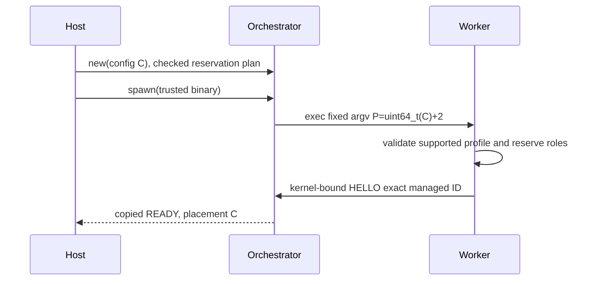

# O3 private layout and worker startup capacity

Design tickets `21a4a04` and `6e517f6`; baseline `25a5936`. This is a header-only
handoff, not runtime implementation or acceptance. The approved N public
contracts remain authoritative; the private declarations replace obsolete local
structs only when O3 bodies are authorized. O2 completion and a different critic
remain required. No application control header is imported into the library.

## Goals, blocks and authority

| Goal | Private block | Authority / bounded storage |
|---|---|---|
| Preserve exact native ownership through shutdown | `orch_worker_t` | Immutable fork PID, checked managed identity, exact-PID reap/signal helper |
| Authenticate without connect-order assumptions | `orch_link_t` | Accepted endpoint plus immediately copied kernel proof, one ingress frame |
| Retain delivery under ordinary pressure | Control slots/FIFO, message descriptors/byte ring | Three transitions per worker independent of ordinary count/bytes |
| Retain affected-session diagnosis | `orch_route_t` | Exact advisory owner/checkpoint; no durable guard or migration engine |
| Fail before unbounded growth | `orch_reservations_t` | Checked constructor products, named arenas; no runtime realloc |
| Separate placement from physical execution | Wide startup scalar | Child C and physical C+2 are distinct quantities |

The existing headless process diagram remains the architecture: orchestrator
owns the worker-control fabric, O4 owns application control and handoff, and Q
owns endpoint internals. These headers add no component or transport protocol.
Known IPC/native lifecycle primitives require no new PoC for this layout.

## Source and fixture ownership

| Owner | Files / responsibility |
|---|---|
| O3 runtime writer | `orchestrator.c`, private `orchestrator_layout.h`: explicit constructor reservation, lifecycle/static dispatch, proof barrier, queues, native checks, routes |
| O3 pure codec writer | `orchestrator_wire.c`, private `orchestrator_wire_internal.h`: four public CGW1/CGH1 codecs; pure file-local scalar/UTF-8 helpers |
| O3 fixture writer | Existing native/unit/orchestrator-IPC/stress fixtures and original07/09/10 component assertions; actual nonblocking service, no fake AGAIN acceptance |
| O4 writer | Worker slot partition/bootstrap and CGH transaction phases, guarded app preparation/activation; consumes public orchestrator APIs only |
| Integration owner | Later source/test CMake registration, not part of this header ticket |

Runtime calls only the public codecs. The native-check, native-signal,
link-step, control-capture and reservation-plan helpers are declared before
bodies; each is implemented in `orchestrator.c`. Wire code cannot signal, reap,
authenticate, allocate or publish a route. Legacy test-hook declarations remain
separate; they do not expose the new private layout as a public API.

## Reservation and retirement rules

Normalize public zero defaults before any multiplication. Reserve max workers,
accepted-link slots (bounded by max workers), max routes, three control slots
and FIFO references per worker, ordinary message descriptors and byte ring,
one ingress frame per link, binary-path slices and socket-path copy. Check all
products, sums, alignments and complete allocation sizes before construction.
Allocation failure leaves no published owner or child. An accept constructor
retains the already approved bounded endpoint allocation exception; no additional
service-time message/path/config allocation is permitted.

Event IDs are assigned in capture order, not at reservation time. Held mandatory
IDs count every uncaptured possible control transition. Spawn proves three more
can be held before fork; ordinary capture cannot consume held IDs. Reaped/lost
workers release impossible unused transitions only once terminal. Acknowledged
control slots cannot be reused by that worker. Class duplicate ACK memory is
one last ID per class. Release requires the exact terminal reservation with no
queued events or routes; stale IDs never select reused storage.

Ring payloads can wrap in at most two spans; they are copied to caller storage
transactionally at peek and wiped on ACK/abandonment. Link ingress and endpoint
TX/RX copies are also wiped on logical retirement, including error unwind and
free. Physical EOF alone must not erase a complete retained frame/proof. Event
payloads never point into endpoint storage. Secret-bearing application bootstrap
uses the approved dedicated direction/retirement policy; it is never logged or
placed in argv or durable event identity metadata.

## Startup capacity and fixed argv

Normalize C=default_core_capacity, with zero meaning4 and C<=UINT32_MAX.
Physical P=uint64_t(C)+2 is checked before addition and stored as uint64_t;
P may be4294967297 even when size_t is32 bits. The orchestrator does not allocate
P application contexts: it formats a decimal startup scalar in21 bytes including
NUL. Generic custom workers may support the full public range. A binary must
reject an unsupported P before readiness; no truncation, reduced advertisement
or task acceptance is permitted. Native publication is asynchronous, so this
postpublication failure remains an owned child reported via service/health/reap.

The installed headless coordinator supports C<=16 and P<=18; it checks its
profile before spawn. Its physical slots partition as one primary, one staged
handoff, and C child slots. Primary/staged roles are exclusive reservations,
not spare child slots; only children contribute to CGW1 active_subagents and
placement. STAGED has no guard/effect authority until the already specified
handoff activation. This partition does not authorize two live primary owners.
O6's syntactic worker parser remains physical1..18: parsing alone is not semantic
startup approval. Worker-host setup validates the two reserved roles and its
supported child profile before HELLO/readiness; P below3 cannot represent a
positive child capacity and is refused without tasks.

The15 pointer entries are executable, `--worker`, six pairs, and NULL, exactly:

```
<absolute executable> --worker --control-socket <path>
  --worker-incarnation <u64> --worker-number <u64> --parent-pid <pid>
  --executor-slots <P> --frame-bytes <bytes>
```

All flags are fixed strings; numeric storage and copied binary/socket paths
outlive native startup. There is no shell, arbitrary extra argv, task, secret or
configuration payload. Minimal environment and child signal-mask rules remain
those in public `orchestrator.h`.

## Pass 1 — recovered drafts and capacity amendment

Preserved both previously untracked drafts. Reviewed public API, N contracts,
implementation ownership and design blueprint. Found size_t could truncate
C+2 on32-bit; replaced the private physical scalar with uint64_t and clarified
the public generic range versus installed binary support. Verified14 strings
plus terminating pointer,21-byte numeric buffers, CGW1 fixed37 bytes and CGH1
fixed62 plus at most127 session bytes. No wire shape or API signature changed.

## Pass 2 — targeted ownership/capacity/failure traces

### A. Startup, child count and width (original03/04/10)



| Step | Declaring header / fields | Boundary |
|---|---|---|
| Normalize default and physical scalar | `orchestrator.h` config; layout reservation plan | C0 means4; P6 |
| Maximum installed profile | Same + worker startup profile | C16 gives P18, active children<=16 |
| Generic maximum on32-bit | `orch_reservations_t.worker_executor_slots` | C4294967295 gives P4294967297, no size_t intermediate |
| Unsupported selected binary | Public spawn/service/health/reap | Fail before HELLO/readiness; retain published process ownership |
| Exact argv | Public spawn; worker argv[15], numeric[21] | Six pairs only; no task/config/secret |

Gap found and amended: constructor INVALID_ARG prose named only NULL path;
now it includes invalid normalized bounds and reservation arithmetic, while
explicitly preserving a wide physical startup scalar above SIZE_MAX. Physical
slots are not an orchestrator array-size multiplier. Runtime worker tests remain
O3/O4 work, not a claim from a header trace.

### B. Full ordinary queue, handshake/EOF and native stop (original05/07/19/20)

```mermaid
sequenceDiagram
  participant Q as IPC
  participant O as Orchestrator
  participant H as Host
  Q-->>O: one handshake publication unit
  O->>Q: immediate peer_info copy
  Q-->>O: complete frame, later EOF
  O->>O: stage frame; ordinary queue full
  H->>O: stop exact managed ID
  O->>O: timer, exact-PID check, TERM/KILL, reap
  O-->>H: reserved disconnect/final control
  H->>O: copy/ack retained ordinary event
```

| Step | Header / ownership | Boundary |
|---|---|---|
| First proof barrier | `orch_link_step`, link proof | Before another service/recv/TX/EOF unit; no private endpoint access |
| Full ring | message slot/ring and link frame | One staged ingress frame; pause only affected receive |
| Native deadline | `orch_native_check/signal`, worker PID/state | No waitpid(-1), no blocking; ECHILD permanently LOST |
| Mandatory control | `orch_control_capture`, independent FIFO and held IDs | Three transitions reserved before fork; ordinary saturation cannot steal IDs |
| Final payload | public event_next/ack | Proof retained through EOF; copy/ACK before wipe |

No new gap: control delivery can overtake ordinary data but does not overwrite
an already accepted CGA terminal or claim escaped descendants stopped. An early
exit may skip READY; unused identity holds release only after terminal state.

### C. Frozen routes, reuse and handoff (original09/13/17)

```mermaid
sequenceDiagram
  participant H as O4 handoff owner
  participant O as Orchestrator
  H->>O: publish exact owner/checkpoint route
  O->>O: worker disconnect/reap; retain affected route
  H->>H: guarded CGH transaction and explicit recovery
  H->>O: forget exact old owner
  H->>O: ack events, release terminal worker
  O->>O: recycle storage with fresh managed number
```

| Step | Header / ownership | Boundary |
|---|---|---|
| Route | Public publish_owner/session_owner/forget_owner; `orch_route_t` | Advisory route, not durable store/guard authority |
| Disconnect | worker bound_once/proof; frozen route | No new peer binding or automatic task replay |
| Release | Public release_worker; route/event references | Refuse live/reference-bearing reservation; stale ID NOT_FOUND |
| Handoff | CGH public codecs; O4 coordinator | Library contains no save/CAS/guard/activation engine |

No new gap. All20 original scenario contracts remain unchanged; the targeted
03/04/05/07/09/10/13/17/19/20 paths exercise these private structures. The other
ten paths use existing provider/tool/app/UI boundaries and add no O3 calls.
