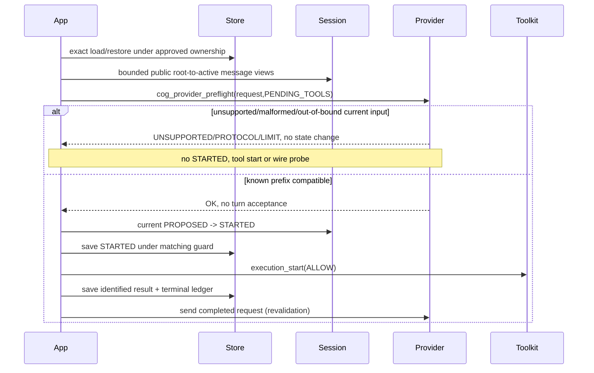

# L/H no-wire provider preflight amendment

Design gate `f7d9933`, linked to L0 `65ccb86`; baseline `fa56242` includes the
independently approved L selectors. No production implementation is authorized
until three targeted passes and an independent final review pass. This document
amends only the narrow provider compatibility boundary; unaffected L work may
continue against the approved selector contract.

## Pass 1: goals, blocks, source audit and initial contract

- Reject unsupported persisted continuation before resumed PROPOSED tool effects.
- Accept supported opaque bytes without protocol-specific CLI branching.
- Check the actual selected prefix and current model/settings/declared limits.
- Preserve turn acceptance, clock, retained output and terminal error evidence.
- Keep normal send eligibility separate from a staged pre-tool prefix.

The functional blocks are the app's bounded public session views, generic static
provider dispatch, and adapter-owned protocol/constructor workspaces. Store,
ledger and toolkit keep their existing roles. Every block serves one goal; no
capability registry, protocol switch in CLI or new persistent representation is
needed. [Boundary diagram](provider-preflight.svg).

The source audit found no existing safe public operation: request_validate calls
message_validate for structural data only; model flags do not describe opaque
payload grammar; the OpenRouter codec validates pinned namespace/json-v1 content
privately during send. Calling send then cancel accepts wire work, and ordinary
copy_history refuses unresolved calls. Blanket refusal of valid opaque content
would violate lossless continuation support. These facts resolve the research
question without writing an implementation or making any wire call.

The minimal amendment adds `cog_provider_preflight_stage_t`, one generic
`cog_provider_preflight(provider,request,stage)` and one required static vtable
callback `preflight`. COMPLETE selects ordinary complete history; PENDING_TOOLS
permits the final assistant call group before results exist. The request struct
has no dry-run flag, so staged permission cannot accidentally reach send.

Return values report input validation directly. preflight does not publish or
replace get_error: that remains a sanitized retained TERMINAL TURN error whose
message lifetime ends at the next send/disconnect, never at preflight. Neither
success nor failure accepts a request, performs transport/service, advances a
sequence/clock, consumes output, retains inputs or allocates. Scratch reuse must
preserve every observable retained lifetime even after an invalid input.

The app supplies its real current model/generation/max_tokens/tools declaration
and a bounded selected root-to-active array from public node/message views. It
checks store/ledger replay eligibility separately; no synthetic TOOL result is
inserted to satisfy an encoder. Compatibility is checked before STARTED/save/
ALLOW for restored PROPOSED work. Later send checks the completed request again,
since future tool output may exhaust a bound or require separate validation.

## Delivery strategy (gated)

Provider dispatch/history checks, OpenRouter adapter, mock fixture and every
custom static vtable must migrate together to the required ninth callback.
Missing required callbacks fail before connect invokes implementation code.
No silent structural-only fallback is allowed. Existing limits/workspaces serve
preflight; no runtime allocation, dependency initialization or global state is
introduced. CLI owns only the generic selected-prefix call, not parser details.

After independent header acceptance, implement a coherent provider migration
with unit/adapter/error-preservation/zero-wire tests, then integrate the dependent
L PROPOSED path with real supported and unsupported opaque fixtures. Source
writing and executable evidence remain gated; this header commit proves neither.

## Pass 2: targeted traces and amendments

| Trace | Exact public boundary | Oracle / discovered gap |
|---|---|---|
| 1. Complete text context | request_validate + preflight(COMPLETE) | Model/generation/configured limits checked without send |
| 2. One persisted PROPOSED call with valid opaque | public node_data/message views + preflight(PENDING_TOOLS), then existing transition/save/start | Accept known metadata; zero wire during preflight |
| 3. Mixed final/proposed multi-call group | final assistant + already-recorded identified TOOL results | Last group may end in TOOL messages, not literally an assistant; amendment below |
| 4. Unsupported namespace/format | real adapter preflight callback | UNSUPPORTED before STARTED, exact bytes remain owned by caller |
| 5. Correct namespace but malformed/duplicate/invalid UTF-8 JSON | real adapter preflight callback | PROTOCOL; old terminal error is unchanged |
| 6. Unknown required opaque semantics | same pinned send grammar | UNSUPPORTED, no silent dropping or blanket rejection of supported opaque |
| 7. Earlier open group followed by unrelated user/assistant | preflight stage association rules | INVALID_STATE even if all individual messages validate |
| 8. Orphan/duplicate/wrong-group TOOL result | preflight stage association rules | INVALID_STATE; reused IDs in distinct completed groups remain legal |
| 9. Active request, retained text or queued terminal | preflight idle precondition | INVALID_STATE; same next item/sequence/capacity survives |
| 10. Last error followed by failed then successful preflight | get_error -> preflight -> get_error | Same snapshot/message lifetime, no synthetic terminal error or success turn |
| 11. Parser/writer/request byte ceiling | real adapter constructor limits + preflight | LIMIT, no pool growth, no retained state invalidation |
| 12. Model/generation/capability mismatch | configured adapter preflight | NOT_FOUND / INVALID_ARG / UNSUPPORTED before any effect |
| 13. Mock fixture profile | mock static preflight callback | Exact 128 KiB representation bound; arbitrary structural fixture opaque accepted, no real protocol claim |
| 14. Missing custom callback | generic connect required-nine contract | INVALID_ARG before invoking implementation connect; no fallback |
| 15. Future tool output exceeds context | initial PENDING_TOOLS OK, later completed send revalidates | Later LIMIT stops continuation; no retry of prior effect |
| 16. Complete preflight requested for open group | preflight(COMPLETE) and normal send | INVALID_STATE, no accidental promotion of pending prefix to wire |

Pass-2 amendments define **the last assistant group**, rather than requiring the
last message itself to be the pending assistant. It may have already-committed,
unique matching results in any order, with at least one call still missing a
result; no unrelated later message is allowed. Earlier groups must be completely
resolved. This is essential for L's mixed completed/PROPOSED restart and is not
permission to send unresolved history. Preflight cannot observe ledger states:
the app still proves PROPOSED versus STARTED/INDETERMINATE independently.

A second amendment distinguishes immutable fixture compatibility from real
protocol compatibility. The mock has a fixed request arena, no model/generation
registry, and intentionally accepts structural opaque fixture bytes. Its
preflight computes/checks the representation without overwriting last_request
or advancing scripted outcomes. Real json-v1 compatibility is tested through
OpenRouter's callback, never inferred from mock acceptance.

### Existing scenario coverage

| Original | Effect of this narrow amendment |
|---|---|
| 01 | Generic send remains COMPLETE-only; preflight accepts no turn |
| 02 | No hidden retry or clock change; prior terminal evidence remains |
| 03 | Custom provider tables migrate required callback; child admission unchanged |
| 04 | Connect validates all nine callbacks before implementation |
| 05 | Active preflight refuses without consuming cancellation/terminal state |
| 06 | Partial multi-call results are allowed only in last pending group |
| 07 | Fencing/reaping still precede any resumed work; preflight is no recovery bypass |
| 08 | Current immutable configuration generation is checked locally |
| 09 | Message routing unchanged, no callbacks/IPC from preflight |
| 10 | Each consumer owns its provider/context; no shared mutable registry |
| 11 | No opaque rendering or display/replay cursor changes |
| 12 | Error/retry-after snapshot survives rejected and accepted preflight |
| 13 | Exact restored selected opaque is validated before PROPOSED effects |
| 14 | Only selected prefix is checked; inactive sibling metadata does not cause false rejection |
| 15 | Durable result closes group before normal send; missing future results never synthesized |
| 16 | get_error remains terminal-turn-only; preflight returns validation error directly |
| 17 | Staged migration ownership remains separate; resumed PROPOSED compatibility is required |
| 18 | No input logging/rendering or arbitrary protocol error persistence |
| 19 | No net/service/DNS/HTTP calls, independent-instance traffic unchanged |
| 20 | Active queues/deltas/cancel flags are unchanged on every preflight return |

All calls/types above are declared in provider_vtable.h, provider_request.h,
message.h, session.h, session_store.h or toolkit_exec.h. This retrace adds no
implementation or passing runtime inference. R04/R10 and L's session amendment
carry the exact new call boundary.

## Pass 3: consistency and edge-case self-review

The final targeted pass checked each declaration against the 16 traces and
existing G/H/K contracts. Amendments from this pass are narrow:

- All nine callbacks are required, including for custom static providers; missing
  preflight is INVALID_ARG rather than a weaker structural-only fallback.
- The stages are arguments to preflight alone. request_validate remains explicitly
  structural; COMPLETE eligibility and the special final pending group are never
  inferred from successful structural validation or carried into send.
- Non-COMPLETE messages and invalid stage/history association fail INVALID_STATE.
  Matching uses call ID within its assistant group, not TOOL name or a global
  textual-ID uniqueness restriction. Result ordering remains flexible as in G.
- Active includes queued FINISH until consumed. preflight cannot cancel, poll,
  service or drain to become idle. Both rejection and success preserve existing
  cancellation, deltas, request acceptance counters and monotonic clock.
- get_error remains terminal-turn-only, including NOT_FOUND before any turn.
  A rejected preflight cannot manufacture a terminal outcome; a valid preflight
  cannot erase earlier error/message bytes. Allocation exhaustion in existing
  fixed pools is LIMIT, with no scratch growth or transient secret logging.
- L preflights the entire known restored prefix before its first PROPOSED effect,
  including opaque metadata on every selected ancestor and the final group.
  No inactive sibling is inspected as candidate wire history. Later ordinary
  send independently revalidates the completed request; future output may still
  fail capacity. This does not expand unrelated K tool-loop policy or ledger APIs.
- Mock acceptance is explicitly fixture compatibility. It is not evidence that
  real opaque syntax is supported. Supported/unsupported json-v1 tests must use
  a real constructed adapter without invoking send/network work.

The include graph remains acyclic: preflight types use the existing provider
request/message/result headers. The stage enum adds no field to request/session
storage and no codec/persistence version. The only static ABI addition is the
required callback at the end of cog_provider_vtable; all initializers migrate
under the subsequent implementation ticket. The app remains backend-generic.

### Required executable oracles after header approval

1. Callback presence, NULL/stage errors and zero implementation-connect calls on
   incomplete tables; custom/mock/real required-nine tables all covered.
2. Complete and pending shape matrix: final open group, some results, all results,
   none, orphan/duplicate/wrong group, earlier open group followed by unrelated
   input, reusable textual call ID in a distinct completed group.
3. Real OpenRouter supported exact opaque and unknown format/type/extra members,
   malformed JSON/UTF-8/duplicates, immutable generation/model/capability and
   exact constructor limit boundaries. Valid opaque must remain supported.
4. Observe zero request acceptance/net calls/active-count changes on every
   preflight return, including shared-net contexts with unrelated active IDs.
5. Retained delta/terminal/error/cancellation/time/request-state snapshots survive
   rejection; failed then successful preflight leaves old get_error unchanged.
6. Mock last_request content/pointers and fixture cursor/counters stay stable;
   preflight never consumes a scripted send_error or reuses its request arena.
7. Inject each relevant constructor allocation failure, then instrument preflight
   for no runtime allocation under GCC/Clang and ASan/UBSan/appropriate TSan.
8. Restore actual PROPOSED with supported opaque: preflight then one effect,
   durable result and ordinary continuation. Unsupported/malformed opaque must
   return before any STARTED/save/tool constructor start, with zero effect count.
   Mixed already-final/PROPOSED groups must not repeat completed effects.

No implementation, paid call or network probe was performed by these passes.
Strict standalone C11/C++11 checks cover the changed public/private header graph;
they are syntax/contract checks, not runtime conformance. The independent final
review is mandatory and must be performed by a different reviewer before any
source implementation of this amendment.

### Recognized member-kind clarification

Independent runtime review found accepted known wrong kinds that the namespace
check alone could not detect. [Profile gate a81767d](REAL_CLIENT_OPAQUE_FIELD_PROFILE.md)
pins common id/format/index and per-kind payload value kinds, preserves unfamiliar
members and keeps null signatures explicitly outside the current profile. It
adds no API or preflight stage. Its targeted three passes and different final
review precede the shared-validator correction; earlier implementation evidence
does not waive this finding.
