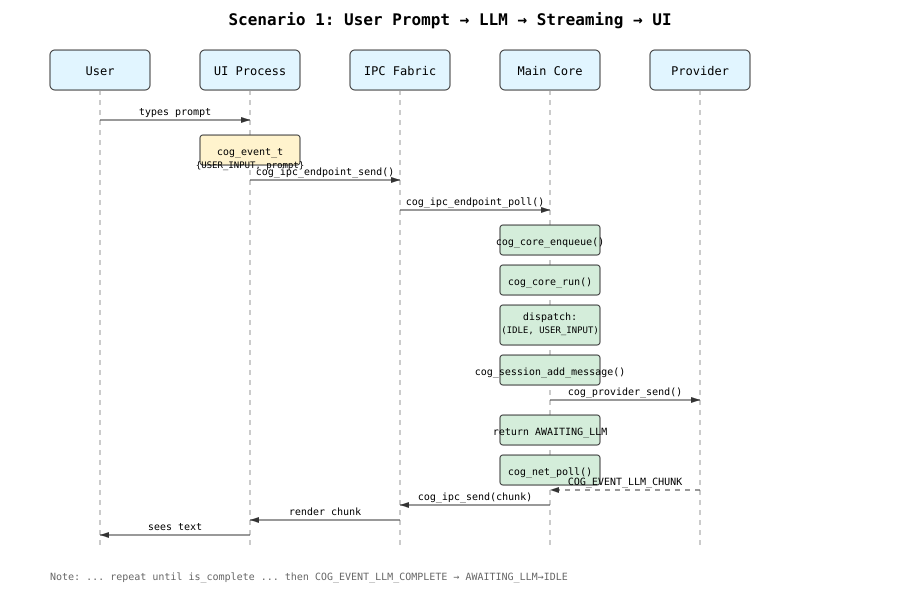

# Scenario 1: User Prompt → LLM → Streaming → UI

## Sequence Diagram

## Header Coverage

| Step | Function | Header | Status |
|------|----------|--------|--------|
| UI sends event | `cog_ipc_endpoint_send()` | `ipc.h` | ✅ |
| Core polls IPC | `cog_ipc_endpoint_poll()` | `ipc.h` | ✅ |
| Core enqueues | `cog_core_enqueue()` | `core.h` | ✅ |
| Core runs loop | `cog_core_run()` | `core.h` | ✅ |
| Dispatch | `cog_state_lookup()` | `state.h` | ✅ |
| Handler signature | `cog_handler_fn` | `handler.h` | ✅ |
| Add to history | `cog_session_add_message()` | `session.h` | ✅ (6h) |
| Get history | `cog_session_get_history()` | `session.h` | ✅ (6h) |
| Get provider | `cog_core_provider()` | `core.h` | ⚠️ declared but not yet in header |
| Send to provider | `cog_provider_send()` | `provider_vtable.h` | ✅ |
| Receive chunk | `cog_provider_receive()` | `provider_vtable.h` | ✅ |
| Stream to UI | `cog_ipc_endpoint_send()` | `ipc.h` | ✅ |
| LLM chunk event | `COG_EVENT_LLM_CHUNK` | `event.h` | ✅ (6h) |
| LLM complete event | `COG_EVENT_LLM_COMPLETE` | `event.h` | ✅ (6h) |

## Gaps Found → FIXED

1. ✅ **`cog_core_provider()`** — added to `core.h`
2. ✅ **Provider in config** — added `cog_provider_t *provider` to `cog_core_config_t`
3. ✅ **Obs context in config** — added `cog_obs_t *obs` to `cog_core_config_t` and `cog_core_obs()` accessor
4. **State machine states** — application-defined, not core-defined. Correct as-is.

## Verdict

✅ All gaps fixed. Headers fully cover the flow.
