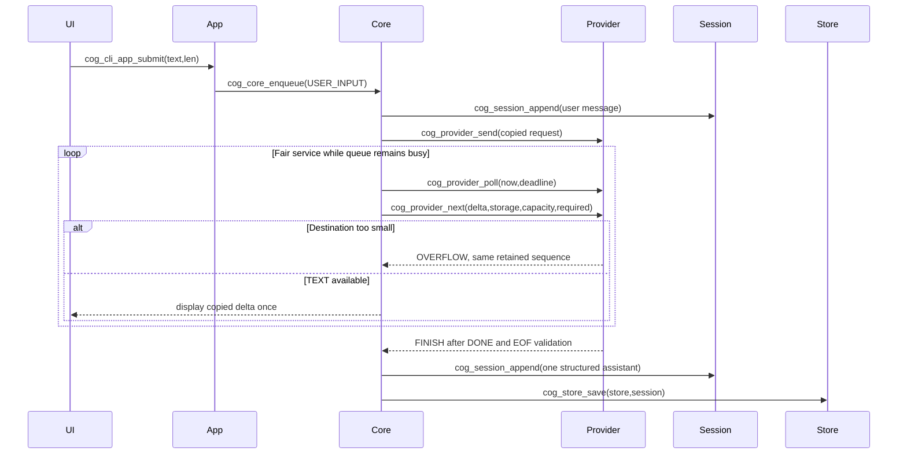

# Scenario 01: User prompt → LLM → streaming → UI

Stage 14.D pass-2 retrace from public-contract baseline `29b41e8`.
This replaces the earlier schematic SVG as the normative call trace. The SVG is
retained as historical design material and is not current API coverage.

## Sequence diagram

## Exact public-header coverage

Names below are exact declared functions, types, enum members or struct fields;
application-only policy/envelope steps are identified explicitly rather than
presented as library calls. Each header path names the declaring public file.

| Trace step | Exact declaration / member | Declaring header |
|---|---|---|
| Submit / dispatch | `cog_cli_app_submit`; `cog_cli_app_run` | [applications/cog-cli/include/cog_cli/cli.h](../../applications/cog-cli/include/cog_cli/cli.h) |
| Event and application payload | `cog_event_t`; `COG_EVENT_USER_INPUT`; `COG_EVENT_LLM_CHUNK`; `COG_EVENT_LLM_COMPLETE` | [libraries/cog-core/include/cog/event.h](../../libraries/cog-core/include/cog/event.h) |
| Bounded external progress | `cog_core_run`; `cog_core_config_t.service_fn`; `cog_core_config_t.service_interval`; `cog_core_config_t.idle_fn` | [libraries/cog-core/include/cog/core.h](../../libraries/cog-core/include/cog/core.h) |
| Static routing | `cog_dispatch_entry_t`; `cog_state_lookup` | [libraries/cog-core/include/cog/state.h](../../libraries/cog-core/include/cog/state.h) |
| Handler contract | `cog_handler_fn` | [libraries/cog-core/include/cog/handler.h](../../libraries/cog-core/include/cog/handler.h) |
| Copied request / typed stream | `cog_provider_send`; `cog_provider_poll`; `cog_provider_next` | [libraries/cog-provider/include/cog/provider_vtable.h](../../libraries/cog-provider/include/cog/provider_vtable.h) |
| Shared transport isolation | `cog_net_peek_request`; `cog_net_ack`; `cog_net_response_t.request_id`; `cog_net_response_t.sequence` | [libraries/cog-net/include/cog/net.h](../../libraries/cog-net/include/cog/net.h) |
| Typed metadata / limits | `cog_provider_request_t`; `cog_provider_delta_t`; `COG_PROVIDER_DELTA_TEXT`; `COG_PROVIDER_DELTA_FINISH` | [libraries/cog-provider/include/cog/provider_request.h](../../libraries/cog-provider/include/cog/provider_request.h) |
| History and completed turn | `cog_session_copy_history`; `cog_session_append` | [libraries/cog-core/include/cog/session.h](../../libraries/cog-core/include/cog/session.h) |
| Durable structure | `cog_message_t`; `cog_message_status_t`; `cog_usage_t` | [libraries/cog-core/include/cog/message.h](../../libraries/cog-core/include/cog/message.h) |
| Explicit save | `cog_store_save` | [libraries/cog-core/include/cog/session_store.h](../../libraries/cog-core/include/cog/session_store.h) |

## Ownership, errors and adversarial branches

- Send copies all nested request data before returning. Endpoint generation remains borrowed until disconnect; history views may be released after send.
- A short delta destination changes only required capacity, not destination metadata/bytes or queue position. Retry across poll preserves sequence; display is committed once after successful copy.
- Multiple providers may share one net context on the same owner thread. Each drains/acks only its own request ID through `cog_net_peek_request`; a stalled provider cannot pin a global selector and block another provider.
- A large frame expands through a bounded resumable cursor; a reserved terminal slot prevents full ordinary queues from losing FINISH. Resume never repeats already-emitted deltas.
- Core service continues under a permanently nonempty input queue. A bounded application assembly buffer retains copied deltas if its event queue is full.
- Streaming display is separate from durable history. Store one assistant with text, tools, continuation and usage; errors/cancel retain an explicit incomplete status. Unknown usage is not zero billing.

## Gap analysis and release amendment

No additional public primitive is required for this single-provider trace. Provider/CLI implementation and queue-retention conformance remain future work; exact shared-net demultiplexing and terminal backpressure are traced in the R-series. The old SVG's `cog_ipc_send` and implicit `cog_net_poll` progress are superseded by this diagram.

## Executable evidence and required follow-up

Existing baseline test: [`tests/scenarios/test_01_user_prompt.c`](../../tests/scenarios/test_01_user_prompt.c). It exists as historical
engine/mock application evidence. It was not rerun in this design-only pass and
does not prove the new mandatory headers, real transport or durable-tool behavior.

Future conformance requirements: Copied-input destruction after send; retained OVERFLOW across poll; one completed assistant; sustained-queue progress and explicit incomplete save.

Header tracing is complete only where the gap analysis says so. Production
implementation and executable scenario migration remain gated by pass 3 and the
independent final review; no passing runtime result is inferred from these tables.
