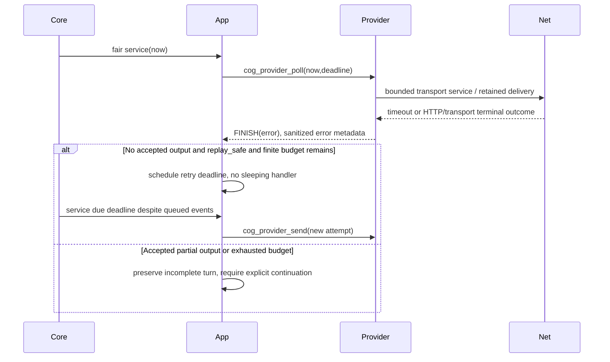

# Scenario 02: Network stall → detection → recovery → resume

Stage 14.D pass-2 retrace from public-contract baseline `29b41e8`.
This replaces the earlier schematic SVG as the normative call trace. The SVG is
retained as historical design material and is not current API coverage.

## Sequence diagram

## Exact public-header coverage

Names below are exact declared functions, types, enum members or struct fields;
application-only policy/envelope steps are identified explicitly rather than
presented as library calls. Each header path names the declaring public file.

| Trace step | Exact declaration / member | Declaring header |
|---|---|---|
| Transport timer / failure | `cog_net_service`; `cog_net_response_t.outcome`; `cog_net_response_t.error_kind`; `cog_net_response_t.retry_after_known` | [libraries/cog-net/include/cog/net.h](../../libraries/cog-net/include/cog/net.h) |
| Provider progress / failure | `cog_provider_poll`; `cog_provider_next`; `cog_provider_get_error` | [libraries/cog-provider/include/cog/provider_vtable.h](../../libraries/cog-provider/include/cog/provider_vtable.h) |
| Retry admission | `cog_provider_error_t.retryable`; `cog_provider_error_t.output_accepted`; `cog_provider_error_t.replay_safe`; `cog_provider_error_t.retry_after_ms` | [libraries/cog-provider/include/cog/provider_request.h](../../libraries/cog-provider/include/cog/provider_request.h) |
| Fair timers | `cog_service_fn`; `cog_core_config_t.service_interval`; `cog_core_run` | [libraries/cog-core/include/cog/core.h](../../libraries/cog-core/include/cog/core.h) |
| UI diagnostics events | `COG_EVENT_NETWORK_STALL`; `COG_EVENT_NETWORK_RECOVERED`; `COG_EVENT_PROVIDER_ERROR` | [libraries/cog-core/include/cog/event.h](../../libraries/cog-core/include/cog/event.h) |
| Incomplete saved message | `COG_MESSAGE_INCOMPLETE`; `cog_message_t.status` | [libraries/cog-core/include/cog/message.h](../../libraries/cog-core/include/cog/message.h) |
| Only application retry budget | `cog_cli_options_t.max_retries`; `cog_cli_options_t.max_retry_elapsed_ms`; `cog_cli_options_t.max_turn_ms` | [applications/cog-cli/include/cog_cli/cli.h](../../applications/cog-cli/include/cog_cli/cli.h) |

## Ownership, errors and adversarial branches

- Net `max_retries` and `retry_backoff_ms` must be zero. A transport restart is not a safe stream resume and cannot silently resend accepted output.
- The application owns one total attempt/elapsed budget. `retryable` is insufficient without `replay_safe`, no accepted output/effects, and time remaining.
- A retry is a new request with a deadline, not blocking sleep inside a handler. Timer, IPC and cancellation service continue even while events remain queued.
- After partial visible output, preserve the incomplete assistant and report failure. Recovery notifications do not imply an executed tool or streamed turn is replayed.

## Gap analysis and release amendment

The baseline claim that cog-net retries autonomously is withdrawn. Recovery policy is covered by generic error metadata and application deadlines; no universal network-resume API is claimed. Future tests must distinguish retry-before-output from explicit user continuation after output.

## Executable evidence and required follow-up

Existing baseline test: [`tests/scenarios/test_02_network_recovery.c`](../../tests/scenarios/test_02_network_recovery.c). It exists as historical
engine/mock application evidence. It was not rerun in this design-only pass and
does not prove the new mandatory headers, real transport or durable-tool behavior.

Future conformance requirements: 429/timeout before output, partial-stream loss, budget exhaustion, retry deadline under sustained queue, no duplicate output or effect.

Header tracing is complete only where the gap analysis says so. Production
implementation and executable scenario migration remain gated by pass 3 and the
independent final review; no passing runtime result is inferred from these tables.
