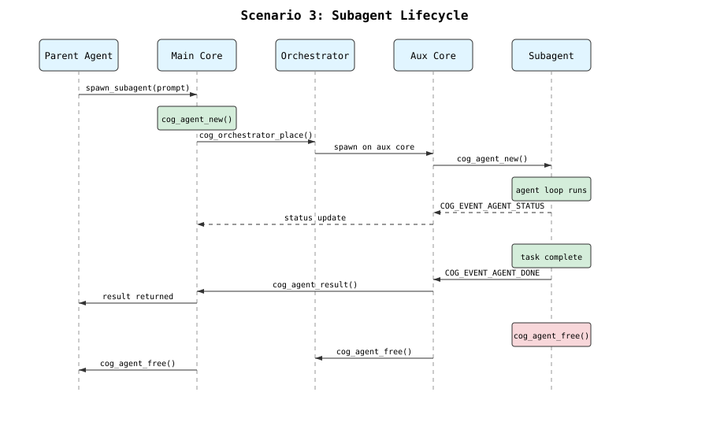

# Scenario 3: Subagent Spawn → Execute → Status → Result → Parent

## Sequence Diagram

## Header Coverage

| Step | Function/Event | Header | Status |
|------|---------------|--------|--------|
| Spawn | `cog_agent_spawn()` | `agent.h` | ✅ (6j) |
| Placement | `cog_orchestrator_place()` | `orchestrator.h` | ✅ (6i) |
| Send spawn | `cog_ipc_endpoint_send()` | `ipc.h` | ✅ |
| Child session | `cog_session_set_parent()` | `session.h` | ✅ (6h) |
| Notify parent | `cog_agent_notify_parent()` | `agent.h` | ✅ (6j) |
| Status event | `COG_EVENT_SUBAGENT_STATUS` | `event.h` | ✅ (6h) |
| Result event | `COG_EVENT_SUBAGENT_RESULT` | `event.h` | ✅ |
| Get result | `cog_agent_result()` | `agent.h` | ✅ (6j) |
| Cancel | `cog_agent_cancel()` | `agent.h` | ✅ (6j) |
| Session routing | `cog_ipc_send_to_session()` | `ipc.h` | ✅ (6k) |

## Gaps Found → ALL FIXED

1. ✅ **Session→peer mapping** — orchestrator registers on spawn; main core registers own sessions at startup
2. ✅ **Result routing** — IPC session routing via `cog_ipc_send_to_session()`
3. ✅ **Timeout** — added `COG_EVENT_SUBAGENT_TIMEOUT` event kind

## Verdict

✅ All gaps fixed. Headers fully cover the flow.
