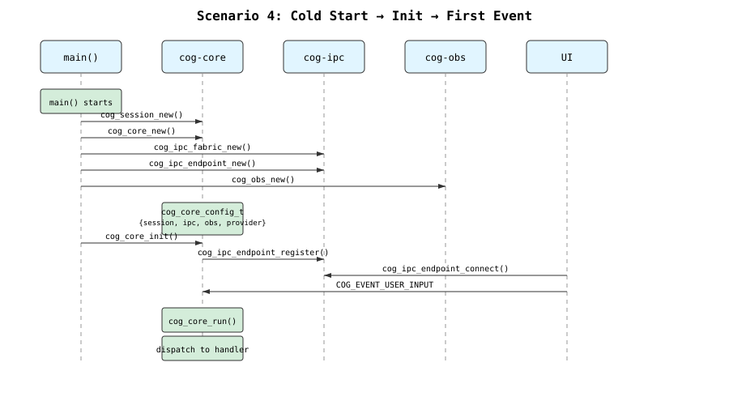

# Scenario 4: Cold Start → Init → First Event

## Sequence Diagram

## Header Coverage

| Step | Function | Header | Status |
|------|----------|--------|--------|
| Config tree | `cog_config_tree_new()` | `config.h` | ✅ |
| Config transaction | `cog_config_begin/set/commit()` | `config.h` | ✅ |
| Observability | `cog_obs_new()` | `obs.h` | ✅ |
| IPC listen | `cog_ipc_endpoint_listen()` | `ipc.h` | ✅ |
| Orchestrator | `cog_orchestrator_new()` | `orchestrator.h` | ✅ (6i) |
| Network | `cog_net_new()` | `net.h` | ✅ |
| Session | `cog_session_new()` | `session.h` | ✅ |
| Core init | `cog_core_new()` | `core.h` | ✅ |
| Core run | `cog_core_run()` | `core.h` | ✅ |
| IPC accept | `cog_ipc_endpoint_accept()` | `ipc.h` | ✅ |
| Connected event | `COG_EVENT_IPC_CONNECTED` | `event.h` | ✅ (6h) |

## Gaps Found → ALL FIXED

1. ✅ **Obs context in config** — added `cog_obs_t *obs` to `cog_core_config_t`
2. **Config → Provider wiring** — application handles this via `cog_config_get()` and endpoint table construction
3. **Init order** — documented: all referenced objects must be initialized before `cog_core_new()`

## Verdict

✅ All gaps fixed. Headers fully cover the flow.
