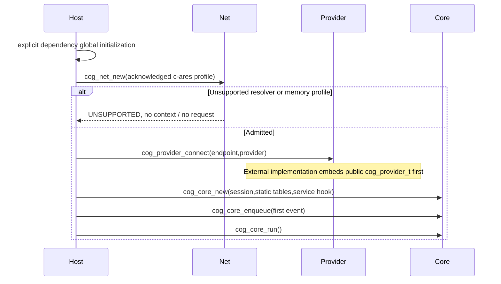

# Scenario 04: Cold start → init → first event

Stage 14.D pass-2 retrace from public-contract baseline `29b41e8`.
This replaces the earlier schematic SVG as the normative call trace. The SVG is
retained as historical design material and is not current API coverage.

## Sequence diagram

## Exact public-header coverage

Names below are exact declared functions, types, enum members or struct fields;
application-only policy/envelope steps are identified explicitly rather than
presented as library calls. Each header path names the declaring public file.

| Trace step | Exact declaration / member | Declaring header |
|---|---|---|
| Config and explicit transaction | `cog_config_tree_new`; `cog_config_begin`; `cog_config_set`; `cog_config_commit` | [libraries/cog-config/include/cog/config.h](../../libraries/cog-config/include/cog/config.h) |
| Observability constructor | `cog_obs_new`; `cog_obs_config_t` | [libraries/cog-obs/include/cog/obs.h](../../libraries/cog-obs/include/cog/obs.h) |
| Transport admission | `cog_net_new`; `cog_net_config_t.host_runtime_initialized`; `cog_net_config_t.dependency_memory`; `cog_net_config_t.dependency_memory_limit` | [libraries/cog-net/include/cog/net.h](../../libraries/cog-net/include/cog/net.h) |
| External provider construction | `cog_provider_t.vtable`; `cog_provider_vtable_t`; `cog_provider_connect` | [libraries/cog-provider/include/cog/provider_vtable.h](../../libraries/cog-provider/include/cog/provider_vtable.h) |
| OpenRouter composition | `cog_openrouter_config_t.net`; `cog_openrouter_provider_vtable` | [libraries/cog-provider/include/cog/openrouter.h](../../libraries/cog-provider/include/cog/openrouter.h) |
| Immutable endpoint configuration | `cog_endpoint_t.implementation_config`; `cog_endpoint_t.generation`; `cog_endpoint_t.api_key` | [libraries/cog-provider/include/cog/endpoint.h](../../libraries/cog-provider/include/cog/endpoint.h) |
| Session and core constructors | `cog_session_new`; `cog_session_config_t` | [libraries/cog-core/include/cog/session.h](../../libraries/cog-core/include/cog/session.h) |
| Static loop composition | `cog_core_new`; `cog_core_config_t`; `cog_core_enqueue`; `cog_core_run` | [libraries/cog-core/include/cog/core.h](../../libraries/cog-core/include/cog/core.h) |
| Optional IPC listener | `cog_ipc_endpoint_new`; `cog_ipc_endpoint_listen` | [libraries/cog-ipc/include/cog/ipc.h](../../libraries/cog-ipc/include/cog/ipc.h) |
| Bounded nonblocking frame service | `cog_ipc_endpoint_new_ex`; `cog_ipc_endpoint_config_t.max_frame_bytes`; `cog_ipc_endpoint_config_t.receive_frames`; `cog_ipc_endpoint_config_t.send_frames`; `cog_ipc_endpoint_config_t.service_quantum`; `cog_ipc_endpoint_service` | [libraries/cog-ipc/include/cog/ipc.h](../../libraries/cog-ipc/include/cog/ipc.h) |

## Ownership, errors and adversarial branches

- Every endpoint has constructor-reserved frame queues and bounded nonblocking service. A peer that sends a partial length prefix or stalls halfway through payload retains its own cursor and cannot block unrelated peers. Send OK copies one frame exactly once; retry only AGAIN, which accepted nothing. Receive OVERFLOW reports required bytes and retains the same complete frame across service calls.
- Host initialization is explicit and precedes net/provider construction. There are no implicit constructors, global Cog reference counters or hidden provider selection.
- Net admission requires proven ENABLE_ARES=ON/ENABLE_THREADED_RESOLVER=OFF, runtime ASYNCHDNS, nonempty ares metadata and c-ares-only DNS_SERVERS support. Unknown, threaded and hybrid profiles fail rather than fallback.
- Caller acknowledges DYNAMIC dependency allocations; any nonzero dependency total-memory cap is UNSUPPORTED. Constructors own and release handles but do not establish a total byte ceiling.
- Provider connect reserves state without a network request. An external provider uses only the public first-member base/vtable contract, never a private layout include.
- Construct all dependencies before core, unwind failures in reverse ownership order, and transfer an IPC endpoint only on successful core construction.

## Gap analysis and release amendment

The old `cog_core_init`, `cog_ipc_fabric_new` and `cog_ipc_endpoint_register` calls are not public APIs and are removed from the trace. Dependency provenance/adoption remains gate E review; public compile coverage is distinct from a runtime profile test.

## Executable evidence and required follow-up

Existing baseline test: [`tests/scenarios/test_04_cold_start.c`](../../tests/scenarios/test_04_cold_start.c). It exists as historical
engine/mock application evidence. It was not rerun in this design-only pass and
does not prove the new mandatory headers, real transport or durable-tool behavior.

Future conformance requirements: Public-only external provider consumer; bad c-ares/hybrid profile rejection; constructor-failure cleanup; two independent net contexts and reverse teardown.

Header tracing is complete only where the gap analysis says so. Production
implementation and executable scenario migration remain gated by pass 3 and the
independent final review; no passing runtime result is inferred from these tables.
