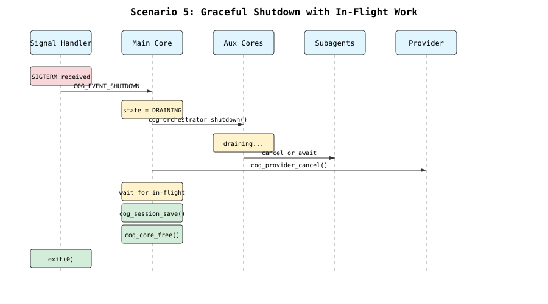

# Scenario 5: Graceful Shutdown with In-Flight Work

## Sequence Diagram

## Header Coverage

| Step | Function | Header | Status |
|------|----------|--------|--------|
| Signal stop | `cog_core_stop()` | `core.h` | ✅ |
| Shutdown event | `COG_EVENT_SHUTDOWN` | `event.h` | ✅ |
| Cancel requests | `cog_net_cancel()` | `net.h` | ✅ |
| Broadcast | `cog_ipc_broadcast()` | `ipc.h` | ✅ (6k) |
| Disconnect provider | `cog_provider_disconnect()` | `provider_vtable.h` | ✅ |
| Close IPC | `cog_ipc_endpoint_disconnect/free()` | `ipc.h` | ✅ |
| Free net | `cog_net_free()` | `net.h` | ✅ |
| Free session | `cog_session_free()` | `session.h` | ✅ |
| Free core | `cog_core_free()` | `core.h` | ✅ |

## Gaps Found → ALL FIXED

1. ✅ **Shutdown timeout** — added `cog_orchestrator_shutdown(orch, timeout_ms)`
2. ✅ **In-flight tracking** — added `cog_net_active_ids()`
3. ✅ **Obs context** — added `cog_obs_t *obs` to core config

## Verdict

✅ All gaps fixed. Headers fully cover the flow.
