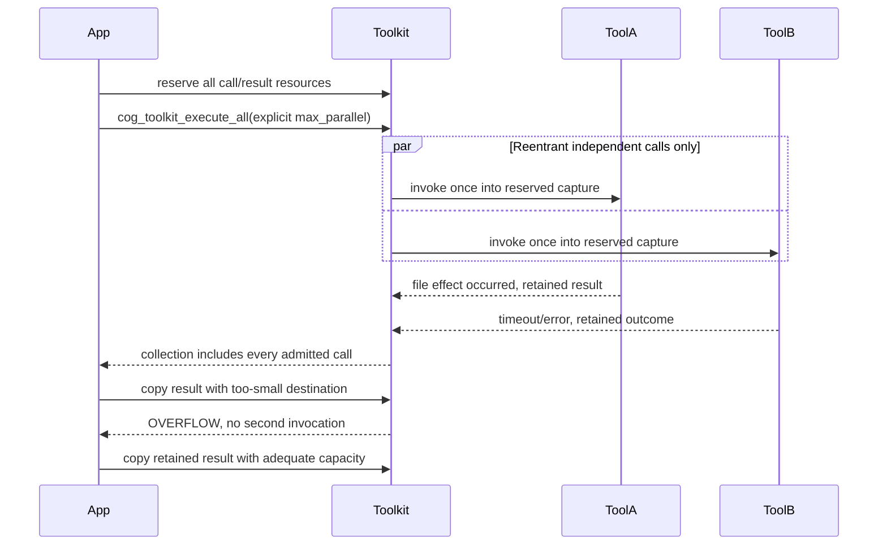

# Scenario 06: Parallel tool calls with timeout and output overflow

Stage 14.D pass-2 retrace from public-contract baseline `29b41e8`.
This replaces the earlier schematic SVG as the normative call trace. The SVG is
retained as historical design material and is not current API coverage.

## Sequence diagram

## Exact public-header coverage

Names below are exact declared functions, types, enum members or struct fields;
application-only policy/envelope steps are identified explicitly rather than
presented as library calls. Each header path names the declaring public file.

| Trace step | Exact declaration / member | Declaring header |
|---|---|---|
| Legacy call construction | `cog_toolkit_call_new`; `cog_toolkit_call_set_timeout`; `cog_toolkit_call_cancel` | [libraries/cog-toolkit/include/cog/toolkit_call.h](../../libraries/cog-toolkit/include/cog/toolkit_call.h) |
| At-most-once compatibility execution | `cog_toolkit_execute`; `cog_toolkit_execute_all`; `cog_toolkit_exec_opts_t.max_parallel`; `cog_toolkit_exec_opts_t.stop_on_error` | [libraries/cog-toolkit/include/cog/toolkit_exec.h](../../libraries/cog-toolkit/include/cog/toolkit_exec.h) |
| No implicit replay on handler overflow | `cog_tool_fn`; `cog_tool_table_t` | [libraries/cog-core/include/cog/tool.h](../../libraries/cog-core/include/cog/tool.h) |
| Collection/outcome access | `cog_toolkit_result_collection_count`; `cog_toolkit_result_collection_get`; `cog_toolkit_result_collection_free`; `cog_toolkit_result_t.truncated`; `cog_toolkit_result_t.side_effects_possible` | [libraries/cog-toolkit/include/cog/toolkit_result.h](../../libraries/cog-toolkit/include/cog/toolkit_result.h) |
| Responsive real-loop alternative | `cog_toolkit_execution_new`; `cog_toolkit_execution_start`; `cog_toolkit_execution_poll`; `cog_toolkit_execution_result` | [libraries/cog-toolkit/include/cog/toolkit_exec.h](../../libraries/cog-toolkit/include/cog/toolkit_exec.h) |
| Errors | `COG_ERROR_TIMEOUT`; `COG_ERROR_OVERFLOW`; `COG_ERROR_ABORTED` | [libraries/cog-core/include/cog/result.h](../../libraries/cog-core/include/cog/result.h) |

## Ownership, errors and adversarial branches

- Zero max_parallel means one; parallel execution is explicit and limited to independent reentrant handlers. Blocking compatibility execution is not used in the responsive real-client loop.
- Reserve batch result resources before any tool effect. A failure stops only unstarted calls when configured; already-launched outcomes remain available and unstarted entries are ABORTED.
- A call context invokes its handler at most once. A file-writing handler that then reports output overflow must never be reinvoked to discover a larger output size.
- Distinguish caller-copy OVERFLOW from constructor capture overflow: the former retries copying cached output; the latter is terminal with side_effects_possible and never triggers rerun.
- Legacy cooperative timeout cannot preempt arbitrary C. Real process timeout/cancel uses asynchronous handles, monotonic deadlines and owned process-group reap.

## Gap analysis and release amendment

The obsolete `cog_toolkit_exec_parallel` and `cog_toolkit_collect` names are removed. Baseline execution bodies still require migration to these at-most-once contracts; this trace alone does not demonstrate the audited duplicate-effect bug is implemented away.

## Executable evidence and required follow-up

Existing baseline test: [`tests/scenarios/test_06_parallel_tools.c`](../../tests/scenarios/test_06_parallel_tools.c). It exists as historical
engine/mock application evidence. It was not rerun in this design-only pass and
does not prove the new mandatory headers, real transport or durable-tool behavior.

Future conformance requirements: Disposable file counter remains exactly one across result-copy overflow retries and capture overflow; partial batch failure retains outcomes; sequential default; asynchronous timeout/reap.

Header tracing is complete only where the gap analysis says so. Production
implementation and executable scenario migration remain gated by pass 3 and the
independent final review; no passing runtime result is inferred from these tables.

## Pass-3 parser/process bounds retrace (E03)

`cog_tool_async_config_t` now fixes argument/schema bytes, JSON depth and codec
workspace capacity ([tool.h](../../libraries/cog-core/include/cog/tool.h)).
Construction rejects over-limit input before effects, duplicate keys and invalid
UTF-8. Scalar-count string lengths, finite numeric semantics and unsupported
schema keywords are pinned in [toolkit_exec.h](../../libraries/cog-toolkit/include/cog/toolkit_exec.h).
No remote schema fetch or hidden parser growth occurs. Process-tree supervision
keeps subreaper/signal changes inside an owned helper, never the embedding host;
the cancellation profile requires descendants remain in the owned group. Test
ordinary inherited-group grandchildren outliving the shell, exact parser/depth
limits, unsupported numeric ranges and result resize with one effect.
