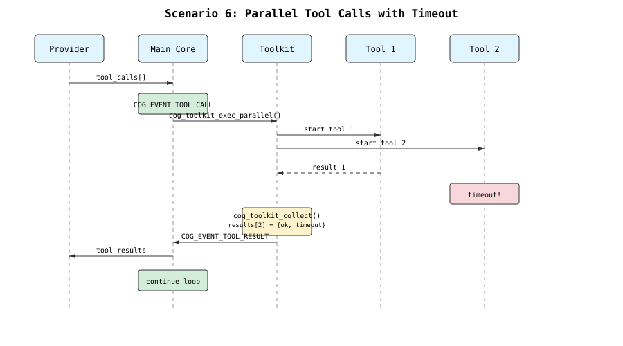

# Scenario 6: Parallel Tool Calls with Timeout

## Sequence Diagram

## Header Coverage

| Step | Function | Header | Status |
|------|----------|--------|--------|
| Create call | `cog_toolkit_call_new()` | `toolkit_call.h` | ✅ |
| Set timeout | `cog_toolkit_call_set_timeout()` | `toolkit_call.h` | ✅ |
| Execute all | `cog_toolkit_execute_all()` | `toolkit_exec.h` | ✅ |
| Exec options | `cog_toolkit_exec_opts_t` | `toolkit_exec.h` | ✅ |
| Cancel | `cog_toolkit_call_cancel()` | `toolkit_call.h` | ✅ |
| Result collection | `cog_toolkit_result_collection_t` | `toolkit_result.h` | ✅ |
| Result access | `cog_toolkit_result_collection_get()` | `toolkit_result.h` | ✅ |
| Result status | `cog_toolkit_result_is_ok()` | `toolkit_result.h` | ✅ |
| Tool result event | `COG_EVENT_TOOL_RESULT` | `event.h` | ✅ |

## Gaps Found → FIXED

1. ✅ **Timeout error code** — added `COG_ERROR_TIMEOUT` to `cog_result_t`
2. **Partial result semantics** — collection always contains exactly `call_count` results. Failed tools have `status != COG_OK` and an error message.
3. **Cancellation propagation** — tools should check for cancellation periodically and return `COG_ERROR_ABORTED`.

## Verdict

✅ Gap fixed. Headers fully cover the flow.
