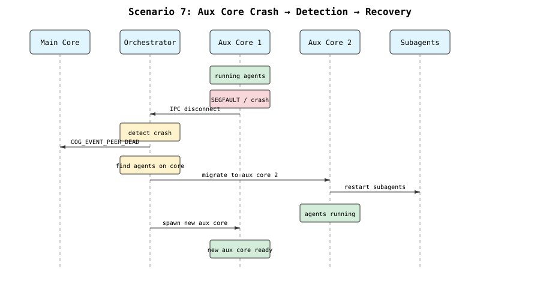

# Scenario 7: Aux Core Crash → Detection → Recovery

## Sequence Diagram

## Header Coverage

| Step | Function/Event | Header | Status |
|------|---------------|--------|--------|
| Health check | `cog_orchestrator_health()` | `orchestrator.h` | ✅ (6i) |
| Heartbeat | `cog_orchestrator_heartbeat()` | `orchestrator.h` | ✅ (6i) |
| Dead status | `COG_HEALTH_DEAD` | `orchestrator.h` | ✅ (6i) |
| Disconnect event | `COG_EVENT_IPC_DISCONNECTED` | `event.h` | ✅ (6h) |
| Find subagents | `cog_session_parent_id()` | `session.h` | ✅ (6h) |
| Mark failed | `cog_agent_status()` | `agent.h` | ✅ (6j) |
| Respawn | `cog_orchestrator_spawn()` | `orchestrator.h` | ✅ (6i) |

## Gaps Found → ALL FIXED

1. ✅ **Finding affected subagents** — added `cog_orchestrator_sessions()`
2. **State persistence** — crashed subagents are marked FAILED and restarted from scratch
3. ✅ **Replacement core** — added `auto_replace` to orchestrator config

## Verdict

✅ All gaps fixed. Headers fully cover the flow.
