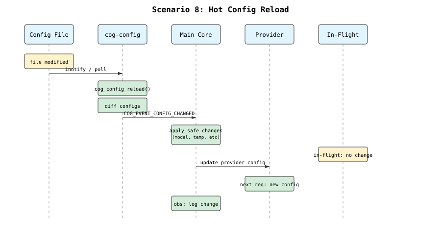

# Scenario 8: Hot Config Reload

## Sequence Diagram

## Header Coverage

| Step | Function | Header | Status |
|------|----------|--------|--------|
| Begin transaction | `cog_config_begin()` | `config.h` | ✅ |
| Set values | `cog_config_set()` | `config.h` | ✅ |
| Commit | `cog_config_commit()` | `config.h` | ✅ |
| Validators | `cog_config_register_validator()` | `config.h` | ✅ |
| Rollback on failure | `cog_config_rollback()` | `config.h` | ✅ |
| Get values | `cog_config_get()` | `config.h` | ✅ |

## Gaps Found → FIXED

1. ✅ **Change notification** — added `COG_EVENT_CONFIG_CHANGED` event kind
2. **Provider registry rebuild** — application handles this via config change event
3. **In-flight request isolation** — documented: in-flight requests are unaffected

## Verdict

✅ Gap fixed. Headers fully cover the flow.
