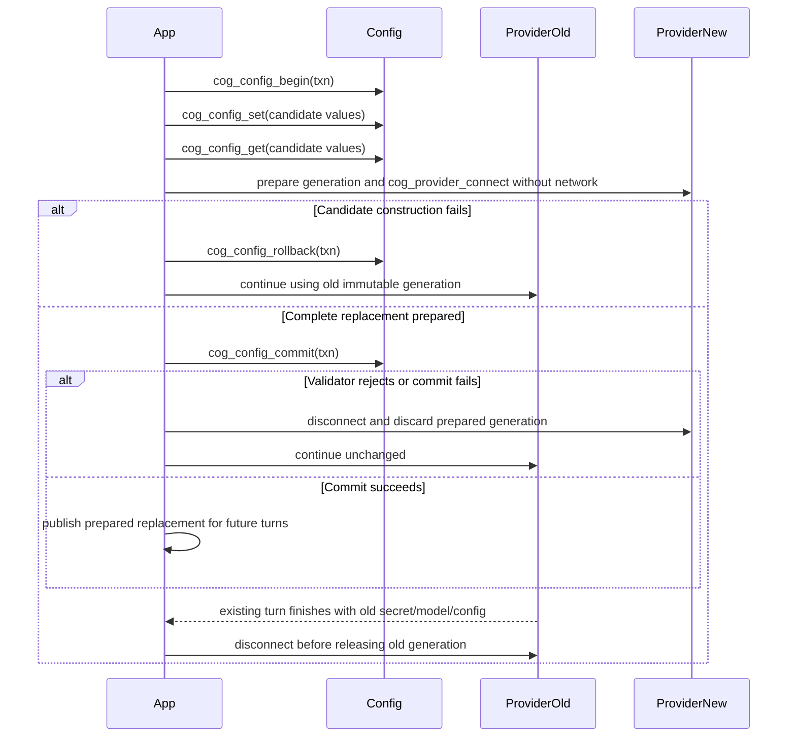

# Scenario 08: Hot config reload with in-flight generation isolation

Stage 14.D pass-2 retrace from public-contract baseline `29b41e8`.
This replaces the earlier schematic SVG as the normative call trace. The SVG is
retained as historical design material and is not current API coverage.

## Sequence diagram

## Exact public-header coverage

Names below are exact declared functions, types, enum members or struct fields;
application-only policy/envelope steps are identified explicitly rather than
presented as library calls. Each header path names the declaring public file.

| Trace step | Exact declaration / member | Declaring header |
|---|---|---|
| Candidate transaction | `cog_config_begin`; `cog_config_set`; `cog_config_commit`; `cog_config_rollback`; `cog_config_register_validator` | [libraries/cog-config/include/cog/config.h](../../libraries/cog-config/include/cog/config.h) |
| Read validated values | `cog_config_get`; `cog_config_list` | [libraries/cog-config/include/cog/config.h](../../libraries/cog-config/include/cog/config.h) |
| Immutable endpoint view | `cog_endpoint_t.generation`; `cog_endpoint_t.implementation_config`; `cog_endpoint_t.api_key`; `cog_endpoint_table_t` | [libraries/cog-provider/include/cog/endpoint.h](../../libraries/cog-provider/include/cog/endpoint.h) |
| Request generation / copied inputs | `cog_provider_request_t.configuration_generation` | [libraries/cog-provider/include/cog/provider_request.h](../../libraries/cog-provider/include/cog/provider_request.h) |
| Independent instance lifetime | `cog_provider_connect`; `cog_provider_send`; `cog_provider_disconnect` | [libraries/cog-provider/include/cog/provider_vtable.h](../../libraries/cog-provider/include/cog/provider_vtable.h) |
| Application notification | `COG_EVENT_CONFIG_CHANGED` | [libraries/cog-core/include/cog/event.h](../../libraries/cog-core/include/cog/event.h) |
| Explicit presence-aware startup inputs | `cog_cli_options_t.explicit_options`; `cog_cli_option_bit_t` | [applications/cog-cli/include/cog_cli/cli.h](../../applications/cog-cli/include/cog_cli/cli.h) |

## Ownership, errors and adversarial branches

- Never mutate a static vtable or an endpoint/model/secret generation borrowed by an in-flight provider.
- Prepare and validate the complete copied endpoint/secret generation from candidate transaction values before commit. Provider connect has no wire effects. Commit failure discards that prepared instance; success publishes it without another fallible constructor step. Do not commit config first and discover afterward that the provider cannot be constructed.
- The old generation remains valid until its final provider disconnects. Secrets are resolved in memory and never copied to config logs, sessions or raw debug fields.
- CLI/environment/config/default precedence must preserve an explicitly supplied zero retry count or ASK policy; absence is not inferred from the numeric value.

## Gap analysis and release amendment

There is no public `cog_config_reload` watcher API. File watching, generation construction and publication are application composition. The shared R-series resolves presence/default combinations and startup behavior; this trace does not invent mutable provider registration.

## Executable evidence and required follow-up

Existing baseline test: [`tests/scenarios/test_08_config_reload.c`](../../tests/scenarios/test_08_config_reload.c). It exists as historical
engine/mock application evidence. It was not rerun in this design-only pass and
does not prove the new mandatory headers, real transport or durable-tool behavior.

Future conformance requirements: Reload during active request, invalid secret/candidate rollback, independent generations, explicit zero/ASK overrides and no old-generation use-after-free.

Header tracing is complete only where the gap analysis says so. Production
implementation and executable scenario migration remain gated by pass 3 and the
independent final review; no passing runtime result is inferred from these tables.

## Pass-3 bounded configuration retrace (E07)

`cog_config_tree_new_ex` reserves aggregate node/string, transaction-identity
and validator limits through `cog_config_limits_t`
([config.h](../../libraries/cog-config/include/cog/config.h)). begin/set/register
never grow storage. Finalized transaction handles retain identity only up to the
configured ceiling; begin then returns LIMIT with no candidate. A rejected commit
may return LIMIT and finalize only its candidate if reset cannot fit; running
configuration and the already published provider generation stay unchanged.
Every config operation, including reads, stays on its owner thread. Delivery J
must test exact pool/identity limits and retain the old generation on each failure.
