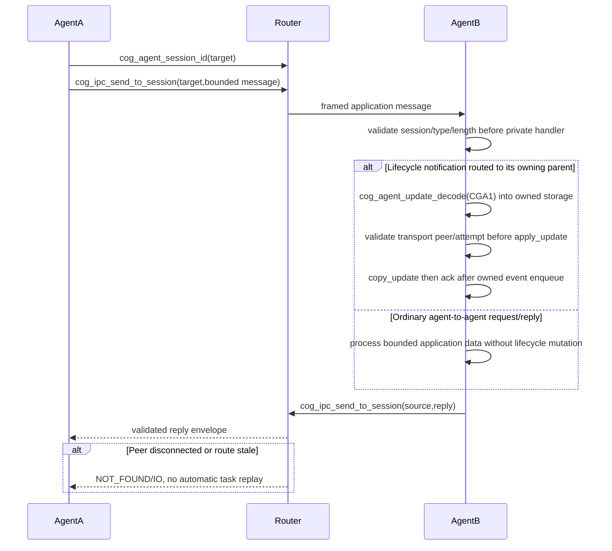

# Scenario 09: Subagent-to-subagent messaging across cores

O9 executable update: the canonical CTest runs actual sibling mailbox tools and
bounded-pressure retry; historical endpoint assertions remain in
`component-subagent_messaging`, with live foreign-group refusal separately in
`component-coordinator-admission`. See the
joined evidence and exact limits (`tix show f63652b`).
The contract/design-pass history below is retained as such.

Stage 14.D pass-2 retrace from public-contract baseline `29b41e8`.
This replaces the earlier schematic SVG as the normative call trace. The SVG is
retained as historical design material and is not current API coverage.

## Sequence diagram



## Exact public-header coverage

Names below are exact declared functions, types, enum members or struct fields;
application-only policy/envelope steps are identified explicitly rather than
presented as library calls. Each header path names the declaring public file.

| Trace step | Exact declaration / member | Declaring header |
|---|---|---|
| Session discovery | `cog_agent_session_id` | [libraries/cog-core/include/cog/agent.h](../../libraries/cog-core/include/cog/agent.h) |
| Route lifecycle | `cog_ipc_register_session`; `cog_ipc_unregister_session`; `cog_ipc_send_to_session` | [libraries/cog-ipc/include/cog/ipc.h](../../libraries/cog-ipc/include/cog/ipc.h) |
| Frame construction / receive | `cog_ipc_message_t`; `cog_ipc_message_new`; `cog_ipc_endpoint_send`; `cog_ipc_endpoint_recv` | [libraries/cog-ipc/include/cog/ipc.h](../../libraries/cog-ipc/include/cog/ipc.h) |
| Application payload event | `cog_event_ipc_t.msg_type`; `cog_event_ipc_t.msg_payload`; `cog_event_ipc_t.msg_payload_len`; `COG_EVENT_IPC_MESSAGE` | [libraries/cog-core/include/cog/event.h](../../libraries/cog-core/include/cog/event.h) |
| Portable lifecycle envelope | `cog_agent_update_encode`; `cog_agent_update_decode` | [libraries/cog-core/include/cog/agent.h](../../libraries/cog-core/include/cog/agent.h) |
| Atomic attempt ingestion | `cog_agent_apply_update`; `cog_agent_update_t.owner_peer`; `cog_agent_update_t.execution_epoch`; `cog_agent_update_t.sequence`; `cog_agent_update_t.status`; `cog_agent_update_t.outcome`; `cog_agent_update_t.data`; `cog_agent_update_t.data_len` | [libraries/cog-core/include/cog/agent.h](../../libraries/cog-core/include/cog/agent.h) |
| Stable notification delivery / release | `cog_agent_copy_update`; `cog_agent_ack_update`; `cog_agent_release` | [libraries/cog-core/include/cog/agent.h](../../libraries/cog-core/include/cog/agent.h) |
| Fair IPC progression | `cog_core_config_t.ipc_peer_capacity`; `cog_core_config_t.ipc_service_quantum`; `cog_core_config_t.service_interval`; `cog_core_run` | [libraries/cog-core/include/cog/core.h](../../libraries/cog-core/include/cog/core.h) |
| Bounded nonblocking frame service | `cog_ipc_endpoint_new_ex`; `cog_ipc_endpoint_config_t.max_frame_bytes`; `cog_ipc_endpoint_config_t.receive_frames`; `cog_ipc_endpoint_config_t.send_frames`; `cog_ipc_endpoint_config_t.service_quantum`; `cog_ipc_endpoint_service` | [libraries/cog-ipc/include/cog/ipc.h](../../libraries/cog-ipc/include/cog/ipc.h) |

## Ownership, errors and adversarial branches

- Every endpoint has constructor-reserved frame queues and bounded nonblocking service. A peer that sends a partial length prefix or stalls halfway through payload retains its own cursor and cannot block unrelated peers. Send OK copies one frame exactly once; retry only AGAIN, which accepted nothing. Receive OVERFLOW reports required bytes and retains the same complete frame across service calls.
- Session routing is a bounded framing/routing primitive, not an authenticated application protocol or proof that a remote execution record was updated.
- Ordinary agent-to-agent message types/payloads are application-defined bounded data under the IPC framing contract; they cannot change lifecycle records or admit tools. A lifecycle subtype instead uses the CGA1 codec and is routed to the owning parent, carrying explicit agent/owner-peer/attempt/sequence/status/outcome and length. Decode is transactional and allocation-free, rejects invalid version/codes/UTF-8/bounds, and never transmits native padding or pointers. Session routing supplies the destination; ingress checks authenticated transport peer and spawned attempt before any record mutation.
- Event payloads are borrowed; copy anything retained past handler execution. Do not queue pointers into an IPC buffer that may be reused.
- Backpressure/disconnect preserves an explicit pending/failed state; it never authorizes duplicate remote effects. Service IPC even while local events remain queued.

## Gap analysis and release amendment

**O09-G1 resolved for lifecycle traffic by pass-2 typed attempt update:** each routed status/result carries its explicit owner peer, attempt epoch and sequence, validated against authenticated IPC peer and the spawned record before apply/copy/ack. General non-effectful application messages remain bounded opaque msg_type/payload under the declared IPC contract; arbitrary message delivery never authorizes a tool or automatic task retry. No private routing or lifecycle API is assumed.

## Executable evidence and required follow-up

Existing baseline test: [`tests/scenarios/test_09_subagent_messaging.c`](../../tests/scenarios/test_09_subagent_messaging.c). It exists as historical
engine/mock application evidence. It was not rerun in this design-only pass and
does not prove the new mandatory headers, real transport or durable-tool behavior.

Future conformance requirements: Public envelope validation, stale route, oversized message, queue backpressure and safe retry of non-effectful messages; child attempt fencing.

Header tracing is complete only where the gap analysis says so. Production
implementation and executable scenario migration remain gated by pass 3 and the
independent final review; no passing runtime result is inferred from these tables.

## Pass-3 IPC ownership retrace (E02)

Core constructor settings `cog_core_config_t.ipc_max_frame_bytes` and
`cog_core_config_t.ipc_payload_bytes` bound admitted frames and queued payload
bytes ([core.h](../../libraries/cog-core/include/cog/core.h)). Reserve an event
slot and owned arena bytes before endpoint receive; if unavailable, consume
nothing and service/dispatch other work. Bytes survive until handler return.
An endpoint-retained frame above the core ceiling closes only that peer with
reported LIMIT, rather than an endless OVERFLOW loop. Accepted endpoint
constructors remain explicit and peer-count-bounded; private intrusive listener
links need no additional public allocation surface. Test just-below/exact/above
frame limits, full arena/full event queue, and caller payload mutation after enqueue.

## Q identity-scope consistency amendment (ee411f9)

A peer number belongs to one listener/fabric, not a process-global registry.
Cross-fabric consumers use `(owning endpoint/fabric, peer_id)`. In the executable
Q fixture, two independent listeners each accept their first peer as ID1 and
register the same session label; routing through listener A reaches only A's
peer, and routing through B reaches only B's peer. Numeric equality never
creates a cross-fabric route. Within each listener, IDs increase without reuse;
uint64 exhaustion returns LIMIT before accepting a new peer. The endpoint
constructor introduces no global mutable identity state. This narrows obsolete
process-wide type prose to the existing single-fabric routing boundary and
changes no function declaration or layout. Independent Q review verifies this
header/trace/fixture consistency amendment before integration.

## Local-agent intent amendment (86f7a3c under bf7a450)

The core queues intent; it does not invoke an application runtime or know a
remote wire protocol. The static application dispatcher consumes these events.
This is a targeted header gap amendment after E, not a new release-gate claim.

```mermaid
sequenceDiagram
    App->>Core: cog_agent_spawn(config,id)
    Core->>Core: reserve record/child/payload and atomically queue SPAWN
    Core-->>App: SUBAGENT_SPAWN typed payload under dispatch lease
    App->>Core: cog_agent_copy_config(id,config,owned bytes,capacity,required)
    App->>Core: cog_agent_is_cancelled(id,cancelled) before effects
    alt local and not cancelled
      App->>Runtime: start copied task with actual nonzero local epoch
    else remote and not cancelled
      App->>Wire: forward copied correlated bounded application protocol
    end
    App->>Core: cog_agent_cancel(id)
    Core-->>App: SUBAGENT_CANCEL leased identity/action
    App->>Runtime: cancel or forward; drain/reap before terminal update
    App->>Core: apply_update; copy_update; enqueue notification; ack_update
    App->>Core: release only after terminal, notification ack and intent leases end
```

| Intent step | Exact public declaration | Declaring header |
|---|---|---|
| Static dispatch convention and leased payload | `COG_EVENT_SUBAGENT_SPAWN`; `COG_EVENT_SUBAGENT_CANCEL`; `cog_event_agent_intent_t.agent_id`; `cog_event_agent_intent_t.execution_epoch`; `cog_event_agent_intent_t.owner_peer`; `cog_event_agent_intent_t.action` | [event.h](../../libraries/cog-core/include/cog/event.h) |
| Copy before deferred work / first update | `cog_agent_copy_config`; `cog_agent_config_t.task`; `cog_agent_config_t.parent_session_id`; `cog_agent_config_t.execution_epoch` | [agent.h](../../libraries/cog-core/include/cog/agent.h) |
| Atomic admission and release lifetime | `cog_agent_spawn`; `cog_agent_cancel`; `cog_agent_is_cancelled`; `cog_agent_release` | [agent.h](../../libraries/cog-core/include/cog/agent.h) |
| Origin and lease unwind | `cog_core_enqueue`; `cog_core_run`; `cog_core_free` | [core.h](../../libraries/cog-core/include/cog/core.h) |

1. **Header pass 1:** append event kinds without renumbering earlier values.
   Core-originated event ID is `(cog_event_id_t)kind`, source_id is agent ID;
   static application rows handle those IDs, which are not globally reserved.
   A pointer-free typed payload carries action and exact ID/epoch/placement.
2. **Targeted trace pass 2:** local epoch=0 resolves to assigned agent ID, so
   copy_config or the spawn event supplies it before the first update. Copy
   OVERFLOW changes required bytes only; successful task/optional-parent bytes
   remain caller-owned after dispatch/release. A remote handler forwards its
   own protocol; arbitrary IPC delivery is not an agent execution grant.
3. **Consistency pass 3:** queue-full spawn leaves no child/record/event/lease
   or output ID; first cancel OVERFLOW changes no state. Repeated admitted
   active cancel is OK without another event, terminal cancel is INVALID_STATE.
   If cancel is admitted before spawn dispatch, the handler checks cancelled
   and starts no effects. Terminal can be applied early, but release still
   refuses queued/in-dispatch intent leases. Lease unwind occurs after every
   dispatch result, including UNHANDLED/handler/transition error. Deferred work
   must copy scalars and strings; destruction never executes queued intents.

The core reserves one spawn and one cancel payload per bounded agent record;
no per-intent allocation, dynamic registry or provider/orchestrator link is added.
Public core_enqueue rejects these origin-controlled kinds with INVALID_ARG,
preventing an unleased forged duplicate. Generic event queues still borrow the
payload pointer, so this does not require a new deep-copy queue policy.

Required bf7a450 executable checks: exact dispatch IDs/action/owner/assigned epoch;
caller task mutation after spawn; config capacity retry before first update; full
queue spawn/cancel rollback; duplicate cancellation; cancel-before-spawn; terminal
release blocked until pending spawn/cancel handlers return (including errors);
owned deferred config after release; no implicit remote wire send. This design
commit supplies declarations/traces only; writer and independent code review
must establish those runtime results before package completion.
