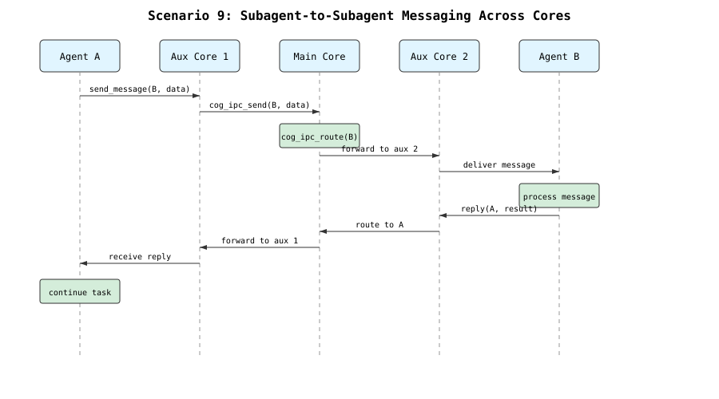

# Scenario 9: Subagent-to-Subagent Messaging Across Cores

## Sequence Diagram

## Header Coverage

| Step | Function | Header | Status |
|------|----------|--------|--------|
| Session routing | `cog_ipc_send_to_session()` | `ipc.h` | ✅ (6k) |
| Register mapping | `cog_ipc_register_session()` | `ipc.h` | ✅ (6k) |
| IPC message event | `COG_EVENT_IPC_MESSAGE` | `event.h` | ✅ (6h) |
| IPC payload | `cog_event_ipc_t` | `event.h` | ✅ (6h) |
| Unregister | `cog_ipc_unregister_session()` | `ipc.h` | ✅ (6k) |

## Gaps Found → FIXED

1. ✅ **Session discovery** — added `cog_agent_session_id()` to `agent.h`
2. **Message deserialization** — `cog_event_ipc_t` carries `msg_type` and `msg_payload`; application interprets based on type
3. **Bidirectional routing** — aux cores register sessions on connect via `cog_ipc_register_session()`

## Verdict

✅ Gap fixed. Headers fully cover the flow.
