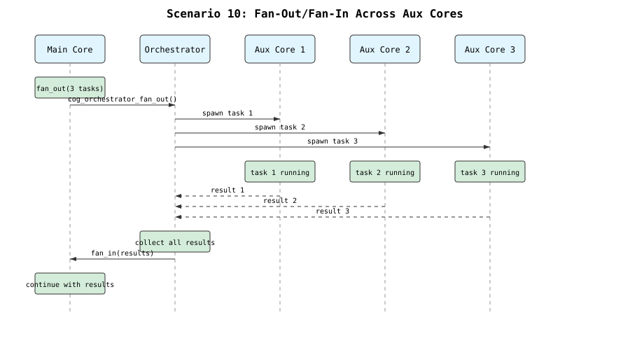

# Scenario 10: Fan-out/Fan-in Across Aux Cores

## Sequence Diagram

## Header Coverage

| Step | Function | Header | Status |
|------|----------|--------|--------|
| Spawn multiple | `cog_agent_spawn()` | `agent.h` | ✅ (6j) |
| Placement | `cog_orchestrator_place()` | `orchestrator.h` | ✅ (6i) |
| Cancel | `cog_agent_cancel()` | `agent.h` | ✅ (6j) |
| Result event | `COG_EVENT_SUBAGENT_RESULT` | `event.h` | ✅ |
| Broadcast cancel | `cog_ipc_broadcast()` | `ipc.h` | ✅ (6k) |

## Gaps Found → ALL FIXED

1. ✅ **Late result handling** — added `cog_agent_is_cancelled()`
2. ✅ **Fan-out grouping** — added `group_id` to `cog_agent_config_t`
3. **Cancellation** — best-effort; handlers check status before processing results

## Verdict

✅ All gaps fixed. Headers fully cover the flow.
