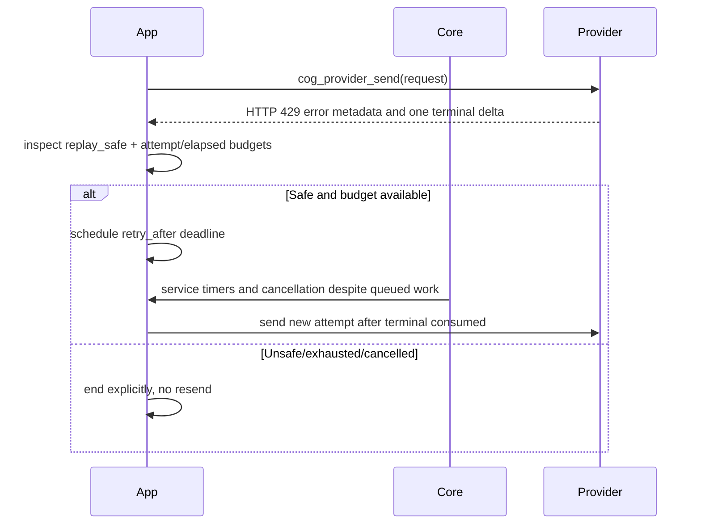

# Scenario 12: Provider rate limit → bounded backoff → queue

Stage 14.D pass-2 retrace from public-contract baseline `29b41e8`.
This replaces the earlier schematic SVG as the normative call trace. The SVG is
retained as historical design material and is not current API coverage.

## Sequence diagram

## Exact public-header coverage

Names below are exact declared functions, types, enum members or struct fields;
application-only policy/envelope steps are identified explicitly rather than
presented as library calls. Each header path names the declaring public file.

| Trace step | Exact declaration / member | Declaring header |
|---|---|---|
| Provider error snapshot | `cog_provider_get_error`; `cog_provider_next` | [libraries/cog-provider/include/cog/provider_vtable.h](../../libraries/cog-provider/include/cog/provider_vtable.h) |
| Retry safety / status | `cog_provider_error_t.http_status`; `cog_provider_error_t.retryable`; `cog_provider_error_t.retry_after_ms`; `cog_provider_error_t.replay_safe`; `cog_provider_error_t.output_accepted` | [libraries/cog-provider/include/cog/provider_request.h](../../libraries/cog-provider/include/cog/provider_request.h) |
| HTTP separate from transport failure | `cog_net_response_t.http_status`; `cog_net_response_t.outcome`; `cog_net_response_t.retry_after_known`; `cog_net_response_t.retry_after_ms` | [libraries/cog-net/include/cog/net.h](../../libraries/cog-net/include/cog/net.h) |
| No net retry layer | `cog_net_config_t.max_retries`; `cog_net_config_t.retry_backoff_ms` | [libraries/cog-net/include/cog/net.h](../../libraries/cog-net/include/cog/net.h) |
| Finite application budget | `cog_cli_options_t.max_retries`; `cog_cli_options_t.max_retry_elapsed_ms`; `cog_cli_options_t.max_turn_ms` | [applications/cog-cli/include/cog_cli/cli.h](../../applications/cog-cli/include/cog_cli/cli.h) |
| Due-deadline service | `cog_service_fn`; `cog_idle_fn`; `cog_core_config_t.service_interval` | [libraries/cog-core/include/cog/core.h](../../libraries/cog-core/include/cog/core.h) |
| Queue notifications | `COG_EVENT_PROVIDER_ERROR`; `COG_EVENT_QUEUE_MSG`; `COG_EVENT_MSG_QUEUED` | [libraries/cog-core/include/cog/event.h](../../libraries/cog-core/include/cog/event.h) |

## Ownership, errors and adversarial branches

- HTTP 429 is a valid HTTP response, not automatically a DNS/TLS failure. Only sanitized classification/header-derived retry metadata crosses the provider error boundary.
- Net retries are disabled. The application permits at most its one configured additional attempt by default, within both elapsed retry and total-turn deadlines.
- Parse/validate Retry-After and cap waits by remaining budget; never sleep inside a handler or let a backoff timer starve behind queued events.
- Cancel during backoff removes retry admission. Accepted output or any executed tool blocks automatic request replay even if the error is marked retryable.

## Gap analysis and release amendment

Backoff scheduling is application-owned and expressed through fair service/deadline hooks; no implicit transport retry is assumed. Presence bits are required to preserve an explicit zero retry override from CLI/programmatic input over configuration.

## Executable evidence and required follow-up

Existing baseline test: [`applications/cog-cli/tests/test_12_rate_limit.c`](../../applications/cog-cli/tests/test_12_rate_limit.c). It exists as historical
engine/mock application evidence. It was not rerun in this design-only pass and
does not prove the new mandatory headers, real transport or durable-tool behavior.

Future conformance requirements: Malformed/unknown Retry-After, explicit zero retries, elapsed exhaustion, queued-message fairness, cancellation before deadline and no double retry layer.

Header tracing is complete only where the gap analysis says so. Production
implementation and executable scenario migration remain gated by pass 3 and the
independent final review; no passing runtime result is inferred from these tables.
