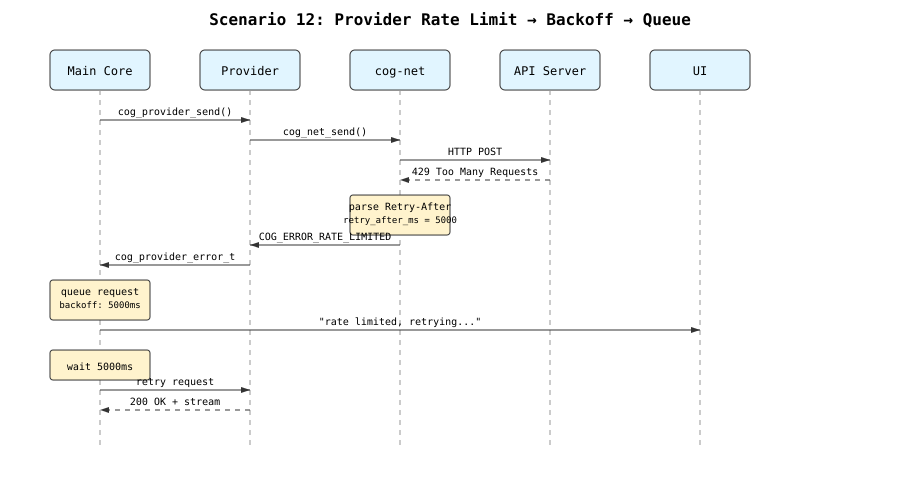

# Scenario 12: Provider Rate Limit → Backoff → Queue

## Sequence Diagram

## Header Coverage

| Step | Function/Event | Header | Status |
|------|---------------|--------|--------|
| Send request | `cog_provider_send()` | `provider_vtable.h` | ✅ |
| HTTP request | `cog_net_request()` | `net.h` | ✅ |
| Error event | `COG_EVENT_PROVIDER_ERROR` | `event.h` | ✅ (6h) |
| Response status | `cog_net_response_t.http_status` | `net.h` | ✅ |
| Retry config | `cog_net_config_t.max_retries` | `net.h` | ✅ |
| Backoff config | `cog_net_config_t.retry_backoff_ms` | `net.h` | ✅ |

## Gaps Found → FIXED

1. ✅ **Retry-After header** — added `headers` field to `cog_net_response_t`
2. ✅ **Rate limit error detail** — added `cog_provider_error_t` with `retryable` flag and `retry_after_ms`
3. **Request queuing** — application manages queuing during backoff
4. **Exponential backoff** — application implements backoff using `retry_after_ms` from error detail

## Verdict

✅ Gaps fixed. Headers fully cover the flow.
