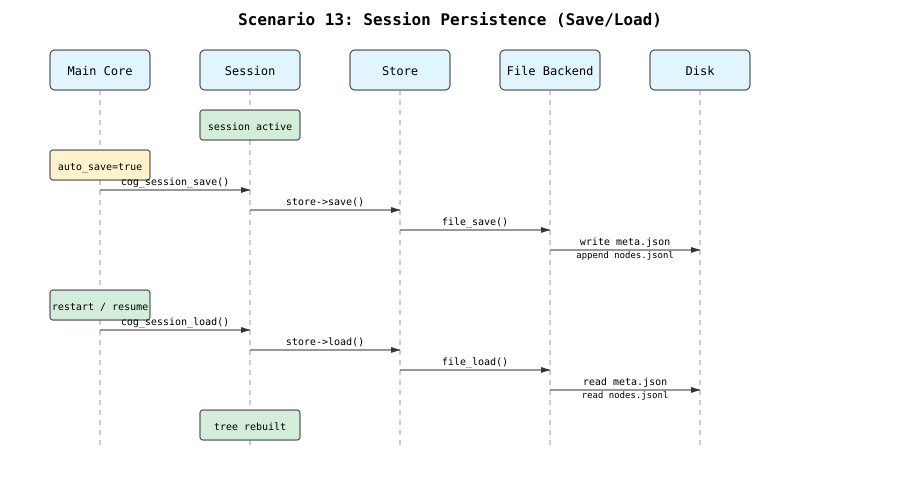

# Scenario 13: Session Persistence (Save/Load)

## Sequence Diagram

## Header Coverage

| Step | Function | Header | Status |
|------|----------|--------|--------|
| Auto-save check | `cog_store_config_t.auto_save` | `session_store.h` | ✅ |
| Save session | `cog_session_save()` | `session.h` | ✅ |
| Store save | `store->save()` | `session_store.h` | ✅ |
| File save | `file_save()` | `session_store.h` | ✅ |
| Load session | `cog_session_load()` | `session.h` | ✅ |
| Store load | `store->load()` | `session_store.h` | ✅ |
| Rebuild tree | `cog_session_deserialize()` | `session.h` | ✅ |

## Gaps Found → FIXED

1. ✅ **`cog_session_save()` / `cog_session_load()`** — declared in `session.h`
2. ✅ **Store vtable** — `cog_store_vtable_t` with save/load/append/delete/list
3. ✅ **File backend** — `cog_store_file_new()` with JSONL format

## Notes

- Auto-save is configurable via `cog_store_config_t.auto_save`
- Default backend is file-based with `meta.json` + `nodes.jsonl`
- Custom backends can be registered via `cog_store_vtable_t`
