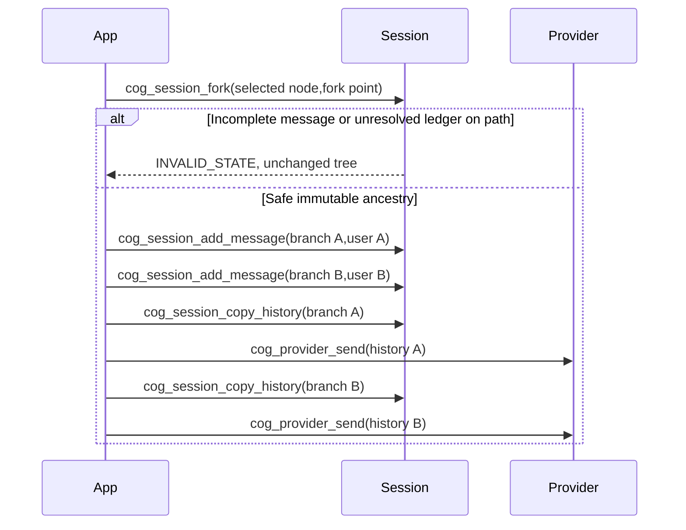

# Scenario 14: Conversation fork and branch isolation

Stage 14.D pass-2 retrace from public-contract baseline `29b41e8`.
This replaces the earlier schematic SVG as the normative call trace. The SVG is
retained as historical design material and is not current API coverage.

## Sequence diagram

## Exact public-header coverage

Names below are exact declared functions, types, enum members or struct fields;
application-only policy/envelope steps are identified explicitly rather than
presented as library calls. Each header path names the declaring public file.

| Trace step | Exact declaration / member | Declaring header |
|---|---|---|
| Fork / ancestry | `cog_session_fork`; `cog_node_parent`; `cog_node_first_child`; `cog_node_next_sibling` | [libraries/cog-core/include/cog/session.h](../../libraries/cog-core/include/cog/session.h) |
| Explicit branch insertion | `cog_session_add_message`; `cog_session_node_t` | [libraries/cog-core/include/cog/session.h](../../libraries/cog-core/include/cog/session.h) |
| Caller-array history | `cog_session_copy_history` | [libraries/cog-core/include/cog/session.h](../../libraries/cog-core/include/cog/session.h) |
| Structured continuation / result identity | `cog_message_t.tool_calls`; `cog_message_t.tool_call_id`; `cog_message_t.opaque`; `cog_message_t.status` | [libraries/cog-core/include/cog/message.h](../../libraries/cog-core/include/cog/message.h) |
| Branch-local ledger | `cog_session_tool_state`; `cog_session_tool_transition` | [libraries/cog-core/include/cog/session.h](../../libraries/cog-core/include/cog/session.h) |
| Independent provider input copy | `cog_provider_send` | [libraries/cog-provider/include/cog/provider_vtable.h](../../libraries/cog-provider/include/cog/provider_vtable.h) |

## Ownership, errors and adversarial branches

- Fork shares immutable ancestors. New user/assistant/tool nodes belong to their selected branch; a call-ID string alone is not a global execution key.
- `(assistant node ID, call ID)` identifies execution. Forking never repeats completed ancestor effects, and incomplete/unresolved paths are refused.
- Copy-history capacity overflow reports required entries transactionally; it does not truncate old context. Nested message views remain session-owned until mutation, and provider send must copy them before returning.
- Opaque continuation bytes and usage-known flags survive both branches exactly. Selecting branch A must never include branch B's result or provider metadata.

## Gap analysis and release amendment

The public tree/history/ledger contracts express branch isolation; cross-process migration and safe durable resume are separate traces. Existing baseline fork tests do not prove structured opaque/ledger behavior after the new layout.

## Executable evidence and required follow-up

Existing baseline test: [`applications/cog-cli/tests/test_14_conversation_fork.c`](../../applications/cog-cli/tests/test_14_conversation_fork.c). It exists as historical
engine/mock application evidence. It was not rerun in this design-only pass and
does not prove the new mandatory headers, real transport or durable-tool behavior.

Future conformance requirements: Fork refusal on incomplete/STARTED/INDETERMINATE path; branch-specific tool ID reuse; opaque copy/persistence; required-count retry and no ancestor effect replay.

Header tracing is complete only where the gap analysis says so. Production
implementation and executable scenario migration remain gated by pass 3 and the
independent final review; no passing runtime result is inferred from these tables.

## Independent final-review revision: active path and unstarted work (E09/E11)

While any call/result is unresolved, `cog_session_fork` and arbitrary-parent
`cog_session_add_message` cannot switch to a safe sibling or ancestor. Only a
matching TOOL result at the active leaf, or atomic reconcile_tool, may extend
that path. REPLAY load rejects off-active unresolved state; no recovery target
can be stranded. An incomplete text-only turn without tool ledger still permits
an explicit fork from its safe ancestor. Crash oracle: create a safe sibling,
then save active STARTED; attempted sibling switch must fail before the crash,
and restored INDETERMINATE remains reachable for reconciliation.

PROPOSED is unresolved lifecycle state but proves no STARTED admission happened:
normal guard acquisition may resume that current policy/denial phase. It cannot
start unrelated model/user/branch work. Crashed STARTED becomes INDETERMINATE and
requires recovery. Cancelled unstarted proposals receive identified no-effect
DENIED results; they are never mistaken for uncertain executed effects. Test the
crash before STARTED save and cancel-after-proposal boundaries with zero effects.

## G implementation clarification: explicit shared fork points

`cog_session_fork` returns the same immutable shared node, preserving all tool
execution identity. A selected leaf may become active. Selecting a nonleaf
preserves the existing active leaf: `cog_session_add_message(parent=fork_point)`
creates and selects the new divergent child; `append` continues the active leaf.
An immediate snapshot after a nonleaf fork retains a valid active leaf. No node,
call identity, payload allocation or ledger slot is copied by fork.

Targeted header passes: (1) initial fork contract checked against identity and
snapshot invariants; (2) trace nonleaf fork -> snapshot -> explicit child ->
branch history, plus completed assistant-call fork with zero repeated effects;
(3) consistency review against active-leaf restore, unresolved branch refusal and
allocation-free constructor capacities. Independent G review remains required.
