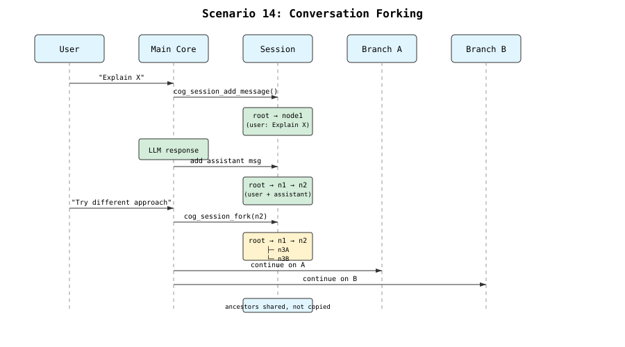

# Scenario 14: Conversation Forking

## Sequence Diagram

## Header Coverage

| Step | Function | Header | Status |
|------|----------|--------|--------|
| Add user message | `cog_session_add_message()` | `session.h` | ✅ |
| Add assistant message | `cog_session_add_message()` | `session.h` | ✅ |
| Fork at node | `cog_session_fork()` | `session.h` | ✅ |
| Get branch A history | `cog_session_get_history(nodeA)` | `session.h` | ✅ |
| Get branch B history | `cog_session_get_history(nodeB)` | `session.h` | ✅ |
| Shared ancestors | tree structure | `session.h` | ✅ |

## Gaps Found → FIXED

1. ✅ **`cog_session_fork()`** — declared in `session.h`
2. ✅ **Tree structure** — `cog_session_node_t` with parent/children
3. ✅ **History building** — `cog_session_get_history()` walks from leaf to root

## Notes

- Forking shares immutable ancestors (no copying)
- Each branch has independent timing and billing
- `cog_session_get_history()` returns messages from root to specified node
- Forked branches can be continued independently
