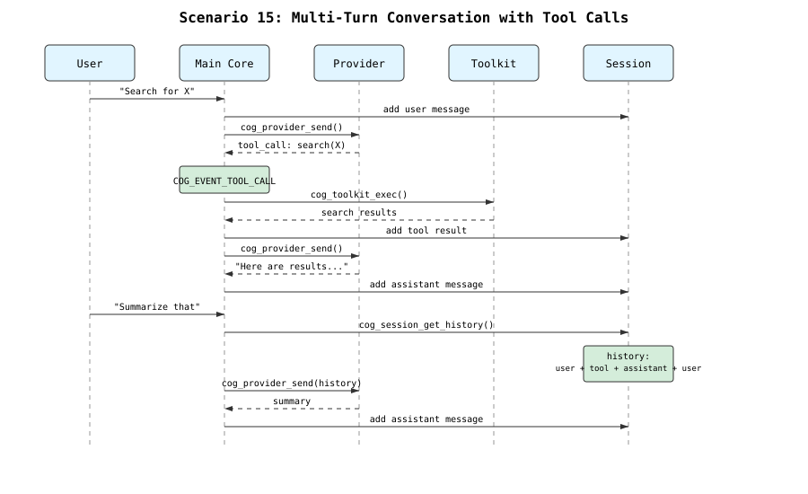

# Scenario 15: Multi-Turn Conversation with Tool Calls

## Sequence Diagram

## Header Coverage

| Step | Function | Header | Status |
|------|----------|--------|--------|
| Add user message | `cog_session_add_message()` | `session.h` | ✅ |
| Send to provider | `cog_provider_send()` | `provider_vtable.h` | ✅ |
| Tool call event | `COG_EVENT_TOOL_CALL` | `event.h` | ✅ |
| Execute tool | `cog_toolkit_exec()` | `toolkit_exec.h` | ✅ |
| Add tool result | `cog_session_add_message()` | `session.h` | ✅ |
| Get history | `cog_session_get_history()` | `session.h` | ✅ |
| Multi-turn send | `cog_provider_send(history)` | `provider_vtable.h` | ✅ |

## Gaps Found → FIXED

1. ✅ **Tool result in session** — `COG_MESSAGE_ROLE_TOOL` in `message.h`
2. ✅ **History includes tools** — `cog_session_get_history()` returns all messages
3. ✅ **Multi-turn flow** — provider receives full history including tool results

## Notes

- Tool calls are stored in the session tree as `COG_MESSAGE_ROLE_TOOL`
- History includes: user → assistant(tool_call) → tool(result) → assistant(response)
- Provider receives full conversation context on each turn
- Tool results are preserved in raw provider data
