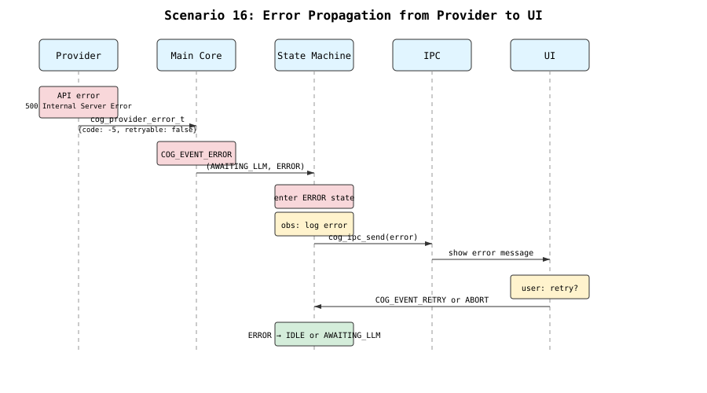

# Scenario 16: Error Propagation from Provider to UI

## Sequence Diagram

## Header Coverage

| Step | Function | Header | Status |
|------|----------|--------|--------|
| Provider error | `cog_provider_error_t` | `provider_request.h` | ✅ |
| Error event | `COG_EVENT_ERROR` | `event.h` | ✅ |
| State machine error | `(AWAITING_LLM, ERROR)` | `state.h` | ✅ |
| Log error | `cog_obs_log_error()` | `obs.h` | ✅ |
| Notify UI | `cog_ipc_send(error)` | `ipc.h` | ✅ |
| User retry/abort | `COG_EVENT_RETRY` / `COG_EVENT_ABORT` | `event.h` | ✅ |

## Gaps Found → FIXED

1. ✅ **`COG_EVENT_ERROR`** — declared in `event.h`
2. ✅ **Error state transition** — state machine handles `(AWAITING_LLM, ERROR)`
3. ✅ **Retry/abort events** — `COG_EVENT_RETRY` and `COG_EVENT_ABORT` in `event.h`

## Notes

- Provider errors include: result code, HTTP status, retryable flag, retry_after_ms
- Non-retryable errors transition to ERROR state
- User can retry (back to AWAITING_LLM) or abort (back to IDLE)
- All errors are logged via cog-obs
