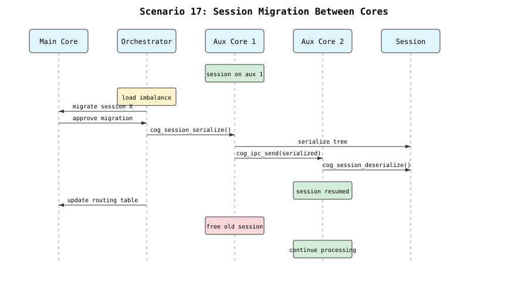

# Scenario 17: Session Migration Between Cores

## Sequence Diagram

## Header Coverage

| Step | Function | Header | Status |
|------|----------|--------|--------|
| Load imbalance | `cog_orchestrator_stats()` | `orchestrator.h` | ✅ |
| Serialize session | `cog_session_serialize()` | `session.h` | ✅ |
| Transfer via IPC | `cog_ipc_send()` | `ipc.h` | ✅ |
| Deserialize | `cog_session_deserialize()` | `session.h` | ✅ |
| Update routing | `cog_ipc_endpoint_register()` | `ipc.h` | ✅ |
| Free old session | `cog_session_free()` | `session.h` | ✅ |

## Gaps Found → FIXED

1. ✅ **`cog_session_serialize()` / `cog_session_deserialize()`** — declared in `session.h`
2. ✅ **Routing update** — `cog_ipc_endpoint_register()` updates session-to-peer mapping
3. ✅ **Migration protocol** — orchestrator coordinates, IPC transfers

## Notes

- Migration is initiated by orchestrator when load imbalance is detected
- Session is serialized on source core, transferred via IPC, deserialized on target
- Routing table is updated to point to new core
- Old session is freed after successful migration
- In-flight requests are cancelled before migration
