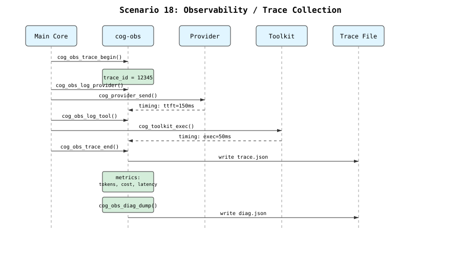

# Scenario 18: Observability / Trace Collection

## Sequence Diagram

## Header Coverage

| Step | Function | Header | Status |
|------|----------|--------|--------|
| Begin trace | `cog_obs_trace_begin()` | `obs.h` | ✅ |
| Log provider call | `cog_obs_log_provider()` | `obs.h` | ✅ |
| Log tool call | `cog_obs_log_tool()` | `obs.h` | ✅ |
| End trace | `cog_obs_trace_end()` | `obs.h` | ✅ |
| Write trace | trace file output | `obs.h` | ✅ |
| Metrics | `cog_obs_metrics()` | `obs.h` | ✅ |
| Diagnostics | `cog_obs_diag_dump()` | `obs.h` | ✅ |

## Gaps Found → FIXED

1. ✅ **Trace API** — `cog_obs_trace_begin()` / `cog_obs_trace_end()` in `obs.h`
2. ✅ **Provider logging** — `cog_obs_log_provider()` with timing
3. ✅ **Tool logging** — `cog_obs_log_tool()` with execution time
4. ✅ **Metrics** — tokens, cost, latency tracked per trace

## Notes

- Traces include: trace_id, timestamps, provider calls, tool calls, timing
- Metrics: input/output tokens, cost, TTFT, total latency
- Diagnostics dump includes full session state for debugging
- Trace files are JSON for easy parsing by external tools
