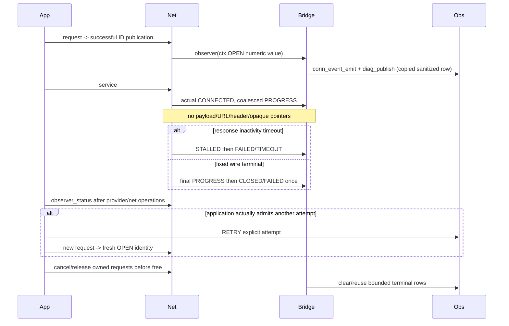

# Scenario 19: Connection diagnostics and event stream

Stage 14.D pass-2 retrace from public-contract baseline `29b41e8`.
This replaces the earlier schematic SVG as the normative call trace. The SVG is
retained as historical design material and is not current API coverage.

## Sequence diagram

## Exact public-header coverage

Names below are exact declared functions, types, enum members or struct fields;
application-only policy/envelope steps are identified explicitly rather than
presented as library calls. Each header path names the declaring public file.

| Trace step | Exact declaration / member | Declaring header |
|---|---|---|
| Numeric source and callback | `cog_net_config_t.observer`; `observer_user`; `cog_net_observer_fn`; `cog_net_observation_t` | [net.h](../../libraries/cog-net/include/cog/net.h) |
| Actual lifecycle / failure status | `cog_net_request`; `cog_net_service`; `cog_net_cancel`; `cog_net_request_release`; `cog_net_observer_status` | [net.h](../../libraries/cog-net/include/cog/net.h) |
| Configured event callback | `cog_obs_config_t.conn_event_sink`; `cog_obs_config_t.conn_event_user`; `cog_obs_conn_event_sink_fn` | [libraries/cog-obs/include/cog/obs.h](../../libraries/cog-obs/include/cog/obs.h) |
| Emit immutable event | `cog_obs_conn_event_emit`; `cog_obs_conn_event_t` | [libraries/cog-obs/include/cog/obs.h](../../libraries/cog-obs/include/cog/obs.h) |
| Lifecycle kinds | `COG_OBS_CONN_EVENT_OPEN`; `COG_OBS_CONN_EVENT_CONNECTED`; `COG_OBS_CONN_EVENT_PROGRESS`; `COG_OBS_CONN_EVENT_STALLED`; `COG_OBS_CONN_EVENT_RETRY`; `COG_OBS_CONN_EVENT_CLOSED`; `COG_OBS_CONN_EVENT_FAILED` | [libraries/cog-obs/include/cog/obs.h](../../libraries/cog-obs/include/cog/obs.h) |
| Identity and counters | `cog_obs_conn_event_t.conn_id`; `cog_obs_conn_event_t.session_id`; `cog_obs_conn_event_t.endpoint`; `cog_obs_conn_event_t.provider`; `cog_obs_conn_event_t.model`; `cog_obs_conn_event_t.bytes_in_delta`; `cog_obs_conn_event_t.bytes_out_delta`; `cog_obs_conn_event_t.bytes_in_total`; `cog_obs_conn_event_t.bytes_out_total`; `cog_obs_conn_event_t.retry_attempt`; `cog_obs_conn_event_t.http_status` | [libraries/cog-obs/include/cog/obs.h](../../libraries/cog-obs/include/cog/obs.h) |
| Query snapshots | `cog_obs_diag_publish`; `cog_obs_diag_clear`; `cog_obs_diag_count_state` | [libraries/cog-obs/include/cog/obs.h](../../libraries/cog-obs/include/cog/obs.h) |
| HTTP/transport distinction | `cog_net_response_t.http_status`; `cog_net_response_t.outcome`; `cog_net_response_t.error_kind` | [libraries/cog-net/include/cog/net.h](../../libraries/cog-net/include/cog/net.h) |

## Ownership, errors and adversarial branches

- One connection/request identity anchors counters; deltas and totals must agree. New admitted attempts carry explicit retry identity rather than silently reusing accepted stream effects.
- Event pointers and string data are borrowed for the callback. Observers copy anything retained and cap table/retention size.
- Sinks run on the owner/calling thread; they must not block core service. No GUI implementation or transport worker thread is required by this diagnostic contract.
- A 429 has an HTTP status with transport outcome OK; DNS/TLS/connect failures carry separate transport classification. Sanitize endpoint labels rather than expose credential query/userinfo.
- Emitting RETRY records an application-admitted attempt; it does not mean cog-net autonomously retries.

## Gap analysis and release amendment

Declared diagnostic events cover the observer interface. The release defers GUI creation; this original GUI-table scenario now traces a generic consumer without adding a GUI requirement. Runtime connection-event ordering must still be proven after the transport implementation migrates.

## Executable evidence and required follow-up

Existing baseline test: [`applications/cog-cli/tests/test_19_connection_events.c`](../../applications/cog-cli/tests/test_19_connection_events.c). It exists as historical
engine/mock application evidence. It was not rerun in this design-only pass and
does not prove the new mandatory headers, real transport or durable-tool behavior.

Future conformance requirements: Real transport event ordering, HTTP vs transport failures, callback lifetime/copy, delta-total consistency, slow consumer bounds and no credentials in endpoint labels.

Header tracing is complete only where the gap analysis says so. Production
implementation and executable scenario migration remain gated by pass 3 and the
independent final review; no passing runtime result is inferred from these tables.

## Runtime observability amendment, pass 1

Design `d32fafd` starts from main8c68b4a after K/L. Generic obs APIs are
implemented but the scenario tests still manually emit observations. The
[dedicated runtime contract](../REAL_CLIENT_OBSERVABILITY_CONTRACTS.md) defines
the minimal production bridge; net.h supplies a numeric constructor-borrowed
observer and checked latched status, with no payload/URL/secret pointers.
Implementation and actual-path oracles are delivery `b64ee7c`, serialized after
R12. No runtime passing claim follows from this header amendment.

## Runtime pass 2: concrete production bridge

The net callback supplies only actual numeric facts. The host bridge assigns
monotonic callback timestamps, copied safe labels, globally distinct obs IDs and
pinned application attempt/generation scope. HTTP429 CLOSED/OK stays distinct
from provider failure and later admitted RETRY. Captured completion wins cancel
even before retained terminal publication; an active release flushes progress and
ABORTED once. The existing body selector/ack is never used to collect telemetry.
A failed callback latches separately and is not retried; app admission checks it
and joins cleanup. Context free ends the whole observation domain without a
callback; observable terminal evidence uses explicit cancel/release before free.
The dedicated contract traces15 success/failure/lifetime cases and actual-path
required oracles. Existing hand-emitted test19 remains component-only evidence.
