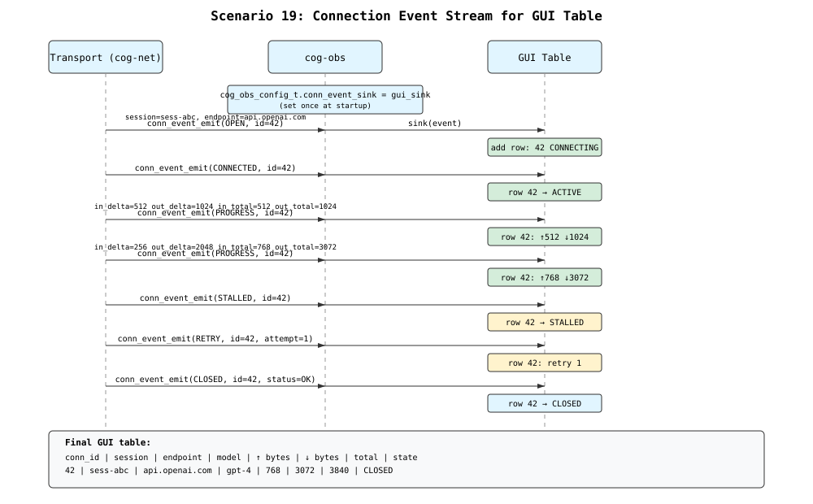

# Scenario 19: Connection Event Stream for GUI Table

## Sequence Diagram



## Purpose

A GUI wants a live table where each row is one logical upstream connection:

| conn_id | session | endpoint | model | ↑ bytes | ↓ bytes | total | state |
|---------|---------|----------|-------|---------|---------|-------|-------|
| 42 | sess-abc | api.openai.com | gpt-4 | 1.2k | 8.4k | 9.6k | ACTIVE |
| 43 | sess-def | api.anthropic.com | claude-3 | 800 | 12.1k | 12.9k | ACTIVE |
| 44 | sess-abc | api.openai.com | gpt-4 | 1.1k | 3.2k | 4.3k | STALLED |

The transport emits a stream of `cog_obs_conn_event_t` events; the GUI
accumulates them into rows keyed by `conn_id`.

## Event Flow

```
Transport (cog-net)              cog-obs                     GUI
       │                            │                          │
       │ cog_obs_conn_event_emit()  │                          │
       │ {OPEN, id=42, endpoint}    │                          │
       │───────────────────────────>│                          │
       │                            │ conn_event_sink(event)   │
       │                            │─────────────────────────>│
       │                            │                          │ add row 42
       │                            │                          │
       │ {CONNECTED, id=42}         │                          │
       │───────────────────────────>│─────────────────────────>│
       │                            │                          │ row 42: ACTIVE
       │                            │                          │
       │ {PROGRESS, id=42, in=512,  │                          │
       │  out=1024, total_in=512,   │                          │
       │  total_out=1024}           │                          │
       │───────────────────────────>│─────────────────────────>│
       │                            │                          │ row 42: ↑512 ↓1024
       │                            │                          │
       │ {STALLED, id=42}           │                          │
       │───────────────────────────>│─────────────────────────>│
       │                            │                          │ row 42: STALLED
       │                            │                          │
       │ {RETRY, id=42, attempt=1}  │                          │
       │───────────────────────────>│─────────────────────────>│
       │                            │                          │ row 42: retry 1
       │                            │                          │
       │ {CLOSED, id=42, status=OK} │                          │
       │───────────────────────────>│─────────────────────────>│
       │                            │                          │ row 42: CLOSED
```

## Header Coverage

| Step | Function | Header | Status |
|------|----------|--------|--------|
| Configure sink | `cog_obs_config_t.conn_event_sink` | `obs.h` | ✅ |
| Emit OPEN | `cog_obs_conn_event_emit(OPEN)` | `obs.h` | ✅ |
| Emit CONNECTED | `cog_obs_conn_event_emit(CONNECTED)` | `obs.h` | ✅ |
| Emit PROGRESS | `cog_obs_conn_event_emit(PROGRESS)` | `obs.h` | ✅ |
| Byte deltas | `bytes_in_delta`, `bytes_out_delta` | `obs.h` | ✅ |
| Byte totals | `bytes_in_total`, `bytes_out_total` | `obs.h` | ✅ |
| Session linkage | `session_id` field | `obs.h` | ✅ |
| Endpoint info | `endpoint`, `provider`, `model` | `obs.h` | ✅ |
| Emit STALLED | `cog_obs_conn_event_emit(STALLED)` | `obs.h` | ✅ |
| Emit RETRY | `cog_obs_conn_event_emit(RETRY)` | `obs.h` | ✅ |
| Emit CLOSED | `cog_obs_conn_event_emit(CLOSED)` | `obs.h` | ✅ |
| Emit FAILED | `cog_obs_conn_event_emit(FAILED)` | `obs.h` | ✅ |
| HTTP status | `http_status` field | `obs.h` | ✅ |

## Event Kinds

| Kind | When | GUI Action |
|------|------|------------|
| OPEN | Connection attempt starts | Add row |
| CONNECTED | TLS + HTTP established | Row → ACTIVE |
| PROGRESS | Bytes transferred (throttled) | Update byte counters |
| STALLED | No progress within threshold | Row → STALLED |
| RETRY | Retry attempt started | Show retry count |
| CLOSED | Connection closed cleanly | Row → CLOSED |
| FAILED | Connection failed | Row → FAILED + error |

## Notes

- Events carry **both deltas and totals** so the GUI can show per-interval rates and cumulative totals
- `session_id` links a connection to its parent conversation for filtering
- `endpoint`, `provider`, `model` identify the upstream target
- Events are emitted on the transport thread; the sink must not block
- A GUI typically throttles PROGRESS events to 1–4 Hz per connection
- Closed/failed rows can be pruned after a retention period
