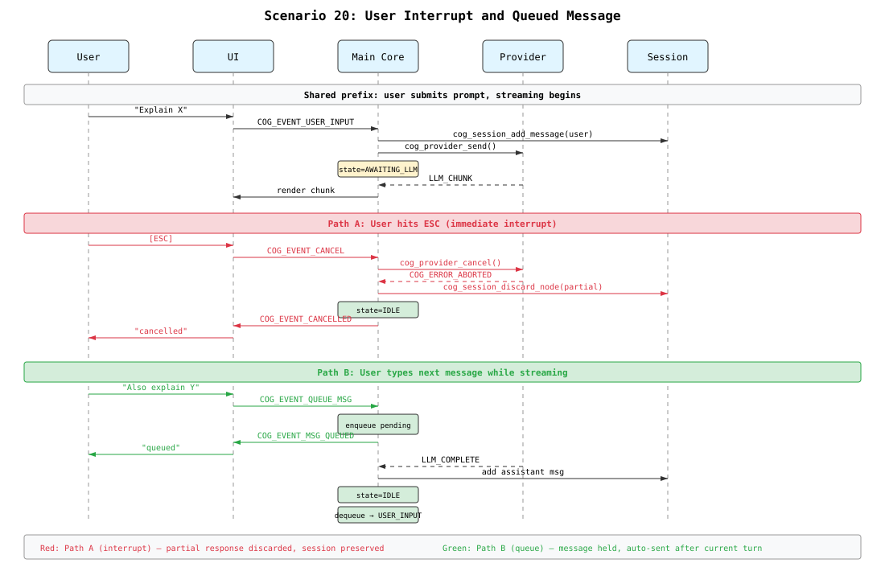

# Scenario 20: User Interrupt and Queued Message

## Sequence Diagram



## Overview

The user submits a prompt, the LLM starts streaming a response, and then
the user either:

- **(a) Interrupts immediately** — cancels the in-flight request, discards
  the partial response, returns to IDLE
- **(b) Queues a message** — lets the current response finish, then sends
  the queued message as the next turn

Both paths must preserve session consistency: no orphaned nodes, no
corrupted history, no leaked provider resources.

---

## Path A: Immediate Interrupt

```
User                UI                  Main Core             Provider           Session
 │                   │                       │                     │                 │
 │ "Explain X"       │                       │                     │                 │
 │──────────────────>│                       │                     │                 │
 │                   │ COG_EVENT_USER_INPUT  │                     │                 │
 │                   │──────────────────────>│                     │                 │
 │                   │                       │ add user msg        │                 │
 │                   │                       │────────────────────>│                 │
 │                   │                       │                     │                 │
 │                   │                       │ cog_provider_send() │                 │
 │                   │                       │────────────────────>│                 │
 │                   │                       │                     │                 │
 │                   │                       │ state=AWAITING_LLM  │                 │
 │                   │                       │                     │                 │
 │                   │                       │   ... streaming ... │                 │
 │                   │<──────────────────────│ COG_EVENT_LLM_CHUNK │                 │
 │                   │                       │                     │                 │
 │ [user hits ESC]   │                       │                     │                 │
 │──────────────────>│                       │                     │                 │
 │                   │ COG_EVENT_CANCEL      │                     │                 │
 │                   │──────────────────────>│                     │                 │
 │                   │                       │                     │                 │
 │                   │                       │ cog_provider_cancel()                 │
 │                   │                       │────────────────────>│                 │
 │                   │                       │                     │ abort stream    │
 │                   │                       │<────────────────────│ COG_ERROR_ABORTED
 │                   │                       │                     │                 │
 │                   │                       │ discard partial     │                 │
 │                   │                       │ response node       │                 │
 │                   │                       │                     │                 │
 │                   │                       │ state=IDLE          │                 │
 │                   │<──────────────────────│ COG_EVENT_CANCELLED │                 │
 │ cancelled         │                       │                     │                 │
 │<──────────────────│                       │                     │                 │
 │                   │                       │                     │                 │
 │                   │                       │ [session tree:      │                 │
 │                   │                       │  user msg preserved,│                 │
 │                   │                       │  no assistant node] │                 │
```

### Path A Header Coverage

| Step | Function | Header | Status |
|------|----------|--------|--------|
| User submits | `COG_EVENT_USER_INPUT` | `event.h` | ✅ |
| Add user message | `cog_session_add_message()` | `session.h` | ✅ |
| Send to provider | `cog_provider_send()` | `provider_vtable.h` | ✅ |
| State transition | `(IDLE, USER_INPUT) → AWAITING_LLM` | `state.h` | ✅ |
| Stream chunk | `COG_EVENT_LLM_CHUNK` | `event.h` | ✅ |
| User cancels | `COG_EVENT_CANCEL` | `event.h` | ✅ |
| Cancel provider | `cog_provider_cancel()` | `provider_vtable.h` | ✅ |
| Provider aborted | `COG_ERROR_ABORTED` | `result.h` | ✅ |
| Discard partial | `cog_session_discard_node()` | `session.h` | ✅ |
| Cancelled event | `COG_EVENT_CANCELLED` | `event.h` | ✅ |
| State transition | `(AWAITING_LLM, CANCEL) → IDLE` | `state.h` | ✅ |

---

## Path B: Queue Message for Next Turn

```
User                UI                  Main Core             Provider           Session
 │                   │                       │                     │                 │
 │ "Explain X"       │                       │                     │                 │
 │──────────────────>│                       │                     │                 │
 │                   │ COG_EVENT_USER_INPUT  │                     │                 │
 │                   │──────────────────────>│                     │                 │
 │                   │                       │ ... streaming ...   │                 │
 │                   │                       │                     │                 │
 │ "Also explain Y"  │                       │                     │                 │
 │ [user types while │                       │                     │                 │
 │  streaming]       │                       │                     │                 │
 │──────────────────>│                       │                     │                 │
 │                   │ COG_EVENT_QUEUE_MSG   │                     │                 │
 │                   │──────────────────────>│                     │                 │
 │                   │                       │                     │                 │
 │                   │                       │ enqueue in pending  │                 │
 │                   │                       │ queue (session-     │                 │
 │                   │                       │ scoped FIFO)        │                 │
 │                   │                       │                     │                 │
 │                   │<──────────────────────│ COG_EVENT_MSG_QUEUED│                 │
 │ "queued"          │                       │                     │                 │
 │<──────────────────│                       │                     │                 │
 │                   │                       │                     │                 │
 │                   │                       │   ... streaming     │                 │
 │                   │                       │    completes ...    │                 │
 │                   │                       │                     │                 │
 │                   │                       │ COG_EVENT_LLM_COMPLETE                │
 │                   │                       │ add assistant msg   │                 │
 │                   │                       │ state=IDLE          │                 │
 │                   │                       │                     │                 │
 │                   │                       │ dequeue pending msg │                 │
 │                   │                       │ COG_EVENT_USER_INPUT│                 │
 │                   │                       │ (auto-injected)     │                 │
 │                   │                       │                     │                 │
 │                   │                       │ add user msg        │                 │
 │                   │                       │ cog_provider_send() │                 │
 │                   │                       │ state=AWAITING_LLM  │                 │
 │                   │                       │                     │                 │
 │                   │<──────────────────────│ COG_EVENT_LLM_CHUNK │                 │
 │ sees response     │                       │                     │                 │
 │<──────────────────│                       │                     │                 │
```

### Path B Header Coverage

| Step | Function | Header | Status |
|------|----------|--------|--------|
| Queue message | `COG_EVENT_QUEUE_MSG` | `event.h` | ✅ |
| Enqueue pending | `cog_core_queue_message()` | `core.h` | ✅ |
| Queued ack | `COG_EVENT_MSG_QUEUED` | `event.h` | ✅ |
| LLM complete | `COG_EVENT_LLM_COMPLETE` | `event.h` | ✅ |
| Add assistant msg | `cog_session_add_message()` | `session.h` | ✅ |
| Dequeue pending | `cog_core_dequeue_message()` | `core.h` | ✅ |
| Auto-inject | `COG_EVENT_USER_INPUT` (re-enqueued) | `event.h` | ✅ |
| Next turn | `cog_provider_send()` | `provider_vtable.h` | ✅ |

---

## Gaps Found → FIXED

### 1. ✅ `cog_session_discard_node()` — added to `session.h`

When the user cancels mid-stream, the partial assistant response node
must be removed from the session tree. Without this, cancelled turns
leave orphaned nodes with incomplete data.

**Proposed signature:**
```c
cog_result_t cog_session_discard_node(cog_session_t *session,
                                       cog_session_node_t *node);
```

**Contract:**
- Only leaf nodes can be discarded
- The node must have role `COG_MESSAGE_ROLE_ASSISTANT`
- Parent's child list is updated
- Node's memory is freed
- Returns `COG_ERROR_INVALID_STATE` if node has children

### 2. ✅ `COG_EVENT_CANCELLED` — added to `event.h`

The core needs to notify the UI that cancellation completed. Without
this, the UI doesn't know when to re-enable input.

**Proposed:** add `COG_EVENT_CANCELLED` to `cog_event_kind_t`

### 3. ✅ `COG_EVENT_QUEUE_MSG` — added to `event.h`

User wants to queue a message while streaming. The core holds it in
a session-scoped FIFO and auto-injects it when the current turn ends.

**Proposed:** add `COG_EVENT_QUEUE_MSG` to `cog_event_kind_t`

### 4. ✅ `COG_EVENT_MSG_QUEUED` — added to `event.h`

Acknowledge to the UI that the message was queued.

**Proposed:** add `COG_EVENT_MSG_QUEUED` to `cog_event_kind_t`

### 5. ✅ `cog_core_queue_message()` / `cog_core_dequeue_message()` — added to `core.h`

Session-scoped pending message queue.

**Proposed signatures:**
```c
cog_result_t cog_core_queue_message(cog_core_t *core,
                                     const char *session_id,
                                     const char *text,
                                     size_t text_len);

cog_result_t cog_core_dequeue_message(cog_core_t *core,
                                       const char *session_id,
                                       char *out_buf,
                                       size_t buf_capacity,
                                       size_t *out_len);
```

**Contract:**
- Messages are queued per session_id
- FIFO order preserved
- `cog_core_dequeue_message` returns `COG_ERROR_NOT_FOUND` when empty
- Queue depth is bounded (configurable, default 8)
- Overflow returns `COG_ERROR_OVERFLOW`

---

## Session Tree State

### After interrupt (Path A):
```
root → node1 (user: "Explain X")
       
(no assistant node — discarded)
```

### After queue + complete (Path B):
```
root → node1 (user: "Explain X")
     → node2 (assistant: "X is...")
     → node3 (user: "Also explain Y")
     → node4 (assistant: "Y is...")
```

Both paths preserve tree integrity. No orphaned nodes, no missing parents.
