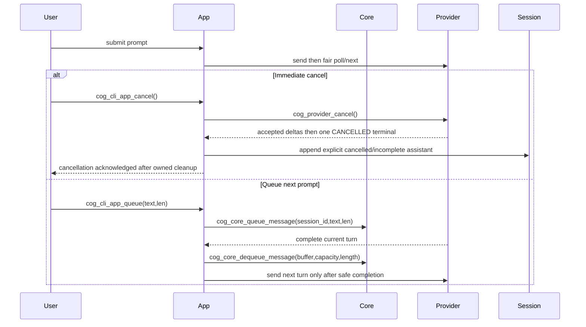

# Scenario 20: User interrupt and queued input

Stage 14.D pass-2 retrace from public-contract baseline `29b41e8`.
This replaces the earlier schematic SVG as the normative call trace. The SVG is
retained as historical design material and is not current API coverage.

## Sequence diagram

## Exact public-header coverage

Names below are exact declared functions, types, enum members or struct fields;
application-only policy/envelope steps are identified explicitly rather than
presented as library calls. Each header path names the declaring public file.

| Trace step | Exact declaration / member | Declaring header |
|---|---|---|
| Application entry points | `cog_cli_app_submit`; `cog_cli_app_cancel`; `cog_cli_app_queue`; `cog_cli_app_stop` | [applications/cog-cli/include/cog_cli/cli.h](../../applications/cog-cli/include/cog_cli/cli.h) |
| Request cancel / retained terminal | `cog_provider_cancel`; `cog_provider_next`; `cog_provider_poll` | [libraries/cog-provider/include/cog/provider_vtable.h](../../libraries/cog-provider/include/cog/provider_vtable.h) |
| Interrupt and queue events | `COG_EVENT_USER_INPUT`; `COG_EVENT_CANCEL`; `COG_EVENT_CANCELLED`; `COG_EVENT_QUEUE_MSG`; `COG_EVENT_MSG_QUEUED`; `COG_EVENT_LLM_COMPLETE` | [libraries/cog-core/include/cog/event.h](../../libraries/cog-core/include/cog/event.h) |
| Per-session FIFO | `cog_core_queue_message`; `cog_core_dequeue_message`; `cog_core_pending_count` | [libraries/cog-core/include/cog/core.h](../../libraries/cog-core/include/cog/core.h) |
| Constructor-reserved input FIFO bounds | `cog_core_config_t.pending_session_capacity`; `cog_core_config_t.pending_messages_per_session`; `cog_core_config_t.pending_message_bytes` | [libraries/cog-core/include/cog/core.h](../../libraries/cog-core/include/cog/core.h) |
| Safe event-loop progress | `cog_core_config_t.service_interval`; `cog_core_config_t.idle_fn`; `cog_core_config_t.max_idle_wait_ms`; `cog_core_stop` | [libraries/cog-core/include/cog/core.h](../../libraries/cog-core/include/cog/core.h) |
| Preserved partial turn | `cog_message_t.status`; `COG_MESSAGE_CANCELLED`; `COG_MESSAGE_INCOMPLETE` | [libraries/cog-core/include/cog/message.h](../../libraries/cog-core/include/cog/message.h) |
| Append final status / narrow discard | `cog_session_append`; `cog_session_discard_node` | [libraries/cog-core/include/cog/session.h](../../libraries/cog-core/include/cog/session.h) |
| Durable cancellation state | `cog_store_save` | [libraries/cog-core/include/cog/session_store.h](../../libraries/cog-core/include/cog/session_store.h) |

## Ownership, errors and adversarial branches

- Only app_stop/core_stop are signal/thread-safe; app_cancel and provider_cancel run on the owner thread. Interrupt progress remains bounded under a perpetually nonempty queue.
- Provider cancellation preserves accepted queued deltas and emits one terminal unless successful completion already won. Do not report success and cancellation for the same turn.
- Accepted visible output is recorded explicitly as cancelled/incomplete. The historical unconditional "discard partial assistant and keep no node" behavior is not the real-client durability policy; discard is limited to safe uncommitted leaves under its contract.
- Pending messages are copied, bounded, per-session FIFO. A short dequeue destination must not lose the next input or change order. Queue overflow is explicit, not silent eviction.
- A queued prompt starts after the current turn and required tool/result durability complete. Cancelled or unresolved tool intent cannot be silently bypassed by dequeuing the next message.

## Gap analysis and release amendment

The original obsolete discard-only interruption policy is superseded by explicit incomplete status. Pass-2 pending-queue amendments require transactional capacity retry: a short dequeue leaves the oldest entry and destination bytes unchanged; failed automatic event enqueue retains that same entry through subsequent service steps, so no prompt is lost or duplicated. Cancellation/terminal ordering and default persistence behavior are also traced in the R-series.

## Executable evidence and required follow-up

Existing baseline test: [`applications/cog-cli/tests/test_20_interrupt_and_queue.c`](../../applications/cog-cli/tests/test_20_interrupt_and_queue.c). It exists as historical
engine/mock application evidence. It was not rerun in this design-only pass and
does not prove the new mandatory headers, real transport or durable-tool behavior.

Future conformance requirements: Busy-queue cancel latency, completion-vs-cancel race, retained delta overflow, FIFO dequeue capacity retry, explicit cancelled persistence and no next turn after indeterminate effects.

Header tracing is complete only where the gap analysis says so. Production
implementation and executable scenario migration remain gated by pass 3 and the
independent final review; no passing runtime result is inferred from these tables.

## Pass-3 explicit continuation and queued text (E05)

An explicitly authorized continuation forks from the failed model turn's last
replay-safe ancestor, preserves the incomplete aggregate on its original branch,
and appends the new user input. It never relabels a failed wire turn COMPLETE or
replays partial tools/opaque data; unresolved effects use E01 recovery instead.
Automatic queued prompts cannot make that decision. FIFO auto-injection leases
the original backing text until its handler returns (or copies into another
reserved owner); successful enqueue alone is not permission to overwrite it.
Future tests enqueue a second prompt before dispatching the first and verify
unchanged text, plus explicit continuation/cancel branch isolation.
