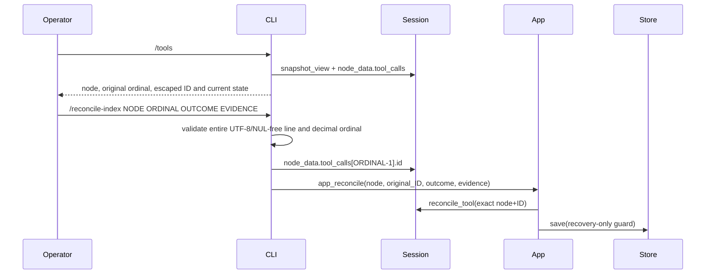

# L01: Terminal reconciliation reaches every valid call identity

This is a narrow terminal spelling of the already-approved
`cog_cli_app_reconcile` operation, not a new public API or execution permission.
Root authorized the reachability correction after identifying valid whitespace
call IDs that a literal whitespace-token command cannot represent.

Pass 1 defines `/reconcile-index NODE ORDINAL OUTCOME EVIDENCE`. ORDINAL is a
positive decimal **1-based index into the original assistant message's
immutable tool_calls array**. It is not the position in a filtered list of
pending ledger entries. The node/call association and original ID remain exact.
`/tools` prints the ordinal and escaped original ID for each ledger entry.
Literal `/reconcile NODE CALL ...` remains literal, including IDs such as `@2`;
there is no ambiguous fallback from a literal ID to an ordinal.

Pass 2 traces exact coverage: `cog_cli_session_command` is private CLI parsing;
`cog_cli_app_reconcile` is declared in cli.h; `cog_cli_app_session`,
`cog_session_snapshot_view`, `cog_node_data` and `cog_session_reconcile_tool` are
already public; `cog_store_save` persists the result/audit under the existing
recovery guard. No additional library function or event is needed.

Pass 3 checks that zero, signed/nondecimal/overflowing ordinals return
INVALID_ARG; positive out-of-range ordinals or an absent node/call return
NOT_FOUND. All validation precedes reconciliation, so rejection changes no
ledger, result, checkpoint or effect. Array order is immutable across each
reconciliation and restart, even when results are appended in a different order.
Already closed calls still refuse mutation. Whitespace/newline IDs are passed
unchanged to the public API; display escaping never rewrites stored identity.
Full line validation still precedes parsing. Evidence/resolution/guard/fencing
requirements and offline-only recovery remain unchanged.

The independent L implementation review covers this syntax/identity mapping and
its regressions alongside the rest of terminal UX. No model/tool executes as a
consequence of selecting an ordinal.
