# P01–P17: Instruction support contract traces

Header/scenario review under `e321ec3` / `04800f5`. These are design traces,
not runtime test passes. Loading belongs to `cog-instructions`; `cog-runtime`
consumes neutral bundles and owns publication. CLI remains the proof frontend.
The joined header gate is accepted. Implementations and executable evidence are
tracked by `7eb6cf9`; these diagrams remain contract traces rather than test claims.

Executable coverage accompanies these traces:

| Boundary | Maintained test targets |
|---|---|
| Source discovery, scope, metadata, ownership and bounds | `instruction-instructions`, `instruction-boundaries`, `instruction-allocations` |
| Canonical manifests and exact restore | `instruction-codec`, `unit-session-context` |
| Prompt/template identity, tool JSON and provider preflight | `unit-provider-prompt`, `runtime-headless` |
| Pinned resume, paired reload, named selection and local delegation | `runtime-headless` |
| Shared source lease and cancelled/waiting siblings | `runtime-instruction_resolver` |
| Native capsules, receipt replay and checkpoint proof | `runtime-instruction_transfer`, `runtime-configuration_capsule`, `runtime-child_capsule`, `runtime-resource_exchange`, `runtime-resource_proof`, `runtime-resource_worker` |
| Real local/native activation, resource and scope transactions | `runtime-native-instructions` |
| Failed construction and CLI-independent installed embedding | `runtime-constructor-failure`, `integration-installed-runtime-only` |

Header key used by every coverage table:

- **R:** [runtime.h](../../libraries/cog-runtime/include/cog/runtime.h)
- **X:** [runtime_instructions.h](../../libraries/cog-runtime/include/cog/runtime_instructions.h)
- **W:** [instruction_transfer.h](../../libraries/cog-runtime/src/instruction_transfer.h), [execution.h](../../libraries/cog-runtime/src/execution.h), [control.h](../../libraries/cog-runtime/src/control.h)
- **S:** [instruction_source.h](../../libraries/cog-instructions/include/cog/instruction_source.h)
- **I:** [instructions.h](../../libraries/cog-instructions/include/cog/instructions.h)
- **M:** [instruction_codec.h](../../libraries/cog-instructions/include/cog/instruction_codec.h)
- **N:** [prompt.h](../../libraries/cog-core/include/cog/prompt.h)
- **P:** [provider_prompt.h](../../libraries/cog-provider/include/cog/provider_prompt.h)
- **O:** [openrouter.h](../../libraries/cog-provider/include/cog/openrouter.h)
- **V:** [provider_vtable.h](../../libraries/cog-provider/include/cog/provider_vtable.h)
- **C:** [session.h](../../libraries/cog-core/include/cog/session.h)
- **D:** [session_store.h](../../libraries/cog-core/include/cog/session_store.h)
- **A:** [agent.h](../../libraries/cog-core/include/cog/agent.h)
- **T:** [toolkit_exec.h](../../libraries/cog-toolkit/include/cog/toolkit_exec.h)

## P01 — Cold source discovery and first request

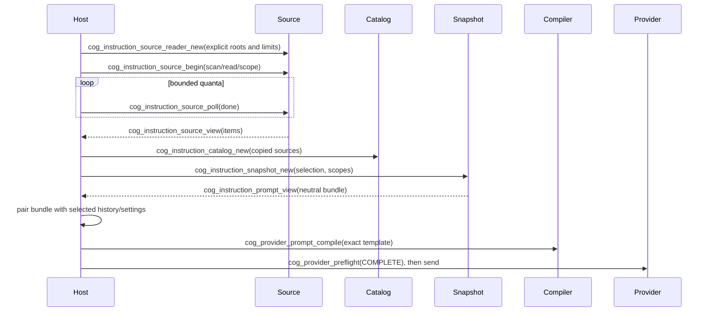

| Step | Exact drafted/existing coverage | Header |
|---|---|---|
| Explicit reads | `cog_instruction_source_config_t`, `cog_instruction_source_reader_new`, `cog_instruction_source_begin`, `cog_instruction_source_poll`, `cog_instruction_source_view` | S |
| Classification/composition | `cog_instruction_source_t`, `cog_instruction_catalog_new`, `cog_instruction_snapshot_new`, `cog_instruction_prompt_view` | I |
| Pure preparation/send | `cog_provider_prompt_compile`, `cog_openrouter_prompt_template`, `cog_provider_preflight`, `cog_provider_send` | P,O,V |
| Joined coverage | `cog_runtime_new`, `cog_session_context_add`, `cog_session_context_publish`, `cog_store_checkpoint_save`, `cog_runtime_begin/step/view/ack` | R,C,D |

**Contract review:** Initial context checkpoint precedes input/send. Source-free caller blobs follow the same composition path. DISABLED is explicit legacy behavior; PINNED never falls back to it.

## P02 — Nested AGENTS.md discovered before an effect

```mermaid
sequenceDiagram
    Model-->>Host: complete proposed edit in a new subtree
    Host->>Source: cog_instruction_source_begin(SCOPE,target directory)
    Host->>Source: cog_instruction_source_poll; cog_instruction_source_view
    Host->>Host: compare exact applicable sources to proposal snapshot
    Host->>Host: deny stale unstarted proposals without STARTED/effects
    Host->>Snapshot: cog_instruction_snapshot_new(new scope)
    Host->>Store: guarded checkpoint(final denials + replacement binding)
    Host->>Compiler: compile next bounded model continuation
```

| Step | Exact coverage | Header |
|---|---|---|
| Root-to-target probe | `COG_INSTRUCTION_SOURCE_SCOPE`, `cog_instruction_source_request_t`, `cog_instruction_source_begin`, `cog_instruction_source_poll`, `cog_instruction_source_view` | S |
| Changed immutable view | `cog_instruction_snapshot_new`, `cog_instruction_manifest_t` | I |
| No effect | `cog_toolkit_execution_start` is **not called** for stale proposals | T |
| Joined coverage | `cog_runtime_scope_binding_t`, static scope admission, `cog_session_context_publish`, guarded checkpoint; native CGIR SCOPE | R,X,C,D,W |

**Contract review:** Changed scope closes unstarted proposals before replacement. An exact unchanged probe does not deny/replay the original call. V1 multiple target directories must be identical or fail UNSUPPORTED before effects; no sibling-chain merge or arbitrary-command confinement is claimed.

## P03 — Absent, unreadable, escaping or oversized source

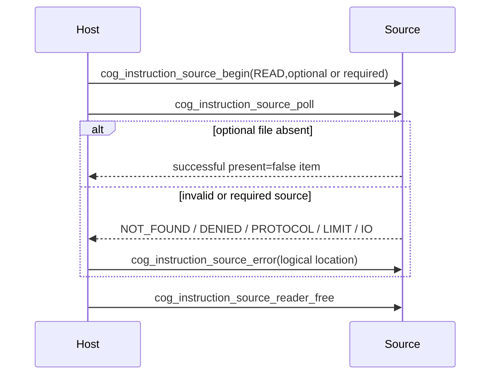

| Step | Exact coverage | Header |
|---|---|---|
| Optional/required outcome | `cog_instruction_source_request_t.optional`, `cog_instruction_source_item_t.present`, `cog_instruction_source_item_t.content_loaded`, `cog_instruction_source_poll`, `cog_instruction_source_view` | S |
| Bound/destructor | `cog_instruction_source_limits_t`, `cog_instruction_source_reader_free` | S |
| Failure location | `cog_instruction_diagnostic_t`, `cog_instruction_source_error` | S |
| Joined coverage | reader errors and consuming cleanup | S |

**Contract review:** Independent reader boundary has no remaining API gap; runtime faults/descriptor and capacity tests are implementation obligations. Exact observed bytes are not an atomic external-filesystem snapshot.

## P04 — Duplicate catalog names and malformed frontmatter

```mermaid
sequenceDiagram
    Host->>Catalog: cog_instruction_catalog_new(all bounded sources)
    Catalog->>Catalog: parse metadata and resolve host-assigned precedence
    alt same name and equal precedence or malformed data
        Catalog-->>Host: PROTOCOL / UNSUPPORTED; output NULL
    else higher explicit precedence
        Catalog-->>Host: effective entries sorted independently of scan order
    end
```

| Step | Exact coverage | Header |
|---|---|---|
| Metadata/collision | `cog_instruction_source_t.precedence`, `COG_INSTRUCTION_METADATA_V1`, `cog_instruction_catalog_new`, `cog_instruction_catalog_view` | I |
| Diagnostic owner | Optional `cog_instruction_diagnostic_t` borrows still-live source inputs; no failed constructor allocation escapes | S,I |
| Joined coverage | `cog_instruction_catalog_new` collision and grammar errors | I |

**Contract review:** Equal-precedence names are PROTOCOL. Unknown grammar is UNSUPPORTED. No include/script execution, general YAML or Unicode-name normalization is promised.

## P05 — Named agent role and capability reduction

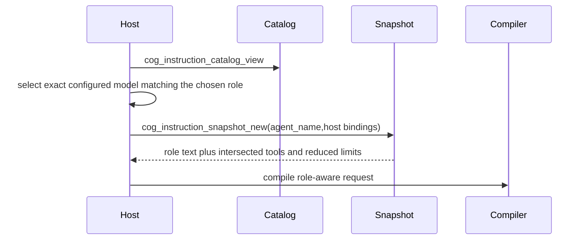

| Step | Exact coverage | Header |
|---|---|---|
| Profile selection | `cog_instruction_entry_t`, `cog_instruction_selection_t.agent_name`, `cog_instruction_selection_t.model_id`, `cog_instruction_selection_t.bindings`, `cog_instruction_snapshot_new` | I |
| Current child admission | `cog_agent_config_t`, `cog_agent_spawn` | A |
| Joined coverage | `cog_runtime_child_select`, `cog_runtime_workers_t`, static delegate role/skill fields | R,X |

**Contract review:** Selection is copied and intersected before admission; role/active-skill requirements cannot be silently dropped. A different model hint cannot introduce an unregistered route.

## P06 — Local/native child context equivalence

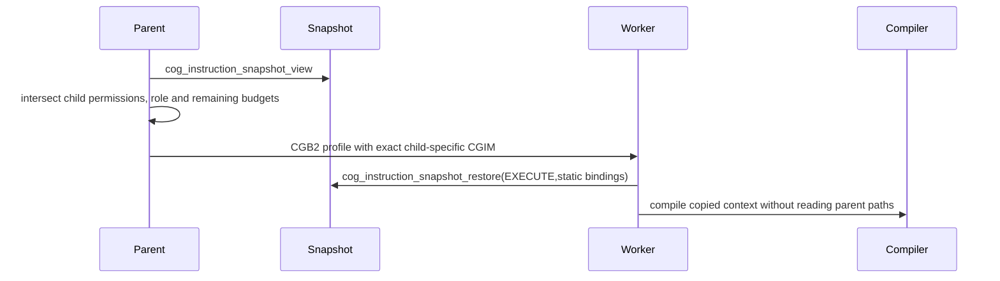

| Step | Exact coverage | Header |
|---|---|---|
| Resolved bytes/restore | `cog_instruction_manifest_t`, `cog_instruction_snapshot_view`, `cog_instruction_snapshot_restore` | I |
| Existing execution identity | `cog_agent_config_t.execution_epoch`, `cog_agent_config_t.owner_peer`, `cog_agent_copy_config`, `cog_agent_session_borrow`, `cog_agent_session_return` | A |
| Joined coverage | `cog_instruction_manifest_encode`, `cog_instruction_snapshot_decode`, CGB2/CGS2, `cog_cli_execution_admission_t.instructions` | M,W |

**Contract review:** Local/native children use the same child-specific reduced snapshot, not parent restore under weaker tools. PROFILE ACK and CHILD_START identity matching precede initial child context checkpoint/task admission.

## P07 — Skill discovery, activation and deduplication

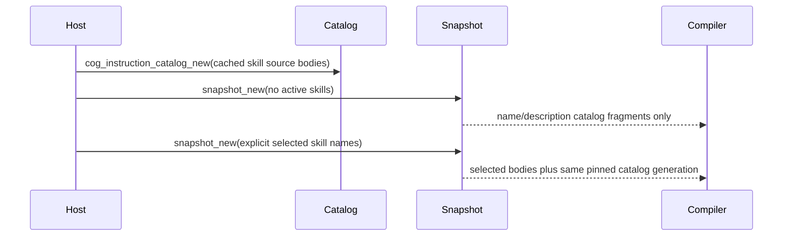

| Step | Exact coverage | Header |
|---|---|---|
| Catalog/body distinction | `cog_instruction_catalog_new`, `cog_instruction_selection_t.skill_names`, `cog_instruction_manifest_t.available_skills`, `cog_instruction_manifest_t.active_skills` | I |
| Immutable activation | `cog_instruction_snapshot_new`, `cog_instruction_prompt_view` | I |
| Joined coverage | `cog_runtime_activate_skill_tool`, `cog_runtime_instruction_prepare/publish`, CGIR ACTIVATE | X,R,W |

**Contract review:** The exact requesting control closes its result/ledger under the old binding with the new binding in one checkpoint; unrelated admitted effects drain. Already-active activation still gets ordinary terminal result durability without a new binding.

## P08 — Referenced skill resource without execution

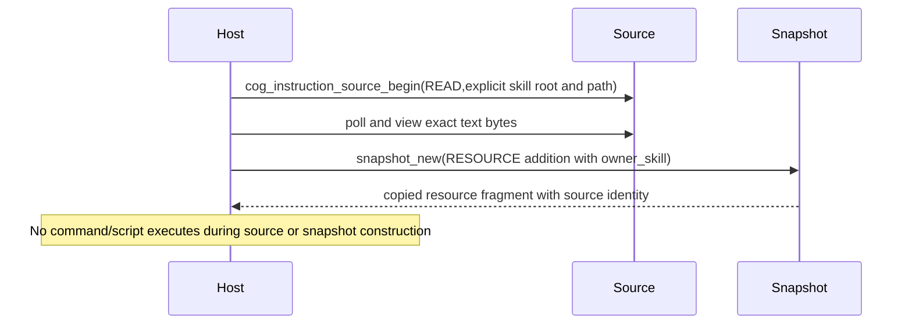

| Step | Exact coverage | Header |
|---|---|---|
| Contained resource read | `COG_INSTRUCTION_SOURCE_READ`, `cog_instruction_source_begin`, `cog_instruction_source_poll`, `cog_instruction_source_view` | S |
| Explicit ownership | `COG_INSTRUCTION_RESOURCE`, `cog_instruction_source_t.owner_skill`, `cog_instruction_snapshot_new` | I |
| Joined coverage | `cog_runtime_read_skill_resource_tool`, CGIR LOAD, candidate/COMMIT/READY/CONSUMED | X,W |

**Contract review:** Coordinator alone resolves package-relative paths beneath the pinned SKILL.md parent. Full replacement CGIM carries resource bytes; duplicates reuse retained candidate bytes. Unchanged resources still complete ordinary tool ledger/result. No source body enters diagnostics or UI replay.

## P09 — Tool descriptions, schemas, ASK and DENY

```mermaid
sequenceDiagram
    Host->>Snapshot: snapshot_new(original static descriptor bindings)
    Snapshot-->>Compiler: effective names/descriptions/schemas and policy
    Compiler->>Compiler: escape strict tool JSON; omit DENY, retain ASK guidance
    Host->>Provider: preflight compiled request
    Note over Host: Only normal durable policy admission can later start an effect
```

| Step | Exact coverage | Header |
|---|---|---|
| Single binding authority | `cog_prompt_tool_binding_t`, `cog_prompt_tool_policy_t`, `cog_instruction_selection_t.bindings` | N,I |
| Strict serialization | `cog_provider_prompt_compile`, `cog_openrouter_prompt_template` | P,O |
| Actual effect gate | `cog_toolkit_execution_start` remains separate | T |
| Joined coverage | `cog_runtime_tool_config_t`, `cog_runtime_answer`, static original descriptors | R,X |

**Contract review:** Composer supplies tool guidance; provider rendering preserves it. Direct neutral-bundle callers supply their own guidance. ASK delivery acknowledgement never grants ALLOW; exact policy identity includes catalog generation and snapshot.

## P10 — Provider/template mismatch before wire effects

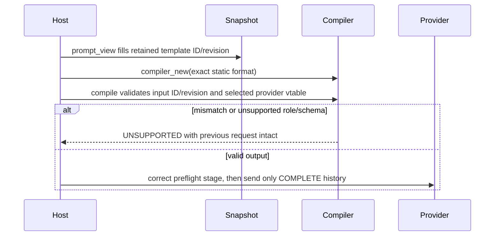

| Step | Exact coverage | Header |
|---|---|---|
| Template identity/purity | `cog_provider_prompt_template_t`, `cog_provider_prompt_render_fn`, `cog_provider_prompt_compiler_new`, `cog_provider_prompt_compile` | P |
| Initial concrete format | `COG_OPENROUTER_PROMPT_TEMPLATE_ID`, `COG_OPENROUTER_PROMPT_TEMPLATE_REVISION`, `cog_openrouter_prompt_template` | O |
| Eligibility | `cog_provider_preflight_stage_t`, `cog_provider_preflight`, `cog_provider_send` | V |
| Joined coverage | paired `cog_runtime_reload` and initial/runtime preflight | R,P,V |

**Contract review:** Selected provider and exact template/model are checked before wire work. Model/template changes require a matching snapshot in the same future candidate; no mismatched preflight pair.

## P11 — Capacity failure retains the previous request

```mermaid
sequenceDiagram
    Host->>Compiler: compile(valid input A)
    Compiler-->>Host: immutable copied request A
    Host->>Compiler: compile(oversize input B into candidate lane)
    Compiler-->>Host: LIMIT; old view A and caller output unchanged
    Host->>Compiler: compiler_free after last borrow
```

| Step | Exact coverage | Header |
|---|---|---|
| Explicit capacities/lanes | `cog_provider_prompt_limits_t`, `cog_provider_prompt_compile`, `cog_provider_prompt_compiler_free` | P |
| Source/snapshot limits | `cog_instruction_source_limits_t`, `cog_instruction_limits_t` | S,I |
| Joined coverage | two-lane compiler and bounded runtime candidate reservations | P,R |

**Contract review:** Overflow preserves old request/candidate state. Explicit constructor phases may allocate finite owners; reader/tool polling cannot. No tokenizer or history truncation claim.

## P12 — Retry keeps the exact context

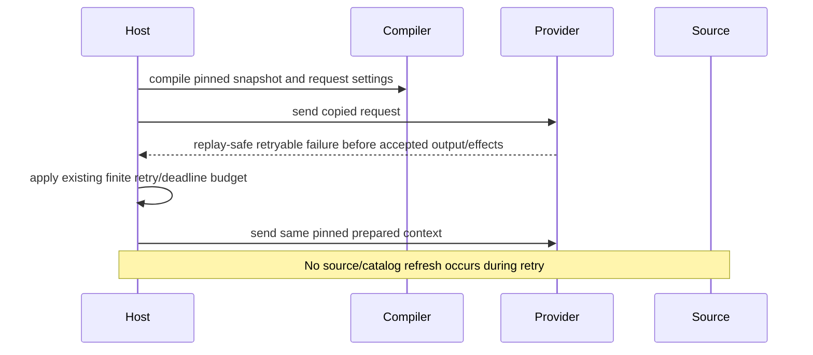

| Step | Exact coverage | Header |
|---|---|---|
| Retained compile view | `cog_provider_prompt_compile` lifetime | P |
| Retry facts/send | `cog_provider_get_error`, `cog_provider_send` | V |
| Joined coverage | whole-turn runtime pinning and guarded context associations | R,C,D |

**Contract review:** Retries reuse the same immutable context, identities and original deadlines. No file refresh, context publication or new policy authority is inferred from retry eligibility.

## P13 — Restart/fork after source deletion or change

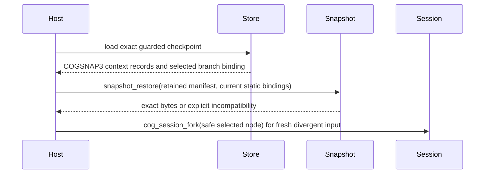

| Step | Exact coverage | Header |
|---|---|---|
| Pure restored context | `cog_instruction_snapshot_restore`, `cog_instruction_restore_mode_t` | I |
| Existing branch/checkpoint | `cog_session_fork`, `cog_store_checkpoint_load` | C,D |
| Joined coverage | `cog_session_context_select/view`, snapshot bindings, `COG_STORE_CAP_CONTEXT_V3`, COGSNAP3, PINNED/ADOPT_LEGACY | C,D,R,M |

**Contract review:** Use selected binding cursor, not highest context or active-node shortcut. Unknown format refuses execution. Explicit safe legacy adoption checkpoints context before fresh input and never rebases unresolved calls.

## P14 — Reload pins old context through an active turn

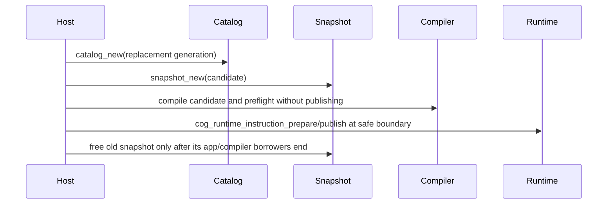

| Step | Exact coverage | Header |
|---|---|---|
| Explicit replacement owners | `cog_instruction_catalog_new`, `cog_instruction_catalog_free`, `cog_instruction_snapshot_new`, `cog_instruction_snapshot_free` | I |
| Candidate preparation | `cog_provider_prompt_compile`, `cog_provider_preflight` | P,V |
| Joined coverage | `cog_runtime_reload(provider,instructions)`, `cog_runtime_instruction_prepare/publish` | R |

**Contract review:** A provider and matching context are one future candidate. Safe idle saves a replacement binding before switching references; failed/uncertain save freezes admission. Old-turn borrows survive through drain.

## P15 — Staged handoff preserves exact context and authority

The public runtime worker configuration places children remotely and retains its
root locally. It exposes no migration command. This trace covers the existing
private handoff machinery and its exact-context guards; legacy CLI migration
scenarios remain unchanged.

```mermaid
sequenceDiagram
    Source->>Store: quiesce and save exact guarded checkpoint
    Source->>Target: CGB2 exact checkpoint capsule; verify before PREPARED
    Target->>Snapshot: snapshot_restore(exact retained context)
    Target->>Compiler: compile and no-wire preflight
    Note over Source,Target: Existing PREPARED/release/CAS/READY/route/ACTIVATE order remains
```

| Step | Exact coverage | Header |
|---|---|---|
| Context restoration/preflight | `cog_instruction_snapshot_restore`, `cog_provider_prompt_compile`, `cog_provider_preflight` | I,P,V |
| Existing durable authority | `cog_store_checkpoint_save`, `cog_store_owner_compare_exchange` | D |
| Joined coverage | CGB2 exact checkpoint capsule, staged execution admission and handoff correlation | W,D,M |

**Contract review:** PREPARED requires exact attachment identity and bytes from the immutable checkpoint. All context transaction receipts retire before quiescence; existing release/CAS/READY/route/ACTIVATE order remains authoritative.

## P16 — Cancellation and consuming cleanup

```mermaid
sequenceDiagram
    Host->>Source: cancel active job
    Source-->>Host: retained ABORTED; owned job descriptors closed
    Host->>Provider: cancel/drain existing provider work if admitted
    Host->>Compiler: compiler_free after request borrow returns
    Host->>Snapshot: snapshot_free; catalog_free
    Host->>Source: source_reader_free
```

| Step | Exact coverage | Header |
|---|---|---|
| Source cleanup | `cog_instruction_source_cancel`, `cog_instruction_source_reader_free` | S |
| Immutable-owner cleanup | `cog_provider_prompt_compiler_free`, `cog_instruction_snapshot_free`, `cog_instruction_catalog_free` | P,I |
| Existing active work | `cog_provider_cancel` | V |
| Joined coverage | `cog_runtime_shutdown/step/close`, candidate free and native receipt teardown | R,W |

**Contract review:** Shutdown drains borrowers before consuming owners. No destructor waits for remote peers. Nonconsuming guard refusal retains cleanup-only ownership; consumed aliases are cleared on every error path.

## P17 — Portable capsule round trip and malformed input

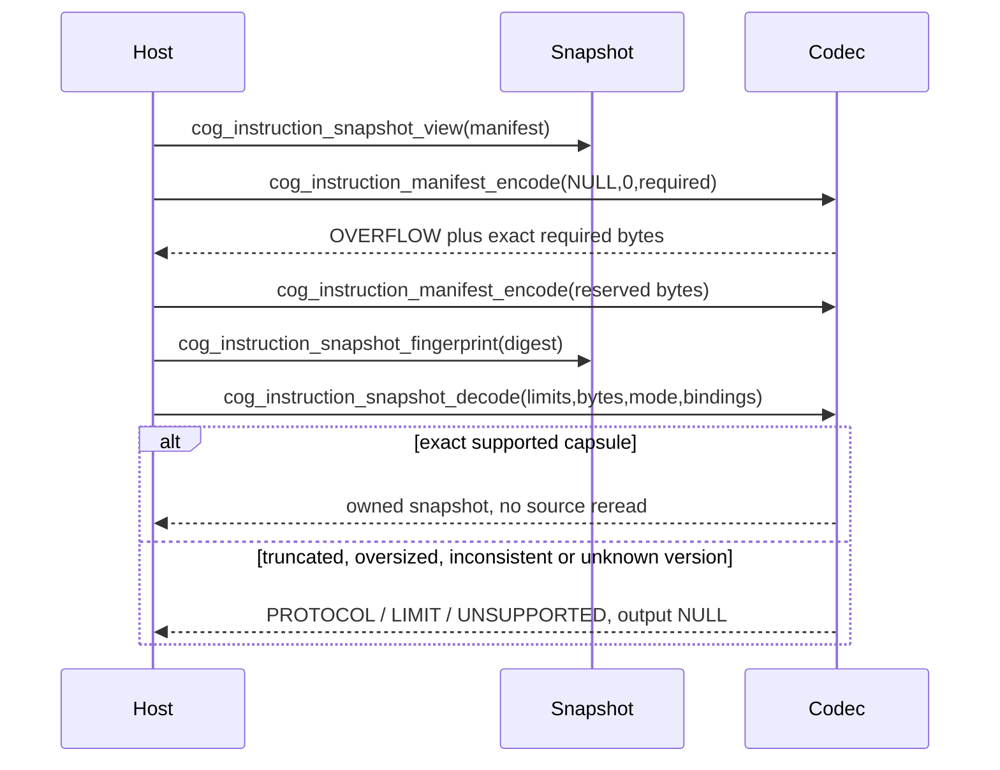

| Step | Exact coverage | Header |
|---|---|---|
| Canonical measured encoding | `cog_instruction_manifest_encode`, `COG_INSTRUCTION_CONTEXT_NAMESPACE`, `COG_INSTRUCTION_CONTEXT_FORMAT` | M |
| Stable canonical identity | `cog_instruction_snapshot_fingerprint` | M |
| Bounded owned decode | `cog_instruction_snapshot_decode`, `cog_instruction_limits_t`, `cog_instruction_restore_mode_t` | M,I |
| Semantic verification | `cog_instruction_snapshot_restore` rederives metadata and fragments and compares exact retained bytes | I |
| Joined coverage | CGIM codec plus v3 store/CGB2 transport | M,C,D,W |

**Contract review:** Canonical bytes, hashes and semantic rederivation are checked before use. Unknown versions, truncation, capacity exhaustion and inconsistent sources/fragments fail closed. Digest equality is not execution authority.

## Original 01–20 retrace

This cross-check covers every original trace without changing its accepted
baseline evidence. It maps the complete declared extension surface; executable tests and final
joined acceptance remain separate gates.

| Original | Instruction extension | Declared coverage |
|---|---|---|
| 01 prompt/stream/UI | Compose before send; acknowledge retained view | R new/begin/step/view/ack; I,P,V |
| 02 stall/recovery | Pin exact context through bounded retry | R whole-turn pinning; P,V |
| 03 child lifecycle | Named local/native reduced snapshot | R child_select; W CGB2/CGS2; A |
| 04 cold start | Initial durable context before first input | R new; C context_add/publish; D v3 |
| 05 shutdown | Drain borrowers before checked close | R shutdown/step/close; W receipt teardown |
| 06 parallel tools | All effects retain originating proposal binding | C node binding; X group closure; T |
| 07 worker crash | Freeze uncertain publication/effects | W COMMIT/READY/native loss; C,D |
| 08 config reload | Pair future provider/context, safe-idle checkpoint | R reload; C,D; P preflight |
| 09 sibling messaging | Context never grants mailbox identity | A unchanged authenticated routing; W pinned attempt |
| 10 fan-out/fan-in | Per-child intersection and bounded capsule reservations | R child_select/workers; W; A |
| 11 UI reconnect | Rebuild views without source rereads/effects | R view/ack; existing replay; no source bodies |
| 12 rate limit | Same snapshot/deadline and request credits | R pinning; V error/retry facts |
| 13 persistence | Atomic messages/ledger/context checkpoint | C snapshot/restore; D v3 capability; M |
| 14 fork | Historical vs pending cursor explicitly selected | C context_select/fork; R fork |
| 15 tool turns | Close group then publish next context | X static controls; R prepare/publish; W |
| 16 provider errors | Retain old compile view; freeze failed checkpoint | P transactional lanes; R cleanup; D |
| 17 migration | Exact checkpoint context and phased authority transfer | W CGB2/staged admission/handoff; D |
| 18 observability | Only safe identities/counts in diagnostics | S diagnostic; R view; W private capsule arenas |
| 19 connection events | Pure compiler/source work creates no transport events | S,P; existing V/net observation |
| 20 interrupt/queue | No stale input/approval/context authority | R submit/cancel/answer; W cancellation; X |

R01/R02/R04–R18 need the same context composition/admission/restoration joins;
R03 retains existing SSE decoding and adds only bounded outgoing encoding checks.
The 05b shutdown regression retains its existing send/cancel ordering. Existing
runtime tests are not weakened or relabeled by these extension traces.
