# P01–P16: Instruction support contract traces

Header authoring under `e321ec3` / `57e749b`. These are design traces, not runtime
test passes. The draft B1–B6 APIs exist as declarations; B7 app/store/worker
joins remain open under `1ddb6d2`. Loading belongs to `cog-instructions`; a
headless runtime consumes its neutral bundles. CLI is a minimal proof frontend.
No imagined runtime publication API is counted as
header coverage. Source classification, static-template selection and policy
decisions shown as Host work are explicit caller responsibilities.

Header key used by every coverage table:

- **S:** [instruction_source.h](../../libraries/cog-instructions/include/cog/instruction_source.h)
- **I:** [instructions.h](../../libraries/cog-instructions/include/cog/instructions.h)
- **N:** [prompt.h](../../libraries/cog-core/include/cog/prompt.h)
- **P:** [provider_prompt.h](../../libraries/cog-provider/include/cog/provider_prompt.h)
- **O:** [openrouter.h](../../libraries/cog-provider/include/cog/openrouter.h)
- **V:** [provider_vtable.h](../../libraries/cog-provider/include/cog/provider_vtable.h)
- **C:** [session.h](../../libraries/cog-core/include/cog/session.h)
- **D:** [session_store.h](../../libraries/cog-core/include/cog/session_store.h)
- **A:** [agent.h](../../libraries/cog-core/include/cog/agent.h)
- **T:** [toolkit_exec.h](../../libraries/cog-toolkit/include/cog/toolkit_exec.h)

## P01 — Cold source discovery and first request

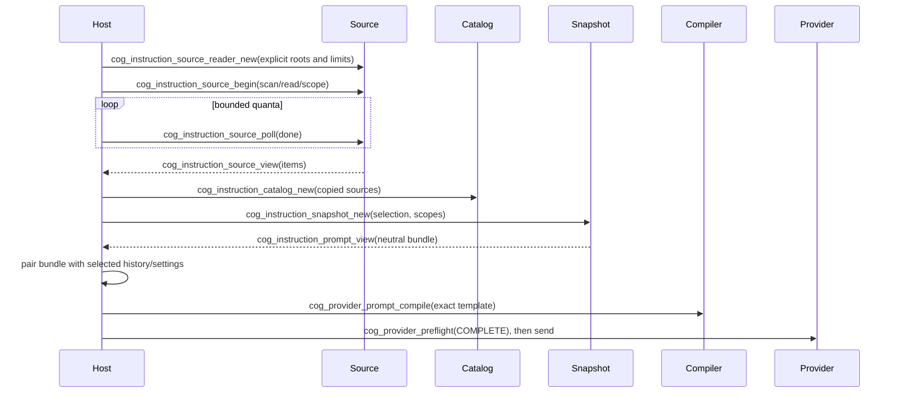

| Step | Exact drafted/existing coverage | Header |
|---|---|---|
| Explicit reads | `cog_instruction_source_config_t`, `cog_instruction_source_reader_new`, `cog_instruction_source_begin`, `cog_instruction_source_poll`, `cog_instruction_source_view` | S |
| Classification/composition | `cog_instruction_source_t`, `cog_instruction_catalog_new`, `cog_instruction_snapshot_new`, `cog_instruction_prompt_view` | I |
| Pure preparation/send | `cog_provider_prompt_compile`, `cog_openrouter_prompt_template`, `cog_provider_preflight`, `cog_provider_send` | P,O,V |

**Gap:** generic app integration and durable context publication before the first
request are not yet declared. Construction failures publish no partial owner.
Caller blobs bypass Source and take the same catalog/composition path.

## P02 — Nested AGENTS.md discovered before an effect

```mermaid
sequenceDiagram
    Model-->>Host: complete proposed edit in a new subtree
    Host->>Source: cog_instruction_source_begin(SCOPE,target directory)
    Host->>Source: cog_instruction_source_poll; cog_instruction_source_view
    Host->>Host: compare exact applicable sources to proposal snapshot
    Host->>Host: deny stale unstarted proposals without STARTED/effects
    Host->>Snapshot: cog_instruction_snapshot_new(new scope)
    Note over Host: B7 must atomically save final denials and replacement context
    Host->>Compiler: compile next bounded model continuation
```

| Step | Exact coverage | Header |
|---|---|---|
| Root-to-target probe | `COG_INSTRUCTION_SOURCE_SCOPE`, `cog_instruction_source_request_t`, `cog_instruction_source_begin`, `cog_instruction_source_poll`, `cog_instruction_source_view` | S |
| Changed immutable view | `cog_instruction_snapshot_new`, `cog_instruction_manifest_t` | I |
| No effect | `cog_toolkit_execution_start` is **not called** for stale proposals | T |

**Gap:** B7 needs the effect-admission scope check and atomic result/context
checkpoint. Missing caller source bytes cannot prove absence of filesystem
rules. Commands can access paths beyond their declared cwd; no confinement is
inferred. Denying a stale call never authorizes replay of that identity.

## P03 — Absent, unreadable, escaping or oversized source

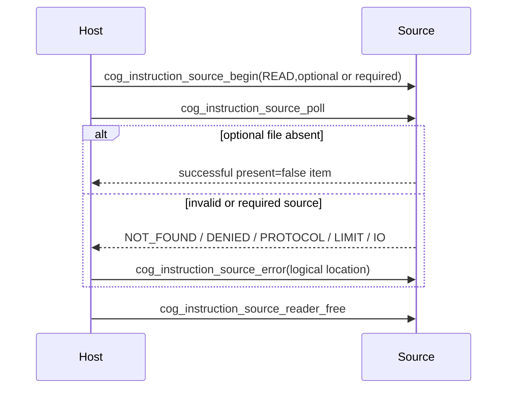

| Step | Exact coverage | Header |
|---|---|---|
| Optional/required outcome | `cog_instruction_source_request_t.optional`, `cog_instruction_source_item_t.present`, `cog_instruction_source_item_t.content_loaded`, `cog_instruction_source_poll`, `cog_instruction_source_view` | S |
| Bound/destructor | `cog_instruction_source_limits_t`, `cog_instruction_source_reader_free` | S |
| Failure location | `cog_instruction_diagnostic_t`, `cog_instruction_source_error` | S |

**Gap:** no new API gap for the independent reader. Runtime fault/descriptor
tests are still required. A detected concurrent file change fails IO; exact
observed bytes do not claim an atomic snapshot of an external writer.

## P04 — Duplicate catalog names and malformed frontmatter

```mermaid
sequenceDiagram
    Host->>Catalog: cog_instruction_catalog_new(all bounded sources)
    Catalog->>Catalog: parse metadata and resolve host-assigned precedence
    alt same name and equal precedence or malformed data
        Catalog-->>Host: PROTOCOL / UNSUPPORTED; output NULL
    else higher explicit precedence
        Catalog-->>Host: effective entries sorted independently of scan order
    end
```

| Step | Exact coverage | Header |
|---|---|---|
| Metadata/collision | `cog_instruction_source_t.precedence`, `COG_INSTRUCTION_METADATA_V1`, `cog_instruction_catalog_new`, `cog_instruction_catalog_view` | I |
| Diagnostic owner | Optional `cog_instruction_diagnostic_t` borrows still-live source inputs; no failed constructor allocation escapes | S,I |

**Gap:** the initial grammar is intentionally a bounded subset. No general YAML,
Unicode-name normalization or cross-client leniency is promised. Parser fixtures
must distinguish duplicate metadata keys, equal-precedence names and legitimate
project-over-user shadowing. No parse-time script or include is executed.

## P05 — Named agent role and capability reduction

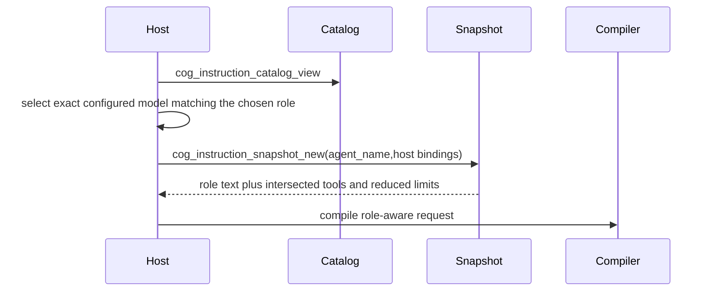

| Step | Exact coverage | Header |
|---|---|---|
| Profile selection | `cog_instruction_entry_t`, `cog_instruction_selection_t.agent_name`, `cog_instruction_selection_t.model_id`, `cog_instruction_selection_t.bindings`, `cog_instruction_snapshot_new` | I |
| Current child admission | `cog_agent_config_t`, `cog_agent_spawn` | A |

**Gap:** binding the selected profile/snapshot to an actual child attempt is B7.
A file cannot introduce a new descriptor, model route, credential resolver or
recursive delegate. A model constraint mismatch is explicit UNSUPPORTED.

## P06 — Local/native child context equivalence

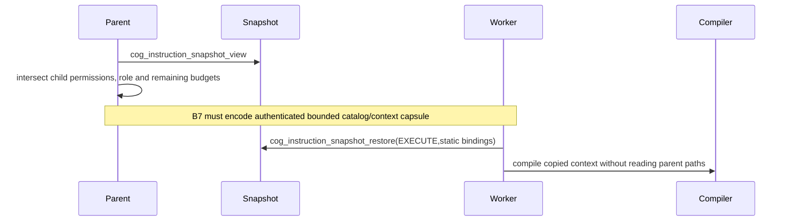

| Step | Exact coverage | Header |
|---|---|---|
| Resolved bytes/restore | `cog_instruction_manifest_t`, `cog_instruction_snapshot_view`, `cog_instruction_snapshot_restore` | I |
| Existing execution identity | `cog_agent_config_t.execution_epoch`, `cog_agent_config_t.owner_peer`, `cog_agent_copy_config`, `cog_agent_session_borrow`, `cog_agent_session_return` | A |

**Gap:** no instruction capsule, frame version, resource forwarding or receipt
lifetime is declared yet. Native pointer serialization and a worker's implicit
reread of parent host paths are forbidden. Failure keeps existing uncertainty,
drain/reap and no-replay rules; no child-parity runtime claim is made.

## P07 — Skill discovery, activation and deduplication

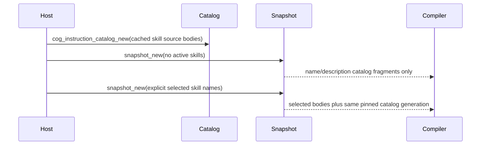

| Step | Exact coverage | Header |
|---|---|---|
| Catalog/body distinction | `cog_instruction_catalog_new`, `cog_instruction_selection_t.skill_names`, `cog_instruction_manifest_t.available_skills`, `cog_instruction_manifest_t.active_skills` | I |
| Immutable activation | `cog_instruction_snapshot_new`, `cog_instruction_prompt_view` | I |

**Gap:** B7 needs static activation-tool/event admission and causal publication
after the current call group closes. Duplicate explicit names fail before
publication. A cached unselected body consumes bounded host memory, not model
context; no file reread occurs merely because a skill is activated.

## P08 — Referenced skill resource without execution

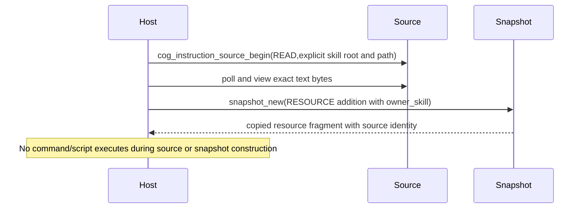

| Step | Exact coverage | Header |
|---|---|---|
| Contained resource read | `COG_INSTRUCTION_SOURCE_READ`, `cog_instruction_source_begin`, `cog_instruction_source_poll`, `cog_instruction_source_view` | S |
| Explicit ownership | `COG_INSTRUCTION_RESOURCE`, `cog_instruction_source_t.owner_skill`, `cog_instruction_snapshot_new` | I |

**Gap:** native resource routing is B7. Binary assets are not UTF-8 prompt
resources in this profile. Script execution uses the existing ordinary tools,
policy/guard/ledger/budgets; a Markdown reference cannot perform it implicitly.

## P09 — Tool descriptions, schemas, ASK and DENY

```mermaid
sequenceDiagram
    Host->>Snapshot: snapshot_new(original static descriptor bindings)
    Snapshot-->>Compiler: effective names/descriptions/schemas and policy
    Compiler->>Compiler: escape strict tool JSON; omit DENY, retain ASK guidance
    Host->>Provider: preflight compiled request
    Note over Host: Only normal durable policy admission can later start an effect
```

| Step | Exact coverage | Header |
|---|---|---|
| Single binding authority | `cog_prompt_tool_binding_t`, `cog_prompt_tool_policy_t`, `cog_instruction_selection_t.bindings` | N,I |
| Strict serialization | `cog_provider_prompt_compile`, `cog_openrouter_prompt_template` | P,O |
| Actual effect gate | `cog_toolkit_execution_start` remains separate | T |

**Gap:** app binding/publication is B7. Runtime fixtures must prove quotes,
newlines and Unicode descriptions cannot corrupt tool JSON, duplicate names
fail even if denied, unsolicited omitted names remain denied, and a restored
proposal cannot bypass preflight or policy. Skill metadata never grants ALLOW.

## P10 — Provider/template mismatch before wire effects

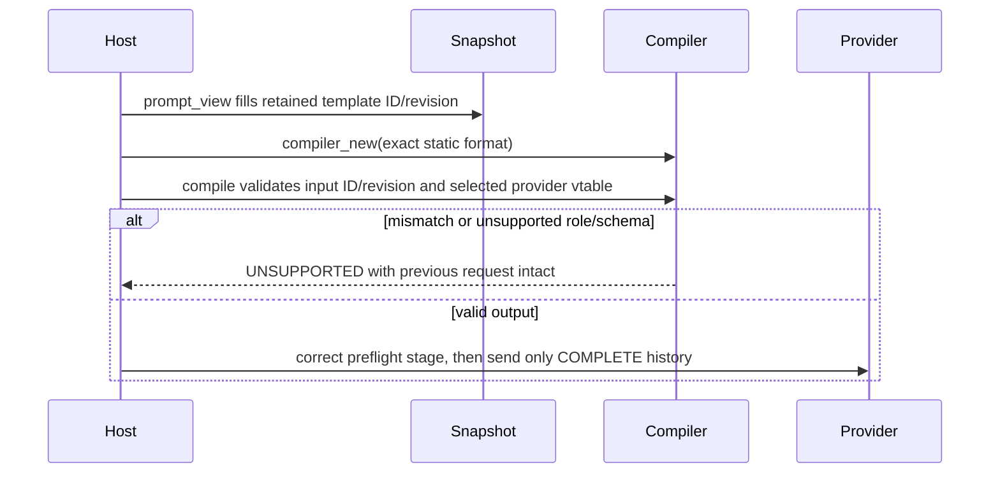

| Step | Exact coverage | Header |
|---|---|---|
| Template identity/purity | `cog_provider_prompt_template_t`, `cog_provider_prompt_render_fn`, `cog_provider_prompt_compiler_new`, `cog_provider_prompt_compile` | P |
| Initial concrete format | `COG_OPENROUTER_PROMPT_TEMPLATE_ID`, `COG_OPENROUTER_PROMPT_TEMPLATE_REVISION`, `cog_openrouter_prompt_template` | O |
| Eligibility | `cog_provider_preflight_stage_t`, `cog_provider_preflight`, `cog_provider_send` | V |

**Gap:** initial adapter renderer has declarations only; no second provider or
developer role is delivered. All preflight paths need the same app integration.
The compiler may render pending-tool input but cannot authorize sending it.

## P11 — Capacity failure retains the previous request

```mermaid
sequenceDiagram
    Host->>Compiler: compile(valid input A)
    Compiler-->>Host: immutable copied request A
    Host->>Compiler: compile(oversize input B into candidate lane)
    Compiler-->>Host: LIMIT; old view A and caller output unchanged
    Host->>Compiler: compiler_free after last borrow
```

| Step | Exact coverage | Header |
|---|---|---|
| Explicit capacities/lanes | `cog_provider_prompt_limits_t`, `cog_provider_prompt_compile`, `cog_provider_prompt_compiler_free` | P |
| Source/snapshot limits | `cog_instruction_source_limits_t`, `cog_instruction_limits_t` | S,I |

**Gap:** no new independent API gap. Runtime OOM/arithmetic/alias/range tests
remain required. The context sum includes generated text and tool JSON;
max_request_bytes separately bounds copied arrays, padding and terminators.
Neither ceiling is a tokenizer claim, and no history truncation is permitted.

## P12 — Retry keeps the exact context

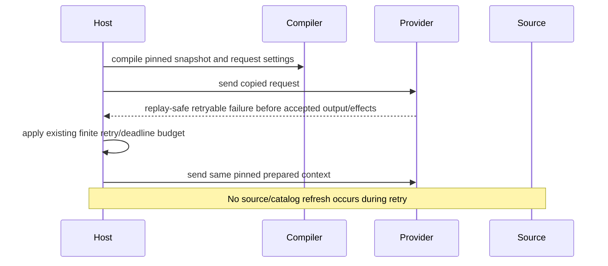

| Step | Exact coverage | Header |
|---|---|---|
| Retained compile view | `cog_provider_prompt_compile` lifetime | P |
| Retry facts/send | `cog_provider_get_error`, `cog_provider_send` | V |

**Gap:** B7 app generation borrowing/publication. The existing app remains the
sole retry owner. Partial output/effects do not become replay-safe because a
context is immutable; new file contents cannot silently change a retry.

## P13 — Restart/fork after source deletion or change

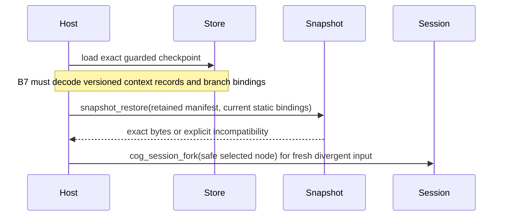

| Step | Exact coverage | Header |
|---|---|---|
| Pure restored context | `cog_instruction_snapshot_restore`, `cog_instruction_restore_mode_t` | I |
| Existing branch/checkpoint | `cog_session_fork`, `cog_store_checkpoint_load` | C,D |

**Gap:** context-to-node binding, store format and old-backend capability are not
yet public. INSPECT cannot produce prompt inputs. A more restrictive host does
not silently rewrite the old proposal's tool set. Legacy context adoption needs
an explicit policy; hashes alone do not reconstruct missing source bytes.

## P14 — Reload pins old context through an active turn

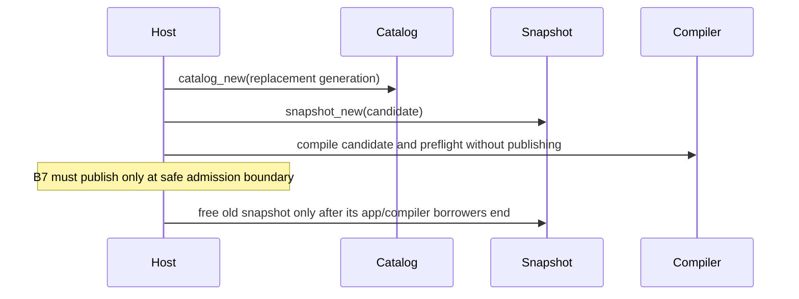

| Step | Exact coverage | Header |
|---|---|---|
| Explicit replacement owners | `cog_instruction_catalog_new`, `cog_instruction_catalog_free`, `cog_instruction_snapshot_new`, `cog_instruction_snapshot_free` | I |
| Candidate preparation | `cog_provider_prompt_compile`, `cog_provider_preflight` | P,V |

**Gap:** B7 app reload/context publication hooks. Explicit constructors are
visible allocation boundaries, not hidden runtime growth. Failed preparation
retains old context and provider state; queued input cannot approve uncertain
work or extend the original deadline.

## P15 — Staged handoff preserves exact context and authority

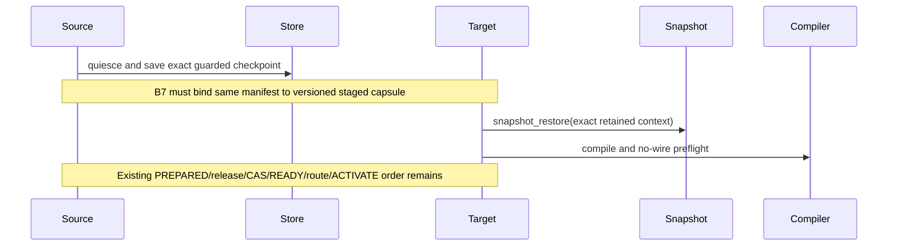

| Step | Exact coverage | Header |
|---|---|---|
| Context restoration/preflight | `cog_instruction_snapshot_restore`, `cog_provider_prompt_compile`, `cog_provider_preflight` | I,P,V |
| Existing durable authority | `cog_store_checkpoint_save`, `cog_store_owner_compare_exchange` | D |

**Gap:** B7 literal capsule and context-checkpoint correlation. A source-free,
guard failure, lost ACK or changed epoch cannot authorize task replay or old
source thaw. No cross-host/live-handle transfer is added.

## P16 — Cancellation and consuming cleanup

```mermaid
sequenceDiagram
    Host->>Source: cancel active job
    Source-->>Host: retained ABORTED; owned job descriptors closed
    Host->>Provider: cancel/drain existing provider work if admitted
    Host->>Compiler: compiler_free after request borrow returns
    Host->>Snapshot: snapshot_free; catalog_free
    Host->>Source: source_reader_free
```

| Step | Exact coverage | Header |
|---|---|---|
| Source cleanup | `cog_instruction_source_cancel`, `cog_instruction_source_reader_free` | S |
| Immutable-owner cleanup | `cog_provider_prompt_compiler_free`, `cog_instruction_snapshot_free`, `cog_instruction_catalog_free` | P,I |
| Existing active work | `cog_provider_cancel` | V |

**Gap:** B7 borrowed app/worker lifetime joins. Reader free consumes on cleanup
error; callers clear aliases and preserve the first error. A completed source
result wins later cancellation. No destructor waits for remote peers or runs a
script. Raw source text and absolute host paths are not diagnostic payloads.

## Original 01–20 retrace

This cross-check covers every original trace without changing its accepted
baseline evidence. It identifies extension work; it does not assert that the
new feature has executable tests or that the joined header gate has passed.

| Original | Instruction extension | Draft coverage / remaining gap |
|---|---|---|
| 01 prompt/stream/UI | Compose exact context before request; display separate | I,P,V; B7 app publication remains. |
| 02 stall/recovery | Retry same snapshot and deadline | P,V; B7 borrow spans retry. |
| 03 child lifecycle | Bind profile/context to actual local/native attempt | I,A; native capsule and admission hook missing. |
| 04 cold start | Explicit read/catalog constructors unwind before first send | S,I,P; durable initial context binding missing. |
| 05 shutdown | End provider/tool borrows before compiler/snapshot free | S,I,P,V; B7 drain/worker joins missing. |
| 06 parallel tools | Pin descriptor/context set across all launched effects | P,T; no late profile mutation; runtime hook missing. |
| 07 worker crash | Retain original snapshot plus factual uncertainty | I,A; versioned durable/native binding missing. |
| 08 config reload | Prepare copied replacement, publish at safe boundary | I,P,V; B7 publication/capacities missing. |
| 09 sibling messaging | Instruction sources do not grant mailbox identity | I,A; existing authenticated routing remains; native snapshot hook missing. |
| 10 fan-out/fan-in | Same effective subset/context for each admitted child | I,A; bounded capsule/group reservation join missing. |
| 11 UI reconnect | No source reread or effect to reconstruct projection | I; new source text is not UI replay data; app projection join missing. |
| 12 rate limit | Original budget owns any next attempt | P,V; B7 snapshot borrow cannot extend timer. |
| 13 persistence | Save exact source cache/fragments with result/ledger | I,D; generic session context and store format missing. |
| 14 fork | Selected immutable branch retains its original context | I,C; explicit node/context binding missing. |
| 15 tool turns | Skill/scope transition closes old group before publication | I,T; atomic result/context checkpoint missing. |
| 16 provider errors | Failed compilation/preflight preserves prior request and effects | P,V; B7 app cleanup hook missing. |
| 17 migration | Exact snapshot/checkpoint/epoch copied, no live handle move | I,D; staged capsule correlation missing. |
| 18 observability | Stable safe IDs/counts, no raw instruction text in logs | S,I; app diagnostic labels/failure path integration missing. |
| 19 connection events | Pure source/compiler operations create no net events | S,P,V; existing numeric transport observation unchanged. |
| 20 interrupt/queue | Queued input never changes admitted context or grants policy | I,P,V; B7 activation/input arbitration missing. |

R01/R02/R04–R18 need the same context composition/admission/restoration joins;
R03 retains existing SSE decoding and adds only bounded outgoing encoding checks.
The 05b shutdown regression retains its existing send/cancel ordering. Existing
runtime tests are not weakened or relabeled by these extension traces.
