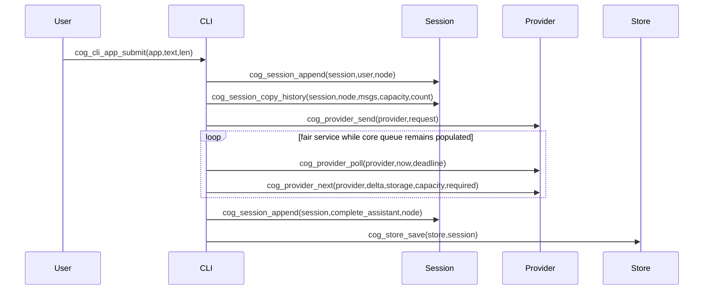

# R02: Prompt through HTTPS, streaming display and complete durable turn

Stage 14.D pass 2; baseline header pass 1 `29b41e8`, amended by this pass.
This is a contract trace, **not an executable conformance pass**.

## Sequence

## Exact public coverage

Each symbol below is declared in the linked public header. Local application
decisions in the diagram are not invented library functions.

| Step | Exact calls, types, events or fields | Declaring header |
|---|---|---|
| Submit/service host | `cog_cli_app_submit`, `cog_cli_app_run` | [applications/cog-cli/include/cog_cli/cli.h](../../applications/cog-cli/include/cog_cli/cli.h) |
| Fair scheduling | `cog_service_fn`, `cog_core_config_t`, `cog_core_run` | [libraries/cog-core/include/cog/core.h](../../libraries/cog-core/include/cog/core.h) |
| History and durable insertion | `cog_session_append`, `cog_session_copy_history` | [libraries/cog-core/include/cog/session.h](../../libraries/cog-core/include/cog/session.h) |
| Send/poll/copy retained delta | `cog_provider_send`, `cog_provider_poll`, `cog_provider_next` | [libraries/cog-provider/include/cog/provider_vtable.h](../../libraries/cog-provider/include/cog/provider_vtable.h) |
| Typed data and terminal | `cog_provider_request_t`, `cog_provider_delta_t`, `COG_PROVIDER_DELTA_TEXT`, `COG_PROVIDER_DELTA_USAGE`, `COG_PROVIDER_DELTA_FINISH` | [libraries/cog-provider/include/cog/provider_request.h](../../libraries/cog-provider/include/cog/provider_request.h) |
| One message and usage availability | `cog_message_t`, `cog_message_status_t`, `cog_usage_t` | [libraries/cog-core/include/cog/message.h](../../libraries/cog-core/include/cog/message.h) |
| Durable generation | `cog_store_save` | [libraries/cog-core/include/cog/session_store.h](../../libraries/cog-core/include/cog/session_store.h) |

## Ownership and invariants

- send deep-copies all nested request inputs before return; freeing caller request storage cannot corrupt asynchronous work. Streaming text is display data; only one assistant message is assembled per turn.
- Only successful FINISH after wire DONE/EOF allows COMPLETE. Repeated identical finish metadata is idempotent; USAGE replaces cumulative snapshots, never adds them. Unknown usage remains explicitly unknown.
- Backpressure propagates next->provider queue->id-local net ring; no accepted delta disappears during core queue overflow. The service hook stages caller-owned delta storage until the queued event is handled.

## Failure and capacity branches

- History array OVERFLOW changes count only; retry before send, no hidden allocation/pruning. next OVERFLOW leaves metadata/storage/sequence unchanged across poll. Internal workspace LIMIT is terminal, not a resize retry.
- Network loss after displayed text produces INCOMPLETE, preserves accepted output and forbids transparent resend. Save failure propagates and stops continuation.

## Evidence and gap disposition

Original01 mock executable and pocs/provider-wire semantic fixtures cover baseline ordering/framing, not the production real adapter.

**Required future executable evidence:** F/G/H/K/Q: captured HTTPS bytes, retained-delta resize, sustained-queue progress, single-message save and restart fixtures.

**Amendment references:** D02,D03,D10 in [pass-2 register](../REAL_CLIENT_SCENARIO_PASS2.md).
