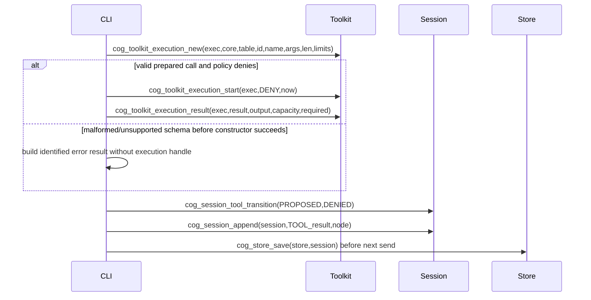

# R05: Denied policy, invalid schema and unsolicited tools

Stage 14.D pass 2; baseline header pass 1 `29b41e8`, amended by this pass.
This is a contract trace, **not an executable conformance pass**.

## Sequence

## Exact public coverage

Each symbol below is declared in the linked public header. Local application
decisions in the diagram are not invented library functions.

| Step | Exact calls, types, events or fields | Declaring header |
|---|---|---|
| Strict schema/denial | `cog_toolkit_execution_new`, `cog_toolkit_execution_start`, `cog_toolkit_execution_result`, `COG_TOOLKIT_POLICY_DENY`, `COG_TOOLKIT_POLICY_UNDECIDED` | [libraries/cog-toolkit/include/cog/toolkit_exec.h](../../libraries/cog-toolkit/include/cog/toolkit_exec.h) |
| Declared table/context | `cog_tool_t`, `cog_tool_async_config_t` | [libraries/cog-core/include/cog/tool.h](../../libraries/cog-core/include/cog/tool.h) |
| Ledger and result | `cog_session_tool_transition`, `cog_session_append`, `COG_TOOL_EXECUTION_DENIED` | [libraries/cog-core/include/cog/session.h](../../libraries/cog-core/include/cog/session.h) |
| Identity/status | `cog_message_t`, `COG_MESSAGE_ROLE_TOOL` | [libraries/cog-core/include/cog/message.h](../../libraries/cog-core/include/cog/message.h) |
| Disabled persistence mode | `COG_CLI_STORE_DISABLED`, `COG_CLI_TOOL_POLICY_ASK` | [applications/cog-cli/include/cog_cli/cli.h](../../applications/cog-cli/include/cog_cli/cli.h) |
| Durable history | `cog_store_save` | [libraries/cog-core/include/cog/session_store.h](../../libraries/cog-core/include/cog/session_store.h) |

## Ownership and invariants

- UNDECIDED is never ALLOW; noninteractive ASK denies. Invalid schema/unsupported keyword/unknown tool never invokes start.
- DENY is a no-effect terminal outcome. It does not need a STARTED save; save denial+identified result before next request when durable mode is enabled. No-store mode keeps denial only in volatile history.
- Malformed wire argument JSON fails the turn before this trace (R15); syntactically valid but schema-invalid arguments can receive an explicit tool error result.

## Failure and capacity branches

- Test traversal/symlink/absolute paths and disabled command descriptor before effects. No unsolicited tool can bypass no-store mode, absent workspace root or command enablement.
- OVERFLOW copying a denied result repeats only copying; constructor NOMEM leaves *exec=NULL and zero effects.

## Evidence and gap disposition

Existing original15 covers baseline tool result only; new denial/schema/policy contracts are not implemented yet.

**Required future executable evidence:** I/K: denied/invalid/UNDECIDED/ASK/no-store matrix with side-effect counter exactly zero.

**Amendment references:** D01,D06 in pass-2 register (`tix show 345a536`).

## Pass-3 parser/process bounds retrace (E03)

`cog_tool_async_config_t` now fixes argument/schema bytes, JSON depth and codec
workspace capacity ([tool.h](../../libraries/cog-core/include/cog/tool.h)).
Construction rejects over-limit input before effects, duplicate keys and invalid
UTF-8. Scalar-count string lengths, finite numeric semantics and unsupported
schema keywords are pinned in [toolkit_exec.h](../../libraries/cog-toolkit/include/cog/toolkit_exec.h).
No remote schema fetch or hidden parser growth occurs. Process-tree supervision
keeps subreaper/signal changes inside an owned helper, never the embedding host;
the cancellation profile requires descendants remain in the owned group. Test
ordinary inherited-group grandchildren outliving the shell, exact parser/depth
limits, unsupported numeric ranges and result resize with one effect.

## Independent final-review revision: active path and unstarted work (E09/E11)

While any call/result is unresolved, `cog_session_fork` and arbitrary-parent
`cog_session_add_message` cannot switch to a safe sibling or ancestor. Only a
matching TOOL result at the active leaf, or atomic reconcile_tool, may extend
that path. REPLAY load rejects off-active unresolved state; no recovery target
can be stranded. An incomplete text-only turn without tool ledger still permits
an explicit fork from its safe ancestor. Crash oracle: create a safe sibling,
then save active STARTED; attempted sibling switch must fail before the crash,
and restored INDETERMINATE remains reachable for reconciliation.

PROPOSED is unresolved lifecycle state but proves no STARTED admission happened:
normal guard acquisition may resume that current policy/denial phase. It cannot
start unrelated model/user/branch work. Crashed STARTED becomes INDETERMINATE and
requires recovery. Cancelled unstarted proposals receive identified no-effect
DENIED results; they are never mistaken for uncertain executed effects. Test the
crash before STARTED save and cancel-after-proposal boundaries with zero effects.

## Stage 14.I executable acceptance evidence

The toolkit implementation now has dedicated real-library tests for this trace:
`test_toolkit_async`, `test_toolkit_resources`, `test_toolkit_fencing` and
`test_workspace`. They cover policy/guard validation, retained at-most-once
output, constructor limits/OOM, disposable workspace refusal/effects and supported
process-tree cancellation/reaping. Strict and ASan/UBSan writer suites pass;
delivery evidence (`tix show 03f60d7`) records exact scope and limits.
Independent review and library integration passed after one correction cycle.
Application durable-loop integration remains with K.
