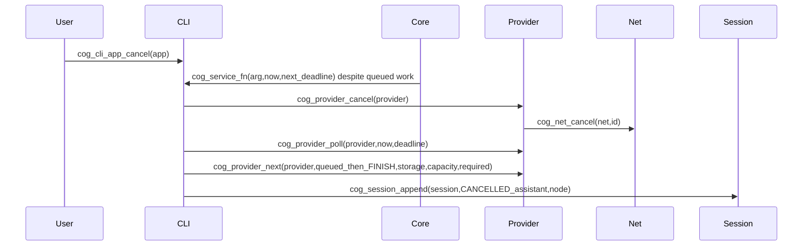

# R08: Cancellation during DNS, connect, stream and backoff

Stage 14.D pass 2; baseline header pass 1 `29b41e8`, amended by this pass.
This is a contract trace, **not an executable conformance pass**.

## Sequence

## Exact public coverage

Each symbol below is declared in the linked public header. Local application
decisions in the diagram are not invented library functions.

| Step | Exact calls, types, events or fields | Declaring header |
|---|---|---|
| Cancellation injection | `cog_cli_app_cancel` | [applications/cog-cli/include/cog_cli/cli.h](../../applications/cog-cli/include/cog_cli/cli.h) |
| Control event | `COG_EVENT_CANCEL`, `COG_EVENT_CANCELLED`, `cog_event_t` | [libraries/cog-core/include/cog/event.h](../../libraries/cog-core/include/cog/event.h) |
| Fair service | `cog_service_fn`, `cog_core_run`, `cog_core_stop` | [libraries/cog-core/include/cog/core.h](../../libraries/cog-core/include/cog/core.h) |
| Provider cancel/drain | `cog_provider_cancel`, `cog_provider_poll`, `cog_provider_next` | [libraries/cog-provider/include/cog/provider_vtable.h](../../libraries/cog-provider/include/cog/provider_vtable.h) |
| Transfer detach/retention | `cog_net_cancel`, `cog_net_request_release`, `cog_net_request_status` | [libraries/cog-net/include/cog/net.h](../../libraries/cog-net/include/cog/net.h) |
| Terminal metadata | `COG_FINISH_REASON_CANCELLED`, `COG_PROVIDER_DELTA_FINISH` | [libraries/cog-provider/include/cog/provider_request.h](../../libraries/cog-provider/include/cog/provider_request.h) |
| Retained turn | `COG_MESSAGE_CANCELLED` | [libraries/cog-core/include/cog/message.h](../../libraries/cog-core/include/cog/message.h) |

## Ownership and invariants

- Cancel detaches wire work without joining resolver threads or waiting for peer. Only the c-ares-only admitted profile is valid. Cancel is owner-thread; only app/core stop are signal-safe.
- Queued earlier deltas remain deliverable, followed by one FINISH/ABORTED; already queued completion wins. A full ordinary typed queue cannot suppress terminal cancellation.
- CLI CANCEL enqueue overflow is explicit; its caller can retry after dispatch. Signal-safe stop reaches the core at a fairness boundary and app_run performs owned cleanup before returning.

## Failure and capacity branches

- DNS blackhole, TCP/TLS stall, full SSE ring and timer backoff all remain responsive to service. No retry is issued on cancel. IDs remain retained until release, so active_count=0 does not mean slot is free.
- Hook errors leave explicit owned handles; cleanup drains/cancels rather than assuming run freed them.

## Evidence and gap disposition

https-lifecycle DNS controlled tests prove empirical c-ares cleanup only; original05b/20 test old app behavior.

**Required future executable evidence:** F/Q/K/L: shipped dependency DNS cancel suite plus saturated queue/ring and terminal-queued race tests.

**Amendment references:** D02,D03,D10 in [pass-2 register](../REAL_CLIENT_SCENARIO_PASS2.md).

## Pass-3 explicit continuation and queued text (E05)

An explicitly authorized continuation forks from the failed model turn's last
replay-safe ancestor, preserves the incomplete aggregate on its original branch,
and appends the new user input. It never relabels a failed wire turn COMPLETE or
replays partial tools/opaque data; unresolved effects use E01 recovery instead.
Automatic queued prompts cannot make that decision. FIFO auto-injection leases
the original backing text until its handler returns (or copies into another
reserved owner); successful enqueue alone is not permission to overwrite it.
Future tests enqueue a second prompt before dispatching the first and verify
unchanged text, plus explicit continuation/cancel branch isolation.

## Independent final-review revision: active path and unstarted work (E09/E11)

While any call/result is unresolved, `cog_session_fork` and arbitrary-parent
`cog_session_add_message` cannot switch to a safe sibling or ancestor. Only a
matching TOOL result at the active leaf, or atomic reconcile_tool, may extend
that path. REPLAY load rejects off-active unresolved state; no recovery target
can be stranded. An incomplete text-only turn without tool ledger still permits
an explicit fork from its safe ancestor. Crash oracle: create a safe sibling,
then save active STARTED; attempted sibling switch must fail before the crash,
and restored INDETERMINATE remains reachable for reconciliation.

PROPOSED is unresolved lifecycle state but proves no STARTED admission happened:
normal guard acquisition may resume that current policy/denial phase. It cannot
start unrelated model/user/branch work. Crashed STARTED becomes INDETERMINATE and
requires recovery. Cancelled unstarted proposals receive identified no-effect
DENIED results; they are never mistaken for uncertain executed effects. Test the
crash before STARTED save and cancel-after-proposal boundaries with zero effects.
