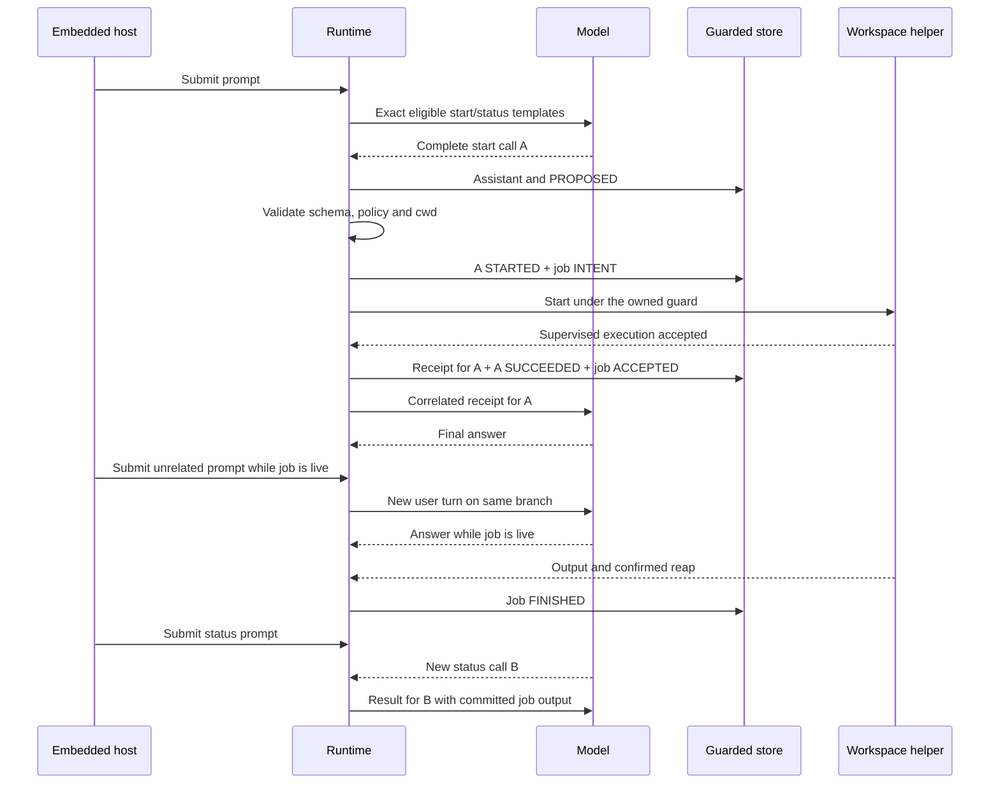

# R10 · Background job across foreground prompts

Runtime and persistence trace for `be72f95` and `8108988`. The [standalone PoC](../../pocs/tool-use/README.md)
verified the provider round trip and Linux direct-child behavior. The executable
`scenario-R10-background-tool-jobs` drives the embedded C runtime with a scripted
provider, a guarded file store and a real workspace process.

| Pass | Trace | Contract and expected observation |
| --- | --- | --- |
| 1 | Advertisement and dispatch, [15](15-multi-turn-tools.md) | Runtime resolves an original descriptor once per pinned context. The provider sees those same names and schemas. V1 background descriptors are absent with disabled configuration, unsupported roles, or a missing capability. |
| 1 | Invalid call, [R05](R05-tool-denial.md) | `cog_toolkit_validate` runs against exact complete arguments before ASK, scope reads, constructor or effects. Malformed input receives a correlated no-effect failure. The standalone toolkit constructor repeats validation. |
| 1 | Allowed launch, [R04](R04-tool-round.md) | `cog_session_tool_job_intent` atomically pairs job intent with STARTED. A committed save is required before toolkit start. Without pidfd/control ownership, the command does not start. Accept documents exactly one correlated receipt and carries no command-success claim. |
| 1 | Worker exits early, [R09](R09-process-timeout.md) | A helper accepted before an exec error still gets an accepted receipt. The job eventually reports failure. The next foreground call observes the committed outcome, even if no running status was observed. |
| 2 | Prompt while running, [20](20-interrupt-and-queue.md) | `cog_runtime_step` continues servicing and reporting deadlines with `input_ready=true`. Fresh input on the same path proceeds. No second model tool result is sent under the launch call ID. |
| 2 | Status and forged IDs, [14](14-conversation-fork.md) | `cog_runtime_job` checks the receipt ancestor and origin binding; inaccessible and absent IDs produce the same failure. Status requires current tool policy. Fork is deferred until durable drain. |
| 2 | Scoped changes, [08](08-config-reload.md), [P01](P01-instruction-support.md) | The job holds its original workspace, binding and guard. Reload returns AGAIN before retaining a candidate. A call that would change scope returns an identified no-effect refusal while the job is live. |
| 2 | Backpressure, [11](11-ui-reconnect.md) | The embedded retained publication gates ordinary new input but cannot stop job polling, timeout, cancellation or terminal save. The offline job records have separate reserved publication storage. |
| 2 | Cancel and shutdown, [05](05-graceful-shutdown.md), [R09](R09-process-timeout.md) | Foreground cancel leaves an accepted job owned. Job cancel or shutdown drives TERM/KILL, bounded drain and actual reap. Close and done remain unavailable until owned cleanup is complete. |
| 3 | Fault saving intent or receipt, [13](13-session-persistence.md) | Intent save failure starts zero commands. Receipt save failure freezes sends, cancels/drains any owned helper and exposes no uncommitted receipt. Restart loads the authoritative generation and reconciles any unresolved pair. |
| 3 | Crash after receipt, [L01](L01-terminal-reconcile-identity.md) | V4 INSPECT exposes the accepted job as indeterminate. Normal acquisition refuses it even though the launch call is closed. Fenced recovery resolves only the job outcome and preserves the original receipt bytes. |
| 3 | Crash before receipt or after terminal save, [17](17-session-migration.md) | Uncertain intent resolves atomically with the unclosed launch. A terminal job restores without re-execution. Handoff requires quiescence; V1–V3 records restore with zero jobs. |
| 3 | Capacity and storage fault | Exhaust job, output, evidence, audit or serialized checkpoint capacity before launch. Later foreground writes cannot consume terminal-commit reservation. On terminal-save failure, retain the evidence, freeze new admission and never expose the candidate as durable. |

The executable R10 scenario holds a workspace command open until an unrelated
prompt completes. It exercises both normal completion and host cancellation,
performs a second model status call, then reopens the V4 store and checks the
job outcome and exact launch/status result counts. During execution it also
reads the committed snapshot through a separate inspection handle. The
`unit-session` and `unit-store-fencing` tests cover the pre-receipt and
post-receipt crash windows, reconciliation and committed evidence.

From a configured build, run `ctest --test-dir build -R 'scenario-R10|unit-store-fencing|^unit-session$' --output-on-failure`.
