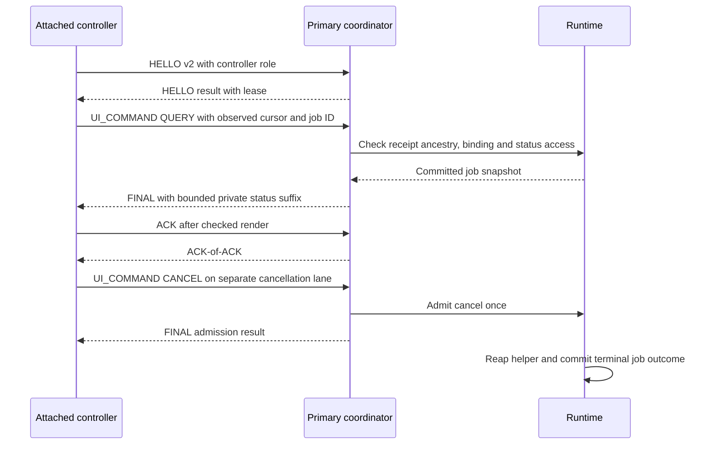

# Background jobs in the terminal and detached controller

Draft frontend contract for ticket `6e9245b`. The primary runtime owns the job
as specified in [R10](R10-background-tool-jobs.md). This trace covers the
installed entry points and the controller's private request and reply.

## Construction and roles

| Entry point | Reservation and authority |
| --- | --- |
| Standalone REAL primary | Resolve `--job-timeout-ms`, `--max-jobs` and `--job-output-bytes` with the presence bits in [cli.h](../../applications/cog-cli/include/cog_cli/cli.h). A positive timeout opts into the primary job profile. Construct the same runtime bridge and guarded workspace used by R10. |
| Headless primary | Resolve the same three options in the server. Retain one local primary execution slot for the lifetime of an admitted job. Root handoff returns AGAIN until terminal checkpoint and release. Child workers do not receive either background descriptor. |
| Attached controller | `--attach --socket PATH --job-control` negotiates HELLO v2. The protected socket, admitted logical controller lease, runtime incarnation and session bind all commands. A v1 attach keeps ordinary conversational controls. |
| Watcher | Use the existing v1 read-only projection. Refuse job queries, cancellation and approval detail before lookup even if a sender knows a valid token, nonce or current cursor. Reject `--watch --job-control` during parsing. |
| Offline recovery | Use the owned RECOVER entry point after fencing. Route unresolved job records to runtime_job_reconcile. A closed launch receipt survives job-only repair. Status/cancel on a live UI socket never grants recovery authority. |

The host checks the entire profile before provider connection or launch.
Positive timeout requires REAL, durable V4, an explicit workspace, enabled
commands, and the configured launch/status bindings. Existing ASK, DENY and
ALLOW policy still applies to each proposed model call. Launch preparation
reserves the job record, output and store capacity. The server also proves its
frame and receipt arenas can retain the worst escaped status JSON, maximum
approval argument bytes, receipt prefix and envelope overhead. Insufficient
budget returns LIMIT at construction. The attach client validates its own
receive, render and retained-command bounds before replacing any view.

## Input and publication

The standalone terminal and a job-capable attach accept `/job-status TOKEN`
and `/job-cancel TOKEN`. TOKEN is exactly `job-` and sixteen lowercase hex
digits encoding a nonzero ID. Read the ID through the authorized launch
receipt. Reject malformed IDs, trailing arguments and embedded controls
before lookup. A status or cancel command is a host operation and consumes
zero provider requests. Fresh status uses the current primary branch, binding
and status visibility. Inaccessible and absent IDs return NOT_FOUND.

Standalone stdin EOF or `/quit` drains the primary. Single-prompt mode returns
its foreground reply, then requests shutdown and drives any remaining job to
durable termination before process exit. Detached client EOF/quit releases
the client connection. The server keeps supervising jobs and accepting later
prompts. Foreground `/cancel` and child `/cancel AGENT` keep their existing
identities. Explicit job cancellation admits a request; only a later committed
status can report completion.

For an ASK launch, standalone renders the bounded original command and cwd
with terminal escaping before accepting its existing explicit decision.
A detached job-capable controller uses `/job-approval NONCE` to fetch the
original validated arguments for the currently acknowledged launch proposal.
NONCE is a nonzero decimal u64 with no sign or trailing data. The server
matches the proposal, current view cursor and immutable policy identity.
The client renders those exact bytes with terminal escaping or checked JSON
encoding, then sends its receipt ACK. The server marks detail delivered for
that lease and exact proposal only after receiving the matching ACK. A
subsequent explicit `/allow NONCE` must match both identities, pass the
ordinary decision checks, and precede the policy deadline. A stale or v1
controller cannot approve this launch. Explicit denial remains possible.
A delivered detail alone never grants consent.

## Detached command exchange

The [private wire header](../../libraries/cog-runtime/src/job_control.h)
specifies the request and reply bytes. The coordinator validates role, actual
peer binding, lease, session, primary placement, lane, current observed
generation and sequence before new admission. QUERY and DETAIL use the
command lane. CANCEL uses the cancellation lane, including through ordinary
publication backpressure. A stale cursor receives a terminal refusal; resync
and a new explicit command are required. No request can name an arbitrary
executor or retarget to a replacement primary.

The same wire ID and byte-identical request under the retained identity replay
the original immutable outcome. Reusing an ID with different bytes fails
PROTOCOL. Reserve original request and worst-case result before admission.
Compare duplicate full result bytes, including its private suffix. Render once
per original input serial. ACK job detail and status only after successful
render; render failure preserves the prior cursor and receipt state. On
reconnect the same controller may retry the same wire under the retained
lease. Recheck role, branch/binding and proposal validity before disclosing
a cached private reply. Changed authority retires the sensitive receipt and
lease; the client reports uncertainty for pending mutations and obtains a
fresh lease for fresh input. Never convert an outstanding CANCEL or ALLOW
into a new command after runtime/lease replacement.

Private query replies, proposal arguments and job output buffers are excluded
from watcher broadcasts, replay records, GAP views, diagnostics and worker
fabric. For job-originated TOOL rows, project a public phase summary without
raw job output or the command arguments. Apply the same projection before both
live delivery and reconnect snapshots. Ordinary user and assistant messages
remain shared conversation text, including anything explicitly quoted there.

## Verification required for delivery

| Trace | Required observation |
| --- | --- |
| Flags and bounds | Explicit zero overrides inherited enablement. Reject duplicate or malformed values, overflow products, unfit frames and conflicting roles before effects. |
| Launch and next prompt | Verify both installed frontends use R10 admission and report the receipt. The model answers another same-session prompt while the helper remains live. |
| Observer and sibling | Identical absent/inaccessible result. A watcher with a copied token or policy nonce gets no private bytes through live view, replay, GAP or commands. |
| Duplicate and reconnect | Drop traffic before/after admission, FINAL, ACK and ACK-of-ACK. Exactly one cancellation. Replayed QUERY keeps the originally observed outcome under the same authorized lease. |
| ASK and scope change | Deny ALLOW before detail ACK and after expired/replaced proposal, changed scope, lease or branch. A successful detail fetch alone launches zero helpers. |
| Backpressure and close | Full command lane allows cancellation service; full private-result capacity refuses before effects. Shutdown drives helper drain and store commit. Detached EOF preserves supervision. |
| Version compatibility | V1 HELLO, ordinary results and existing command bytes stay valid. Job-capable attach reports unsupported/incompatible peer explicitly; a v1 server receives no subsequent job command. |
