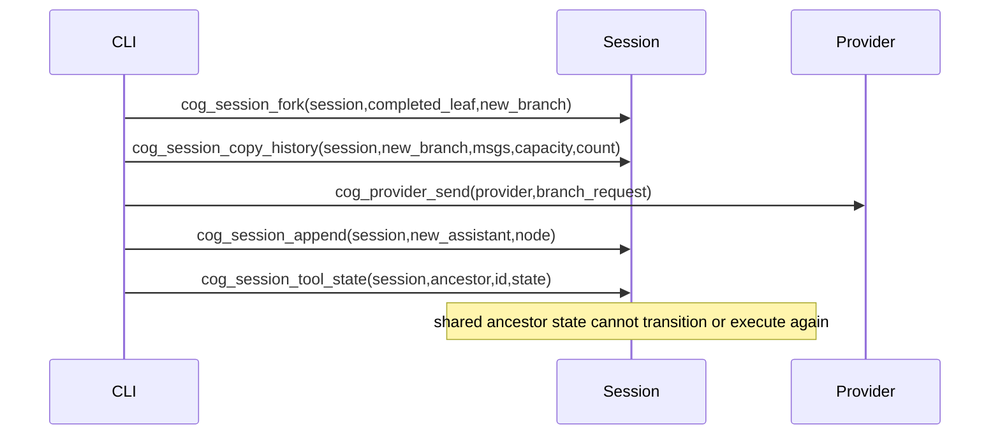

# R11: Fork isolation, call identity and opaque replay

Stage 14.D pass 2; baseline header pass 1 `29b41e8`, amended by this pass.
This is a contract trace, **not an executable conformance pass**.

## Sequence

## Exact public coverage

Each symbol below is declared in the linked public header. Local application
decisions in the diagram are not invented library functions.

| Step | Exact calls, types, events or fields | Declaring header |
|---|---|---|
| Fork/history/ledger | `cog_session_fork`, `cog_session_copy_history`, `cog_session_append`, `cog_session_tool_state`, `cog_session_tool_transition` | [libraries/cog-core/include/cog/session.h](../../libraries/cog-core/include/cog/session.h) |
| Identity/owned continuation | `cog_message_t`, `cog_message_tool_call_t`, `cog_message_opaque_t` | [libraries/cog-core/include/cog/message.h](../../libraries/cog-core/include/cog/message.h) |
| Replay supported format | `cog_openrouter_provider_vtable` | [libraries/cog-provider/include/cog/openrouter.h](../../libraries/cog-provider/include/cog/openrouter.h) |
| Transitive request copy | `cog_provider_send` | [libraries/cog-provider/include/cog/provider_vtable.h](../../libraries/cog-provider/include/cog/provider_vtable.h) |

## Ownership and invariants

- Fork requires a complete path with resolved tool ledger. INCOMPLETE or INDETERMINATE fails INVALID_STATE without tree mutation. Completed shared ancestor effects never execute again.
- New assistant node IDs scope new call IDs even if model reuses textual call ID on another turn. Branch-local result matching cannot attach to a different assistant or branch.
- Exact opaque namespace/format/bytes from ancestor history pass unchanged into request copy; unsupported provider namespace fails before network/effects. Synthetic fixture uses nonsecret opaque strings only.

## Failure and capacity branches

- OVERFLOW history array count retry writes no entries; session mutation invalidates nested views, so send before mutating or copy owned deep message storage.
- Attempt changing a fork-shared ancestor ledger fails; adding a result for an ancestor from the wrong branch fails atomically.

## Evidence and gap disposition

Original14 baseline tree/fork executable covers old identity only.

**Required future executable evidence:** G/L: divergent branches with reused call labels, exact opaque/base64 and no ancestor-effect replay counters.

**Amendment references:** D05,D07 in [pass-2 register](../REAL_CLIENT_SCENARIO_PASS2.md).

## Pass-3 opaque preservation retrace (E04)

The codec retains explicit `reasoning_details: []` presence. Merged text/summary
blocks preserve non-payload members as a union; conflicting repeated JSON values
fail UNSUPPORTED instead of discarding unknown continuation metadata. Absence
does not erase a previous member. These rules are pinned in
[openrouter.h](../../libraries/cog-provider/include/cog/openrouter.h). Future
fixtures cover absent vs empty, signature-only suffixes and unknown equal/conflicting
members, then compare exact generated opaque bytes through save/load/fork/replay.

## Independent final-review revision: active path and unstarted work (E09/E11)

While any call/result is unresolved, `cog_session_fork` and arbitrary-parent
`cog_session_add_message` cannot switch to a safe sibling or ancestor. Only a
matching TOOL result at the active leaf, or atomic reconcile_tool, may extend
that path. REPLAY load rejects off-active unresolved state; no recovery target
can be stranded. An incomplete text-only turn without tool ledger still permits
an explicit fork from its safe ancestor. Crash oracle: create a safe sibling,
then save active STARTED; attempted sibling switch must fail before the crash,
and restored INDETERMINATE remains reachable for reconciliation.

PROPOSED is unresolved lifecycle state but proves no STARTED admission happened:
normal guard acquisition may resume that current policy/denial phase. It cannot
start unrelated model/user/branch work. Crashed STARTED becomes INDETERMINATE and
requires recovery. Cancelled unstarted proposals receive identified no-effect
DENIED results; they are never mistaken for uncertain executed effects. Test the
crash before STARTED save and cancel-after-proposal boundaries with zero effects.

## G implementation clarification: explicit shared fork points

`cog_session_fork` returns the same immutable shared node, preserving all tool
execution identity. A selected leaf may become active. Selecting a nonleaf
preserves the existing active leaf: `cog_session_add_message(parent=fork_point)`
creates and selects the new divergent child; `append` continues the active leaf.
An immediate snapshot after a nonleaf fork retains a valid active leaf. No node,
call identity, payload allocation or ledger slot is copied by fork.

Targeted header passes: (1) initial fork contract checked against identity and
snapshot invariants; (2) trace nonleaf fork -> snapshot -> explicit child ->
branch history, plus completed assistant-call fork with zero repeated effects;
(3) consistency review against active-leaf restore, unresolved branch refusal and
allocation-free constructor capacities. Independent G review remains required.
