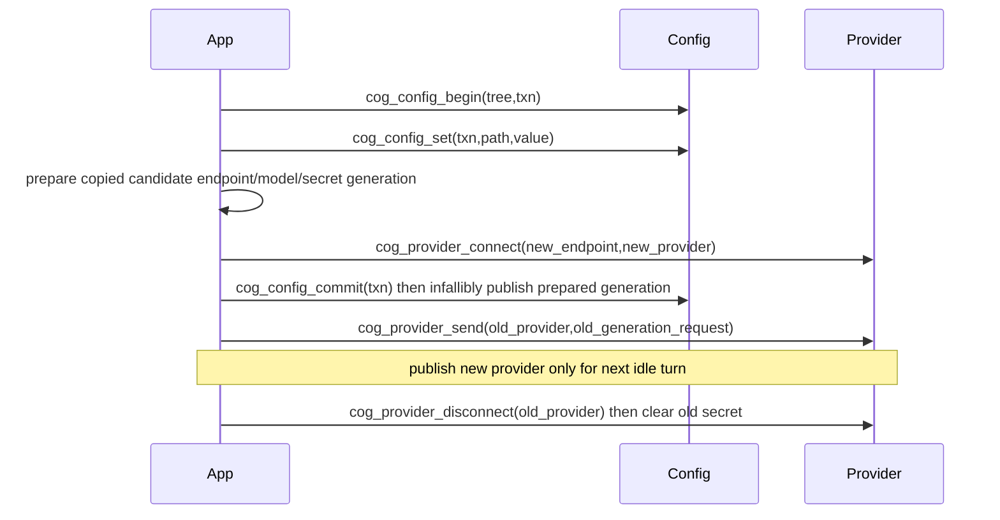

# R12: Configuration reload with pinned in-flight generations

Stage 14.D pass 2; baseline header pass 1 `29b41e8`, amended by this pass.
This is a contract trace, **not an executable conformance pass**.

## Sequence

## Exact public coverage

Each symbol below is declared in the linked public header. Local application
decisions in the diagram are not invented library functions.

| Step | Exact calls, types, events or fields | Declaring header |
|---|---|---|
| Candidate/commit/rollback | `cog_config_begin`, `cog_config_set`, `cog_config_get`, `cog_config_commit`, `cog_config_rollback`, `cog_config_register_validator` | [libraries/cog-config/include/cog/config.h](../../libraries/cog-config/include/cog/config.h) |
| Immutable generation | `cog_endpoint_t`, `cog_model_table_t`, `cog_endpoint_table_t` | [libraries/cog-provider/include/cog/endpoint.h](../../libraries/cog-provider/include/cog/endpoint.h) |
| Construct/send/release | `cog_provider_connect`, `cog_provider_send`, `cog_provider_disconnect` | [libraries/cog-provider/include/cog/provider_vtable.h](../../libraries/cog-provider/include/cog/provider_vtable.h) |
| Generation validation | `cog_provider_request_t` | [libraries/cog-provider/include/cog/provider_request.h](../../libraries/cog-provider/include/cog/provider_request.h) |
| Configuration notification | `COG_EVENT_CONFIG_CHANGED` | [libraries/cog-core/include/cog/event.h](../../libraries/cog-core/include/cog/event.h) |

## Ownership and invariants

- Prepare complete copied endpoint/model/secret/provider generation before commit, with no wire effects. Construction failure rolls back candidate and keeps old running config. Commit failure discards prepared provider. After successful commit only infallible publication remains; no partially adopted generation.
- Old instance borrows old endpoint/config/credential until disconnect; no mutation/refcount/global registry. New request.configuration_generation must match selected endpoint generation.
- Already-sent request retains copied data and original generation through completion/cancel. Changing limits/policy cannot retroactively authorize old tool calls; admission uses the fixed generation and explicit decision.

## Failure and capacity branches

- Inject config validation, secret resolution and new provider NOMEM failures: old in-flight and published state remain usable. Never clear an old credential while provider/owned transfer headers still borrow/copy it.
- Reload at retained next OVERFLOW does not replace selected delta/identity. A later new generation cannot reinterpret old opaque bytes under an incompatible namespace/format.

## Evidence and gap disposition

Original08 exercises config transactions only; no real-generation ownership proof exists yet.

**Required future executable evidence:** J/H/K: two live-in-memory generations, failed publication rollback, old send request_generation mismatch and cleanup ordering tests.

**Amendment references:** D01,D02 in [pass-2 register](../REAL_CLIENT_SCENARIO_PASS2.md).
