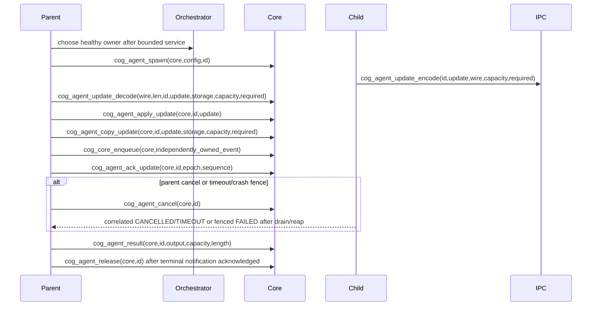

# R14: Bounded remote child attempt, cancellation, crash and result ingress

Stage 14.D pass 2; baseline header pass 1 `29b41e8`, amended by this pass.
This is a contract trace, **not an executable conformance pass**.

## Sequence



## Exact public coverage

Each symbol below is declared in the linked public header. Local application
decisions in the diagram are not invented library functions.

| Step | Exact calls, types, events or fields | Declaring header |
|---|---|---|
| Spawn bounded attempt/placement identity | `cog_agent_spawn`, `cog_agent_config_t`, `cog_agent_update_t` | [libraries/cog-core/include/cog/agent.h](../../libraries/cog-core/include/cog/agent.h) |
| Ordered portable ingress | `cog_agent_update_encode`, `cog_agent_update_decode`, `cog_agent_apply_update` | [libraries/cog-core/include/cog/agent.h](../../libraries/cog-core/include/cog/agent.h) |
| Retained independent event copy | `cog_agent_copy_update`, `cog_agent_ack_update`, `cog_agent_result`, `cog_agent_release` | [libraries/cog-core/include/cog/agent.h](../../libraries/cog-core/include/cog/agent.h) |
| Cancel/status | `cog_agent_cancel`, `cog_agent_status`, `COG_AGENT_STATUS_CANCELLED`, `COG_AGENT_STATUS_TIMEOUT`, `COG_AGENT_STATUS_FAILED` | [libraries/cog-core/include/cog/agent.h](../../libraries/cog-core/include/cog/agent.h) |
| Bounded records/fair enqueue | `cog_core_config_t`, `cog_core_enqueue`, `cog_service_fn` | [libraries/cog-core/include/cog/core.h](../../libraries/cog-core/include/cog/core.h) |
| Event semantics | `COG_EVENT_SUBAGENT_STATUS`, `COG_EVENT_SUBAGENT_RESULT`, `COG_EVENT_SUBAGENT_TIMEOUT` | [libraries/cog-core/include/cog/event.h](../../libraries/cog-core/include/cog/event.h) |
| Nonblocking peer frames | `cog_ipc_endpoint_service`, `cog_ipc_endpoint_send`, `cog_ipc_endpoint_recv` | [libraries/cog-ipc/include/cog/ipc.h](../../libraries/cog-ipc/include/cog/ipc.h) |
| Public asynchronous orchestration | `cog_orchestrator_service`, `cog_orchestrator_request_shutdown`, `cog_orchestrator_publish_owner`, `cog_orchestrator_session_owner` | [libraries/cog-orchestrator/include/cog/orchestrator.h](../../libraries/cog-orchestrator/include/cog/orchestrator.h) |


## Ownership and invariants

- Application validates source connection against immutable owner_peer and nonreused execution_epoch before ingress. Update sequence is contiguous; identical latest retry is idempotent, conflicting/stale update fails. No pointer-containing native update crosses IPC.
- Apply copies bounded payload atomically. A prior pending notification backpressures new updates; copied event storage is independent, and ack occurs only after enqueue succeeds. Event queue OVERFLOW cannot release upstream data or repeat a mutation.
- Cancel rejects later RUNNING/COMPLETED but permits one correlated drained CANCELLED/TIMEOUT/fenced FAILED terminal. Terminal accepted before cancel wins; no second completion. Release requires terminal state and notification ack.
- Crash recovery fences/reaps owned local processes, records failed/indeterminate work and never automatically replays tool effects. Quiescent same-host migration is original17 with durable epoch ownership, not a restart shortcut.

## Failure and capacity branches

- Spawn capacity/NOMEM sends no task. Oversized status/result returns LIMIT unchanged; caller must report bounded terminal failure rather than silently truncate task identity.
- Late result for an older owner/epoch after a new attempt is rejected. Result/notification destination OVERFLOW retries only copying. Continuous queues still service heartbeat/cancel/reap.

## Evidence and gap disposition

Original03/07/09/10 use private baseline hooks; they are not evidence of new public lifecycle ingress, epoch fencing or async orchestrator service.

**Required future executable evidence:** N/O/Q: public-only two-core lifecycle, forged/stale peer, duplicate sequence, enqueue saturation, cancel-after-success race and fenced crash tests.

**Amendment references:** D06,D10,D11,D13,D14 in [pass-2 register](../REAL_CLIENT_SCENARIO_PASS2.md).

## Pass-3 recovery retrace (E01)

A crash leaves STARTED as INDETERMINATE. Ordinary guard acquisition still refuses
execution. After fencing/reaping the old incarnation and admitting a fresh epoch
against the exact latest checkpoint, an explicitly authorized operator uses the
restricted recovery path below; there is no automatic task or tool replay.

```mermaid
sequenceDiagram
    App->>Store: cog_store_owner_acquire_recovery(id,current_owner,guard)
    App->>Session: cog_session_reconcile_tool(assistant,id,resolution,identified_result)
    App->>Store: cog_store_save(reconciliation only)
    App->>Store: cog_store_owner_release(recovery_guard)
    App->>Store: owner_read; owner_compare_exchange(NEW epoch,exact checkpoint)
    App->>Store: cog_store_owner_acquire(normal guard) only after safe validation
```

| Recovery step | Exact declaration | Declaring header |
|---|---|---|
| Restricted ownership | `cog_store_owner_acquire_recovery`; `cog_store_owner_guard_borrow`; `cog_store_save` | [session_store.h](../../libraries/cog-core/include/cog/session_store.h) |
| Atomic explicit result closure | `cog_session_reconcile_tool`; `COG_TOOL_EXECUTION_ACKNOWLEDGED` | [session.h](../../libraries/cog-core/include/cog/session.h) |

Recovery guard cannot admit model/tool/child work or ordinary append/checkpoint.
Only explicit monotonic ledger/result reconciliation is saveable; all original
messages, opaque bytes and audit evidence remain. ACKNOWLEDGED preserves unknown
effects in its result instead of claiming they did not happen. A failed save or
crash retains uncertainty; it never repeats execution. Releasing recovery guard
does not itself grant execution: a new durable epoch and normal guard are required.
Future G/L tests must cover rejected execution borrows, wrong call IDs, capacity
failure atomicity, failed final save and crash after every recovery boundary.

## Independent final-review revision: committed identity (E08)

Discard/reset cannot remove identified/admitted/effect-bearing/fork-shared state.
Safe disposal remains limited to uncommitted text drafts, without rewinding node
IDs. Save/append compare the locked committed generation even if the caller
constructs an empty replacement with the same session ID: committed call/assistant/
ancestor identity, arguments, opaque data, results and prior audit evidence cannot
be removed/rebound or rolled backward. Only documented monotonic ledger progress
is permitted; final results are immutable and INDETERMINATE closes only through
explicit recovery. Newly indeterminate work halts new admission under an already
held guard as well as during acquisition. Failed/uncertain save never makes prior
intent erasable. Test discard/reset/replacement-save against a saved STARTED leaf
with no result, and against a completed result/audit; expect refusal and zero reruns.

## Independent final-review revision: active path and unstarted work (E09/E11)

While any call/result is unresolved, `cog_session_fork` and arbitrary-parent
`cog_session_add_message` cannot switch to a safe sibling or ancestor. Only a
matching TOOL result at the active leaf, or atomic reconcile_tool, may extend
that path. REPLAY load rejects off-active unresolved state; no recovery target
can be stranded. An incomplete text-only turn without tool ledger still permits
an explicit fork from its safe ancestor. Crash oracle: create a safe sibling,
then save active STARTED; attempted sibling switch must fail before the crash,
and restored INDETERMINATE remains reachable for reconciliation.

PROPOSED is unresolved lifecycle state but proves no STARTED admission happened:
normal guard acquisition may resume that current policy/denial phase. It cannot
start unrelated model/user/branch work. Crashed STARTED becomes INDETERMINATE and
requires recovery. Cancelled unstarted proposals receive identified no-effect
DENIED results; they are never mistaken for uncertain executed effects. Test the
crash before STARTED save and cancel-after-proposal boundaries with zero effects.
