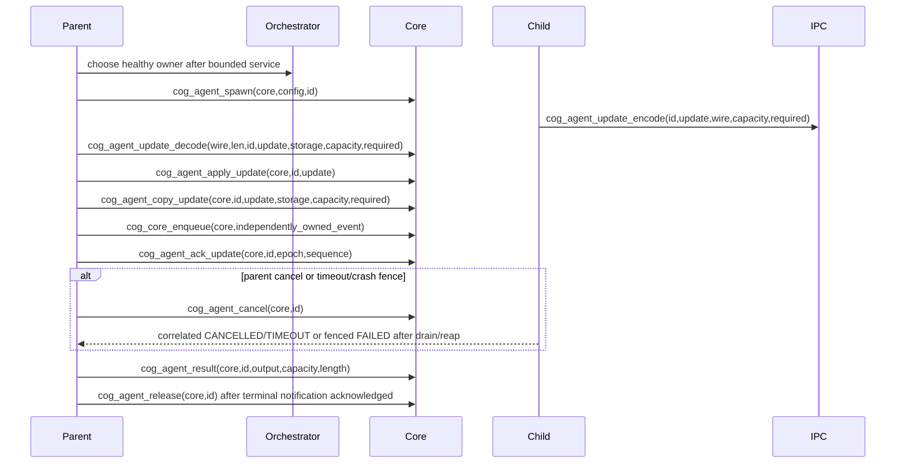

# R14: Bounded remote child attempt, cancellation, crash and result ingress

Stage 14.D pass 2; baseline header pass 1 `29b41e8`, amended by this pass.
This is a contract trace, **not an executable conformance pass**.

## Sequence

## Exact public coverage

Each symbol below is declared in the linked public header. Local application
decisions in the diagram are not invented library functions.

| Step | Exact calls, types, events or fields | Declaring header |
|---|---|---|
| Spawn bounded attempt/placement identity | `cog_agent_spawn`, `cog_agent_config_t`, `cog_agent_update_t` | [libraries/cog-core/include/cog/agent.h](../../libraries/cog-core/include/cog/agent.h) |
| Ordered portable ingress | `cog_agent_update_encode`, `cog_agent_update_decode`, `cog_agent_apply_update` | [libraries/cog-core/include/cog/agent.h](../../libraries/cog-core/include/cog/agent.h) |
| Retained independent event copy | `cog_agent_copy_update`, `cog_agent_ack_update`, `cog_agent_result`, `cog_agent_release` | [libraries/cog-core/include/cog/agent.h](../../libraries/cog-core/include/cog/agent.h) |
| Cancel/status | `cog_agent_cancel`, `cog_agent_status`, `COG_AGENT_STATUS_CANCELLED`, `COG_AGENT_STATUS_TIMEOUT`, `COG_AGENT_STATUS_FAILED` | [libraries/cog-core/include/cog/agent.h](../../libraries/cog-core/include/cog/agent.h) |
| Bounded records/fair enqueue | `cog_core_config_t`, `cog_core_enqueue`, `cog_service_fn` | [libraries/cog-core/include/cog/core.h](../../libraries/cog-core/include/cog/core.h) |
| Event semantics | `COG_EVENT_SUBAGENT_STATUS`, `COG_EVENT_SUBAGENT_RESULT`, `COG_EVENT_SUBAGENT_TIMEOUT` | [libraries/cog-core/include/cog/event.h](../../libraries/cog-core/include/cog/event.h) |
| Nonblocking peer frames | `cog_ipc_endpoint_service`, `cog_ipc_endpoint_send`, `cog_ipc_endpoint_recv` | [libraries/cog-ipc/include/cog/ipc.h](../../libraries/cog-ipc/include/cog/ipc.h) |
| Public asynchronous orchestration | `cog_orchestrator_service`, `cog_orchestrator_request_shutdown`, `cog_orchestrator_publish_owner`, `cog_orchestrator_session_owner` | [libraries/cog-orchestrator/include/cog/orchestrator.h](../../libraries/cog-orchestrator/include/cog/orchestrator.h) |

## Ownership and invariants

- Application validates source connection against immutable owner_peer and nonreused execution_epoch before ingress. Update sequence is contiguous; identical latest retry is idempotent, conflicting/stale update fails. No pointer-containing native update crosses IPC.
- Apply copies bounded payload atomically. A prior pending notification backpressures new updates; copied event storage is independent, and ack occurs only after enqueue succeeds. Event queue OVERFLOW cannot release upstream data or repeat a mutation.
- Cancel rejects later RUNNING/COMPLETED but permits one correlated drained CANCELLED/TIMEOUT/fenced FAILED terminal. Terminal accepted before cancel wins; no second completion. Release requires terminal state and notification ack.
- Crash recovery fences/reaps owned local processes, records failed/indeterminate work and never automatically replays tool effects. Quiescent same-host migration is original17 with durable epoch ownership, not a restart shortcut.

## Failure and capacity branches

- Spawn capacity/NOMEM sends no task. Oversized status/result returns LIMIT unchanged; caller must report bounded terminal failure rather than silently truncate task identity.
- Late result for an older owner/epoch after a new attempt is rejected. Result/notification destination OVERFLOW retries only copying. Continuous queues still service heartbeat/cancel/reap.

## Evidence and gap disposition

Original03/07/09/10 use private baseline hooks; they are not evidence of new public lifecycle ingress, epoch fencing or async orchestrator service.

**Required future executable evidence:** N/O/Q: public-only two-core lifecycle, forged/stale peer, duplicate sequence, enqueue saturation, cancel-after-success race and fenced crash tests.

**Amendment references:** D06,D10,D11,D13,D14 in [pass-2 register](../REAL_CLIENT_SCENARIO_PASS2.md).
