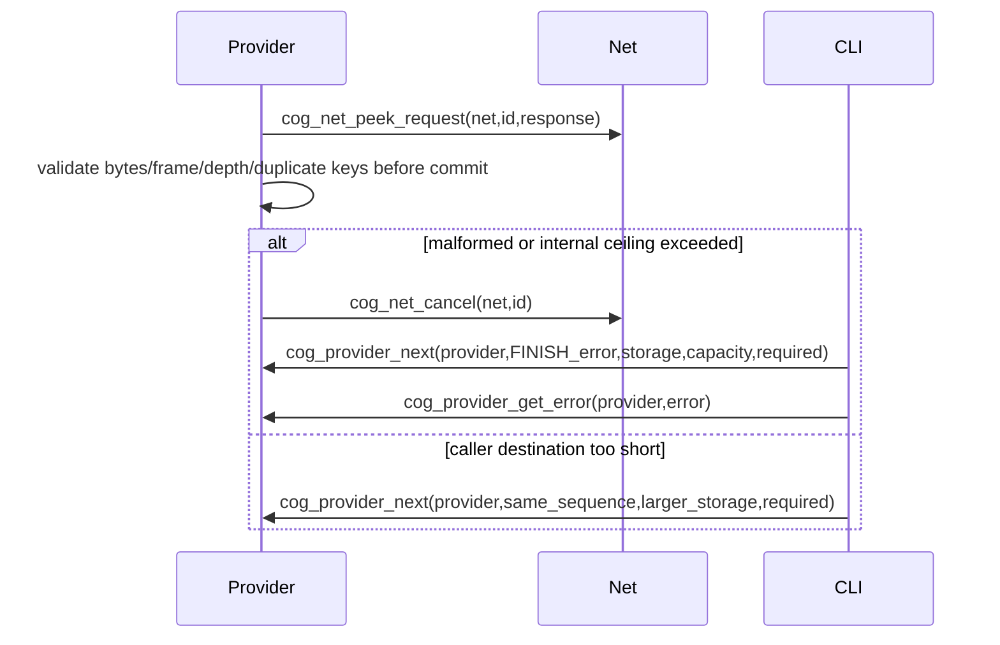

# R15: Malformed, oversized or ambiguous provider data

Stage 14.D pass 2; baseline header pass 1 `29b41e8`, amended by this pass.
This is a contract trace, **not an executable conformance pass**.

## Sequence

## Exact public coverage

Each symbol below is declared in the linked public header. Local application
decisions in the diagram are not invented library functions.

| Step | Exact calls, types, events or fields | Declaring header |
|---|---|---|
| Retained bytes/limits | `cog_net_peek_request`, `cog_net_cancel`, `cog_net_ack`, `cog_net_config_t` | [libraries/cog-net/include/cog/net.h](../../libraries/cog-net/include/cog/net.h) |
| Bounded codec | `cog_openrouter_config_t` | [libraries/cog-provider/include/cog/openrouter.h](../../libraries/cog-provider/include/cog/openrouter.h) |
| Typed workspaces | `cog_provider_limits_t`, `cog_provider_error_t`, `cog_provider_delta_t` | [libraries/cog-provider/include/cog/provider_request.h](../../libraries/cog-provider/include/cog/provider_request.h) |
| Safe delivery/error | `cog_provider_next`, `cog_provider_get_error` | [libraries/cog-provider/include/cog/provider_vtable.h](../../libraries/cog-provider/include/cog/provider_vtable.h) |
| Error codes | `COG_EVENT_PROVIDER_ERROR`, `COG_EVENT_ERROR` | [libraries/cog-core/include/cog/event.h](../../libraries/cog-core/include/cog/event.h) |

## Ownership and invariants

- Invalid UTF-8/Unicode, duplicate nested keys, JSON depth, malformed SSE data and conflicting post-finish content fail before committing the frame. Unknown required continuation fails UNSUPPORTED, not silent drop.
- Text/arguments/opaque/event retention limits are separate; a single unrepresentable item fails LIMIT. A temporarily full ring/queue pauses with retained cursors. A callback larger than TOTAL ring capacity terminates instead of pausing forever.
- No raw peer error/body or secret-bearing URL becomes persisted error metadata. Accepted earlier text remains explicitly incomplete; successful earlier effects remain in their ledger and cannot retry.

## Failure and capacity branches

- Fuzz split boundaries and all zero/size_t-overflow constructor capacities. Constructor OOM returns NULL/no wire effects; dependency runtime OOM becomes terminal error unless the whole driver fails.
- next caller OVERFLOW is recoverable and changes only required capacity; cannot be confused with internal LIMIT or protocol error.

## Evidence and gap disposition

Protocol research has malformed/Unicode/depth/pool OOM tests; transport PoC has injected curl failures. Neither proves new production decoder/runtime behavior.

**Required future executable evidence:** F/H: malformed/duplicate/oversized fixture suite and every allocation-failure point with sequence/payload canaries.

**Amendment references:** D02,D03,D05 in [pass-2 register](../REAL_CLIENT_SCENARIO_PASS2.md).

## Pass-3 parser/process bounds retrace (E03)

`cog_tool_async_config_t` now fixes argument/schema bytes, JSON depth and codec
workspace capacity ([tool.h](../../libraries/cog-core/include/cog/tool.h)).
Construction rejects over-limit input before effects, duplicate keys and invalid
UTF-8. Scalar-count string lengths, finite numeric semantics and unsupported
schema keywords are pinned in [toolkit_exec.h](../../libraries/cog-toolkit/include/cog/toolkit_exec.h).
No remote schema fetch or hidden parser growth occurs. Process-tree supervision
keeps subreaper/signal changes inside an owned helper, never the embedding host;
the cancellation profile requires descendants remain in the owned group. Test
ordinary inherited-group grandchildren outliving the shell, exact parser/depth
limits, unsupported numeric ranges and result resize with one effect.
