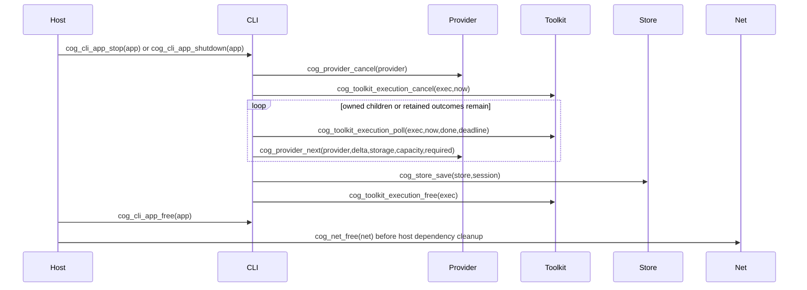

# R16: Stop and shutdown with active transport, tools and saved intent

Stage 14.D pass 2; baseline header pass 1 `29b41e8`, amended by this pass.
This is a contract trace, **not an executable conformance pass**.

## Sequence



## Exact public coverage

Each symbol below is declared in the linked public header. Local application
decisions in the diagram are not invented library functions.

| Step | Exact calls, types, events or fields | Declaring header |
|---|---|---|
| Signal-safe stop vs queued shutdown | `cog_cli_app_stop`, `cog_cli_app_shutdown`, `cog_cli_app_run`, `cog_cli_app_free` | [applications/cog-cli/include/cog_cli/cli.h](../../applications/cog-cli/include/cog_cli/cli.h) |
| Core lifetime | `cog_core_stop`, `cog_core_run`, `cog_core_free` | [libraries/cog-core/include/cog/core.h](../../libraries/cog-core/include/cog/core.h) |
| Provider drain/release | `cog_provider_cancel`, `cog_provider_next`, `cog_provider_disconnect` | [libraries/cog-provider/include/cog/provider_vtable.h](../../libraries/cog-provider/include/cog/provider_vtable.h) |
| Process cleanup | `cog_toolkit_execution_cancel`, `cog_toolkit_execution_poll`, `cog_toolkit_execution_free` | [libraries/cog-toolkit/include/cog/toolkit_exec.h](../../libraries/cog-toolkit/include/cog/toolkit_exec.h) |
| Owned runtime | `cog_net_free`, `cog_net_request_release` | [libraries/cog-net/include/cog/net.h](../../libraries/cog-net/include/cog/net.h) |
| Durable incomplete/ledger and guard release | `cog_store_save`, `cog_store_owner_release` | [libraries/cog-core/include/cog/session_store.h](../../libraries/cog-core/include/cog/session_store.h) |


## Ownership and invariants

- Core stop alone does not free application-owned work. app_run must perform cancel/drain/reap after core_run returns, including error/stop paths, before app_free preconditions hold.
- After all execution borrowers, provider and children are drained, release the session owner guard before store_free. No thread except owner performs provider/net/tool cancel. Signal handler only records app/core stop. No curl global cleanup while Cog or other host users remain.
- Active tool cancellation may leave effects; persist terminal outcome or INDETERMINATE. IO at shutdown is reported, never silently discarding durable STARTED history.

## Failure and capacity branches

- Already queued provider success wins over cancellation; never enqueue a second FINISH. Full queues retain terminal outcomes during drain.
- Unreapable/driver-error cleanup cannot claim success or destroy active handle; report failure and preserve explicit ownership. OS scheduling is not a hard wall-clock guarantee.

## Evidence and gap disposition

Original05/05b baseline tests prove old shutdown cancellation only.

**Required future executable evidence:** F/I/K/Q: signal during every DNS/tool/backoff phase, continuous queue stop, PID/fd cleanup and failed final save tests.

**Amendment references:** D02,D03,D10 in pass-2 register (`tix show 345a536`).

## Pass-3 recovery retrace (E01)

A crash leaves STARTED as INDETERMINATE. Ordinary guard acquisition still refuses
execution. After fencing/reaping the old incarnation and admitting a fresh epoch
against the exact latest checkpoint, an explicitly authorized operator uses the
restricted recovery path below; there is no automatic task or tool replay.

```mermaid
sequenceDiagram
    App->>Store: cog_store_owner_acquire_recovery(id,current_owner,guard)
    App->>Session: cog_session_reconcile_tool(assistant,id,resolution,identified_result)
    App->>Store: cog_store_save(reconciliation only)
    App->>Store: cog_store_owner_release(recovery_guard)
    App->>Store: owner_read; owner_compare_exchange(NEW epoch,exact checkpoint)
    App->>Store: cog_store_owner_acquire(normal guard) only after safe validation
```

| Recovery step | Exact declaration | Declaring header |
|---|---|---|
| Restricted ownership | `cog_store_owner_acquire_recovery`; `cog_store_owner_guard_borrow`; `cog_store_save` | [session_store.h](../../libraries/cog-core/include/cog/session_store.h) |
| Atomic explicit result closure | `cog_session_reconcile_tool`; `COG_TOOL_EXECUTION_ACKNOWLEDGED` | [session.h](../../libraries/cog-core/include/cog/session.h) |

Recovery guard cannot admit model/tool/child work or ordinary append/checkpoint.
Only explicit monotonic ledger/result reconciliation is saveable; all original
messages, opaque bytes and audit evidence remain. ACKNOWLEDGED preserves unknown
effects in its result instead of claiming they did not happen. A failed save or
crash retains uncertainty; it never repeats execution. Releasing recovery guard
does not itself grant execution: a new durable epoch and normal guard are required.
Future G/L tests must cover rejected execution borrows, wrong call IDs, capacity
failure atomicity, failed final save and crash after every recovery boundary.

## Independent final-review revision: committed identity (E08)

Discard/reset cannot remove identified/admitted/effect-bearing/fork-shared state.
Safe disposal remains limited to uncommitted text drafts, without rewinding node
IDs. Save/append compare the locked committed generation even if the caller
constructs an empty replacement with the same session ID: committed call/assistant/
ancestor identity, arguments, opaque data, results and prior audit evidence cannot
be removed/rebound or rolled backward. Only documented monotonic ledger progress
is permitted; final results are immutable and INDETERMINATE closes only through
explicit recovery. Newly indeterminate work halts new admission under an already
held guard as well as during acquisition. Failed/uncertain save never makes prior
intent erasable. Test discard/reset/replacement-save against a saved STARTED leaf
with no result, and against a completed result/audit; expect refusal and zero reruns.

## L metadata lifecycle retrace

LIST/RECOVER application modes have no provider/core. The L header amendment
therefore requires a constructor-verified lock-free app stop flag in addition
to forwarding to core_stop when present. Recovery retains its guard through
EOF/signal and app_free, never executes a tool, and leaves unresolved evidence
intact. Main explicitly suppresses SIGPIPE only for its host lifetime so output
errors can propagate through cleanup, then restores the original disposition.
