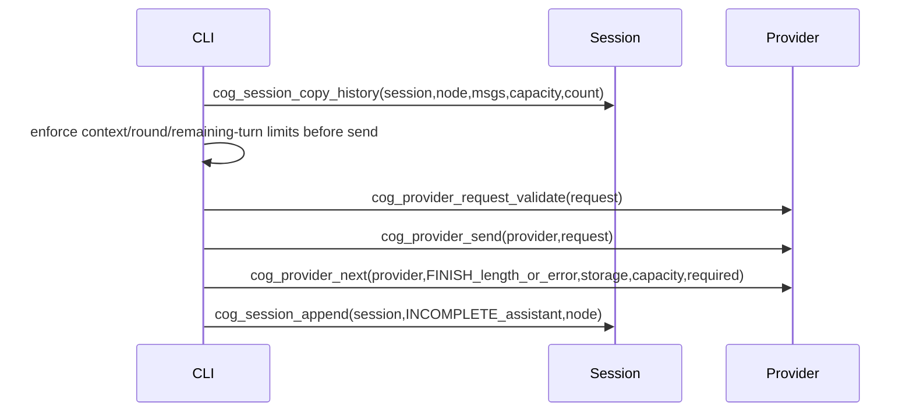

# R17: Context, token, turn, output and tool-round limits

Stage 14.D pass 2; baseline header pass 1 `29b41e8`, amended by this pass.
This is a contract trace, **not an executable conformance pass**.

## Sequence

## Exact public coverage

Each symbol below is declared in the linked public header. Local application
decisions in the diagram are not invented library functions.

| Step | Exact calls, types, events or fields | Declaring header |
|---|---|---|
| Config presence/finite budgets | `cog_cli_options_t`, `COG_CLI_OPT_OUTPUT_TOKENS`, `COG_CLI_OPT_TOOL_ROUNDS`, `COG_CLI_OPT_CONTEXT` | [applications/cog-cli/include/cog_cli/cli.h](../../applications/cog-cli/include/cog_cli/cli.h) |
| Context without pruning | `cog_session_copy_history`, `cog_session_append`, `cog_session_config_t` | [libraries/cog-core/include/cog/session.h](../../libraries/cog-core/include/cog/session.h) |
| Validated request/finish | `cog_provider_request_validate`, `cog_provider_request_t`, `COG_FINISH_REASON_LENGTH`, `COG_FINISH_REASON_CONTENT_FILTER`, `cog_provider_limits_t` | [libraries/cog-provider/include/cog/provider_request.h](../../libraries/cog-provider/include/cog/provider_request.h) |
| Send/copy | `cog_provider_send`, `cog_provider_next` | [libraries/cog-provider/include/cog/provider_vtable.h](../../libraries/cog-provider/include/cog/provider_vtable.h) |
| Incomplete/availability | `COG_MESSAGE_INCOMPLETE`, `cog_usage_t` | [libraries/cog-core/include/cog/message.h](../../libraries/cog-core/include/cog/message.h) |

## Ownership and invariants

- Finite nonzero max_tokens and explicit context/turn/tool bounds are admission conditions. Explicit zero is invalid, not a default when present. Limit exhaustion cannot silently prune history or switch model.
- Token-limit/content-filter finish retains display text but does not authorize partially assembled tools; successful wire FINISH outcome and semantic finish reason are both examined.
- Max_tool_rounds counts completed model->tool rounds per user turn; retry budget never resets max_turn_ms. Tool output limits are capture bounds, not output-buffer resize instructions.

## Failure and capacity branches

- Context one byte over limit produces LIMIT before network send. Too many nodes/payload fails atomic session append; old branch remains intact.
- Unknown token/cost usage does not become zero billing. Report exact provider data only.

## Evidence and gap disposition

No existing production executable proves all real-client finite-budget interactions; protocol PoC tests length finish rejection for tool readiness.

**Required future executable evidence:** G/H/K: exact-boundary budgets and overflow arithmetic, tool round count, retry+tool elapsed composition and unknown usage fixtures.

**Amendment references:** D03,D09 in pass-2 register (`tix show 345a536`).

## Pass-3 parser/process bounds retrace (E03)

`cog_tool_async_config_t` now fixes argument/schema bytes, JSON depth and codec
workspace capacity ([tool.h](../../libraries/cog-core/include/cog/tool.h)).
Construction rejects over-limit input before effects, duplicate keys and invalid
UTF-8. Scalar-count string lengths, finite numeric semantics and unsupported
schema keywords are pinned in [toolkit_exec.h](../../libraries/cog-toolkit/include/cog/toolkit_exec.h).
No remote schema fetch or hidden parser growth occurs. Process-tree supervision
keeps subreaper/signal changes inside an owned helper, never the embedding host;
the cancellation profile requires descendants remain in the owned group. Test
ordinary inherited-group grandchildren outliving the shell, exact parser/depth
limits, unsupported numeric ranges and result resize with one effect.
